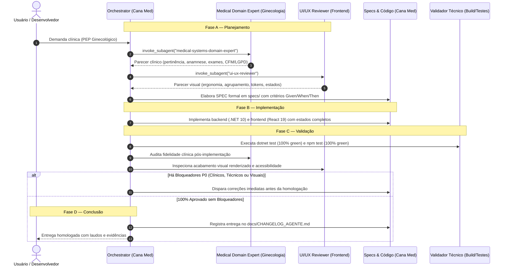

# Ecossistema de Agentes Especializados — Cana Med (Ginecologia)

Este diretório contém as definições dos agentes autônomos configurados especificamente para a arquitetura, regras de engenharia, governança clínica ginecológica e consistência de interface do **Cana Med** (.NET 10, PostgreSQL, React 19 / CSS Tokens e conformidade com CFM, LGPD e ANVISA).

---

## 🤖 Catálogo de Agentes

| Agente | Arquivo | Perfil / Modelo | Papel Principal |
| :--- | :--- | :--- | :--- |
| **`orchestrator`** | [`orchestrator.md`](orchestrator.md) | Gemini 3.1 Pro (`model: pro`) | **Maestro & Tech Lead:** Conduz o ciclo de vida do desenvolvimento em 4 fases (Planejamento, Implementação, Validação, Conclusão), acionando os especialistas antes e depois do código. |
| **`medical-systems-domain-expert`** | [`medical-systems-domain-expert.md`](medical-systems-domain-expert.md) | Gemini 3.1 Pro (`model: pro`) | **Especialista em Domínio Clínico Ginecológico:** Validador crítico de fluxos de saúde da mulher, anamnese ginecológica, histórico menstrual/obstétrico, rastreamento preventivo, exame físico, PEP/SOAP e regras CFM/LGPD. |
| **`ui-ux-reviewer`** | [`ui-ux-reviewer.md`](ui-ux-reviewer.md) | Gemini 3.1 Pro (`model: pro`) | **Especialista em UI/UX e Qualidade Visual:** Revisor de consistência estética, tokens do design system (`theme.css`), ergonomia clínica, acessibilidade WCAG e estados visuais completos no frontend. |

---

## 🔄 Fluxo de Trabalho Integrado em Quatro Fases



---

## 🎯 Mecanismo de Ativação em Tempo de Execução

Os subagentes estão registrados no runtime do Antigravity via `define_subagent` e podem ser invocados diretamente pelo orquestrador:

```yaml
invoke_subagent:
  Subagents:
    - TypeName: "medical-systems-domain-expert"
      Role: "Medical Systems Domain Expert"
      Model: "pro"
      Prompt: "Validar criticamente o fluxo clínico de anamnese ginecológica..."
    - TypeName: "ui-ux-reviewer"
      Role: "UI/UX Reviewer"
      Model: "pro"
      Prompt: "Avaliar o agrupamento visual de campos e estados de interação do prontuário..."
```
