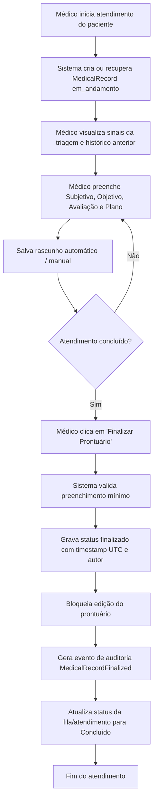

# SPEC-0010 — Prontuário Eletrônico do Paciente (PEP)

| Campo | Valor |
| :--- | :--- |
| **ID** | SPEC-0010 |
| **Título** | Prontuário Eletrônico do Paciente (PEP) — Registro Clínico SOAP, Histórico Contínuo, Imutabilidade e Guarda Legal |
| **Status** | Implementada |
| **Versão** | 1.0 |
| **Data** | 2026-10-02 |
| **Autor** | Antigravity AI / Equipe CANAMED |
| **Revisores** | Responsável pelo Projeto CANAMED |
| **Módulos afetados** | backend (Domain, Application, Infrastructure, Api), frontend (workspace médico, componentes clínicos), banco de dados (schema `medical_records`) |
| **ADRs relacionados** | ADR-0003 (dados sensíveis), ADR-0006 (.NET + React), ADR-0007 (PostgreSQL/EF Core), ADR-0008 (autenticação e auditoria) |

---

## 1. Objetivo

Implementar o módulo central de Prontuário Eletrônico do Paciente (PEP), permitindo que profissionais de saúde registrem anotações clínicas estruturadas (modelo SOAP: Subjetivo, Objetivo, Avaliação e Plano), consultem o histórico cronológico de atendimentos anteriores e garantam a integridade e inviolabilidade do registro médico com suporte a adendos justificados e retenção legal mínima de 20 anos.

Pergunta de controle do `GEMINI.md`: **isso reduz atrito na rotina da clínica?**
Sim. Reduz o manuseio de fichas físicas em papel, centraliza a informação assistencial do paciente em uma linha do tempo única, confere proteção jurídica ao médico e agiliza a tomada de decisão clínica durante o atendimento.

---

## 2. Contexto

Até o momento, o CANAMED cobre agendamento (SPEC-0002), fila de espera (SPEC-0005), triagem de sinais vitais (SPEC-0009) e cobrança (SPEC-0008). No entanto, o atendimento médico propriamente dito ainda não dispõe de um repositório para o registro clínico da consulta.

O registro clínico em saúde não é um formulário comum de cadastro: está sujeito a normas federais rigorosas — em especial a **Lei Federal nº 13.787/2018** (digitalização e guarda de prontuário), a **Resolução CFM nº 1.821/2007**, o **Código de Ética Médica** (Resolução CFM nº 2.217/2018) e a **LGPD** (Art. 11, dados sensíveis de saúde). Esta especificação estabelece os alicerces do PEP do CANAMED, assegurando imutabilidade pós-finalização, identificação profissional estrita e rastreabilidade total de visualizações.

---

## 3. Escopo

### 3.1 Dentro do escopo
- Registro clínico estruturado por consulta segundo a metodologia SOAP (Subjetivo, Objetivo, Avaliação, Plano de Conduta) e notas clínicas complementares;
- Associação inequívoca com o agendamento (`appointment_id`), paciente (`patient_id`), clínica (`clinic_id`) e médico responsável (`doctor_id`);
- Ciclo de vida do registro: estado `em_andamento` (rascunho durante o atendimento) e estado `finalizado` (fechamento com carimbo do tempo);
- Imutabilidade absoluta do registro após a finalização: proibição sistêmica e no banco de dados de `UPDATE` ou `DELETE` no conteúdo finalizado;
- Retificação clínica exclusivamente através de **Adendos Clínicos Justificados** (`MedicalRecordAddendum`) com data, hora, justificativa do médico e identificação;
- Histórico cronológico contínuo do paciente (timeline assistencial) acessível pelo médico;
- Restrição rígida de sigilo: perfis de recepção e faturamento **não** possuem permissão de leitura dos campos clínicos;
- Auditoria de visualização (*read-audit*) para conformidade CFM/SBIS NGS2.

### 3.2 Fora do escopo
- Assinatura digital com certificados ICP-Brasil (A1/A3) e emissão de receitas/atestados em PDF (tratados especificamente na [SPEC-0011](0011-spec-prescricao-eletronica-atestados-e-documentos-clinicos.md));
- Algoritmos de apoio diagnóstico automatizado ou predição clínica baseada em IA (vedados para não enquadrar como SaMD pela ANVISA RDC nº 657/2022);
- Armazenamento de imagens médicas PACS/DICOM pesadas (previsto para fase futura de expansão diagnóstica).

---

## 4. Atores e Permissões

| Ator | Permissões necessárias | Observações |
| :--- | :--- | :--- |
| **Médico / Profissional de Saúde** | `records:create`, `records:update`, `records:finalize`, `records:addendum`, `records:read` | Acesso completo para criar, preencher rascunho, finalizar seus prontuários e ler o histórico clínico dos pacientes que atende. |
| **Gestor da Clínica** | `records:audit_view` | Visualização apenas de metadados gerenciais e auditoria (quem atendeu, quando finalizou). Não visualiza anotações clínicas sigilosas salvo consentimento ou previsão legal estrita. |
| **Recepcionista / Atendente** | *(Nenhuma permissão em records)* | Acesso categoricamente bloqueado no backend aos campos clínicos do prontuário. |
| **Administrador do Sistema** | `records:audit_view` | Suporte técnico e auditoria operacional, sem permissão de alteração de conteúdo. |

A autorização é verificada **no backend por recurso e por clínica**, garantindo que nenhum usuário visualize dados de saúde fora do seu escopo de permissão (ADR-0008).

---

## 5. Regras de Negócio

| ID | Regra | Justificativa / Origem |
| :--- | :--- | :--- |
| **RN-001** | O registro de prontuário deve ser estruturado em 4 seções principais (SOAP): **Subjetivo** (queixa do paciente, história da moléstia atual), **Objetivo** (exame físico, observações clínicas), **Avaliação** (hipóteses diagnósticas ou impressão clínica) e **Plano** (conduta, orientações e prescrições). | Metodologia clínica padrão recomendada pelo CFM e pela literatura médica internacional. |
| **RN-002** | O prontuário deve ser vinculado obrigatoriamente a uma clínica ativa (`clinic_id`), a um paciente cadastrado (`patient_id`), a um profissional responsável (`doctor_id`) e opcionalmente a um agendamento (`appointment_id`). | Integridade assistencial e rastreabilidade da relação médico-paciente. |
| **RN-003** | Durante o atendimento, o prontuário permanece no status `em_andamento`, permitindo atualizações parciais (salvamento de rascunho) apenas pelo médico autor. | Evitar perda de dados durante a consulta médica antes da conclusão do atendimento. |
| **RN-004** | A ação de finalização do prontuário altera seu estado para `finalizado`, registrando o timestamp exato (`finalized_at`) e a identificação indelével do médico. | Encerramento do ato médico perante o Conselho de Medicina. |
| **RN-005** | Um prontuário com status `finalizado` torna-se **estritamente imutável**. Nenhuma alteração direta (`UPDATE`) ou exclusão (`DELETE`) é permitida no registro original por qualquer perfil ou usuário. | Lei Federal nº 13.787/2018 (Art. 4º) e Resolução CFM nº 1.821/2007. |
| **RN-006** | Qualquer correção de erro formal, acréscimo de resultado de exame ou complemento posterior à finalização deve ser realizado por meio de **Adendo Clínico** (`MedicalRecordAddendum`), contendo texto complementar, justificativa clara da inclusão, data/hora e assinatura do médico. | Princípio de inviolabilidade documental do prontuário médico. |
| **RN-007** | O médico tem acesso ao histórico cronológico integral de prontuários anteriores do paciente atendido na mesma clínica, ordenado da consulta mais recente para a mais antiga. | Continuidade do cuidado assistencial e anamnese comparativa. |
| **RN-008** | Cada abertura de prontuário médico gera obrigatoriamente um registro de auditoria (`MedicalRecordViewed`) com identificador do médico, paciente, clínica, data, hora e endereço IP. | Requisito de rastreabilidade de acesso a dados sensíveis de saúde (CFM e LGPD Art. 11). |
| **RN-009** | Nenhum registro de prontuário ou adendo pode ser descartado do banco de dados antes do prazo mínimo legal de **20 (vinte) anos** a contar do último atendimento do paciente. | Lei Federal nº 13.787/2018 (Art. 6º). |
| **RN-010** | O sistema não executa diagnósticos automatizados, cálculo de risco prognóstico preditivo ou escolha mandatória de terapêutica clínica por inteligência artificial. | Conformidade com a ANVISA RDC nº 657/2022 (evita enquadramento como SaMD). |

---

## 6. Fluxos

### 6.1 Fluxo Principal — F-001: Atendimento Clínico e Fechamento SOAP



1. O médico inicia o atendimento e abre a interface clínica do paciente;
2. O sistema inicializa uma entidade `MedicalRecord` associada ao paciente e à consulta com status `em_andamento`;
3. O médico preenche as seções SOAP com suporte a salvamento automático contínuo de rascunho;
4. Ao concluir, o médico clica em "Finalizar Atendimento Clínico";
5. O sistema valida que pelo menos uma das seções clínicas possui conteúdo preenchido;
6. O sistema carimba `finalized_at`, comuta o status para `finalizado` e bloqueia os campos para edição;
7. É emitido o evento de auditoria correspondente.

### 6.2 Fluxos Alternativos e Exceções

- **F-002: Inclusão de Adendo Pós-Finalização**
  1. O médico identifica necessidade de complementar o prontuário já finalizado (ex: chegada de laudo de ultrassom);
  2. O médico abre o prontuário finalizado e seleciona a opção "Adicionar Adendo Clínico";
  3. Informa a **Justificativa da Retificação/Acréscimo** (obrigatória) e o **Texto do Adendo**;
  4. O sistema persiste a entidade `MedicalRecordAddendum` associada ao prontuário, com data e hora atual;
  5. O adendo é exibido abaixo do prontuário original com badge visual indicativo de retificação e carimbo de tempo.

- **F-003: Visualização da Linha do Tempo Assistencial**
  1. Durante a consulta, o médico clica em "Histórico do Paciente";
  2. O backend valida a permissão `records:read` e registra a auditoria de leitura;
  3. A lista de atendimentos anteriores é exibida em ordem cronológica decrescente com data, médico responsável e resumo das condutas tomadas.

---

## 7. Modelo de Dados

### 7.1 Entidade `MedicalRecord` (Tabela `medical_records`)

| Campo | Tipo | Obrigatório | Classificação LGPD | Regra / Descrição |
| :--- | :--- | :--- | :--- | :--- |
| `id` | `UUID` | Sim | Anônimo | Chave primária |
| `clinic_id` | `UUID` | Sim | Comum | FK `clinics(id)` |
| `patient_id` | `UUID` | Sim | Dado pessoal | FK `patients(id)` |
| `doctor_id` | `UUID` | Sim | Comum | FK `users(id)` do médico responsável |
| `appointment_id` | `UUID` | Não | Comum | FK `appointments(id)` (quando originado de agendamento) |
| `status` | `VARCHAR(20)` | Sim | Operacional | `em_andamento`, `finalizado` (default: `em_andamento`) |
| `subjective` | `TEXT` | Não | Sensível (Saúde) | Queixas, sintomas relatados pelo paciente, HMA |
| `objective` | `TEXT` | Não | Sensível (Saúde) | Exame físico realizado, observações clínicas objetivas |
| `assessment` | `TEXT` | Não | Sensível (Saúde) | Hipóteses diagnósticas e impressão clínica |
| `plan` | `TEXT` | Não | Sensível (Saúde) | Conduta terapêutica, orientações e prescrições |
| `clinical_notes`| `TEXT` | Não | Sensível (Saúde) | Observações clínicas complementares do médico |
| `finalized_at` | `TIMESTAMPTZ` | Não | Operacional | Timestamp da finalização clínica |
| `finalized_by` | `UUID` | Não | Comum | FK `users(id)` de quem finalizou |
| `created_at` | `TIMESTAMPTZ` | Sim | Operacional | Timestamp de criação |
| `updated_at` | `TIMESTAMPTZ` | Sim | Operacional | Timestamp da última atualização de rascunho |

Índices:
- `ix_medical_records_patient_clinic` em `(clinic_id, patient_id, created_at DESC)` para consulta rápida do histórico;
- `ix_medical_records_appointment` em `(appointment_id)` com filtro único quando não nulo.

### 7.2 Entidade `MedicalRecordAddendum` (Tabela `medical_record_addenda`)

| Campo | Tipo | Obrigatório | Classificação LGPD | Regra / Descrição |
| :--- | :--- | :--- | :--- | :--- |
| `id` | `UUID` | Sim | Anônimo | Chave primária |
| `medical_record_id`| `UUID` | Sim | Operacional | FK `medical_records(id)` ON DELETE RESTRICT |
| `doctor_id` | `UUID` | Sim | Comum | FK `users(id)` do profissional autor do adendo |
| `justification` | `VARCHAR(500)` | Sim | Operacional | Motivo do adendo (ex.: "Acréscimo de resultado de hemograma") |
| `notes` | `TEXT` | Sim | Sensível (Saúde) | Conteúdo clínico do adendo retificador |
| `created_at` | `TIMESTAMPTZ` | Sim | Operacional | Timestamp de inclusão do adendo |

Gatilho de integridade no PostgreSQL:
- Gatilho impedindo `UPDATE` ou `DELETE` em `medical_records` quando `status = 'finalizado'`.
- Gatilho impedindo `UPDATE` ou `DELETE` em `medical_record_addenda`.

---

## 8. Contrato de API

### 8.1 Iniciar ou Obter Prontuário do Atendimento
- **Método / Rota:** `POST /api/v1/medical-records`
- **Autorização:** `records:create` (Perfil: `medico`)
- **Entrada:**
  ```json
  {
    "patientId": "3fa85f64-5717-4562-b3fc-2c963f66afa6",
    "appointmentId": "9fa85f64-5717-4562-b3fc-2c963f66afa7"
  }
  ```
- **Retorno de Sucesso:** `200 OK` (se já existia rascunho) ou `201 Created` com o objeto completo do prontuário.

### 8.2 Atualizar Rascunho Clínico
- **Método / Rota:** `PUT /api/v1/medical-records/{id}`
- **Autorização:** `records:update` (Apenas o médico autor e se `status == em_andamento`)
- **Entrada:**
  ```json
  {
    "subjective": "Paciente relata cefaleia frontal pulsátil há 3 dias...",
    "objective": "Afebril, hidratado, PA 120x80 mmHg...",
    "assessment": "Cefaleia tensional / Enxaqueca a esclarecer",
    "plan": "Orientada hidratação e prescrito analgésico oral se dor..."
  }
  ```
- **Retorno:** `200 OK` com o prontuário atualizado.
- **Códigos de Erro:** `400 Bad Request`, `403 Forbidden`, `409 Conflict` (se prontuário já finalizado).

### 8.3 Finalizar Prontuário Clínico
- **Método / Rota:** `POST /api/v1/medical-records/{id}/finalize`
- **Autorização:** `records:finalize` (Apenas o médico autor)
- **Retorno:** `200 OK` com `status = finalizado` e `finalizedAt` preenchido.
- **Efeitos Colaterais:** Transforma o registro em imutável; dispara evento de auditoria `MedicalRecordFinalized`.

### 8.4 Adicionar Adendo ao Prontuário Finalizado
- **Método / Rota:** `POST /api/v1/medical-records/{id}/addenda`
- **Autorização:** `records:addendum`
- **Entrada:**
  ```json
  {
    "justification": "Recebimento e conferência de resultado de exame de sangue",
    "notes": "Hemograma apresentando contagem de plaquetas e leucócitos normais."
  }
  ```
- **Retorno:** `201 Created` com os dados do adendo inserido.

### 8.5 Consultar Histórico Clínico do Paciente
- **Método / Rota:** `GET /api/v1/patients/{patientId}/medical-records`
- **Autorização:** `records:read` (Perfil: `medico`)
- **Retorno:** `200 OK` com array cronológico de prontuários e seus respectivos adendos.
- **Efeito Colateral:** Gera evento de auditoria `MedicalRecordHistoryViewed`.

---

## 9. Interface e Experiência

| Componente | Estado | Comportamento |
| :--- | :--- | :--- |
| **Painel de Atendimento SOAP** | `em_andamento` | 4 caixas de texto com auto-expansão para Subjetivo, Objetivo, Avaliação e Plano. Indicador sutil de rascunho salvo ("Salvo às 14:32"). Botão principal destacado: "Finalizar Atendimento Clínico". |
| **Prontuário Finalizado** | `finalizado` | Visualização em modo leitura com fundo estilizado, badge verde "Prontuário Finalizado", dados do médico e data/hora. Campos travados contra edição. Botão "Adicionar Adendo Clínico" disponível. |
| **Modal de Adendo Clínico** | Aberto | Campo obrigatório para justificativa da alteração e área de texto para a conduta adicional, com aviso de inviolabilidade documental. |
| **Linha do Tempo do Paciente** | Lista | Cards laterais com resumo cronológico dos atendimentos anteriores, com destaque para diagnóstico e data, expansíveis com um clique. |

A interface segue rigorosamente a identidade oficial do CANAMED (verde petróleo `#005F6A`, verde menta `#66CDAA` e tipografia *Plus Jakarta Sans*).

---

## 10. Critérios de Aceitação

| ID | Critério |
| :--- | :--- |
| **CA-001** | **Dado** um atendimento em andamento, **Quando** o médico preencher as seções SOAP e clicar em salvar, **Então** o sistema persiste as alterações mantendo o status `em_andamento`. |
| **CA-002** | **Dado** um prontuário `em_andamento`, **Quando** o médico acionar a finalização, **Então** o status torna-se `finalizado`, o timestamp `finalized_at` é gravado e nenhuma nova alteração direta via `PUT` é aceita. |
| **CA-003** | **Dado** um prontuário `finalizado`, **Quando** qualquer usuário tentar executar `UPDATE` ou `DELETE` no registro, **Então** a API retorna `409 Conflict` e o banco rejeita a operação. |
| **CA-004** | **Dado** um prontuário `finalizado`, **Quando** o médico submeter um adendo com justificativa e texto, **Então** o adendo é gravado e associado ao prontuário, aparecendo de forma indelével na consulta. |
| **CA-005** | **Dado** um usuário com papel de `recepcionista`, **Quando** tentar acessar qualquer endpoint de `/api/v1/medical-records`, **Então** o backend recusa com `403 Forbidden`. |
| **CA-006** | **Dado** um médico visualizando o prontuário de um paciente, **Quando** o recurso for carregado na tela, **Então** um evento de auditoria `MedicalRecordViewed` é gravado na tabela `audit_events`. |
| **CA-007** | **Dado** uma consulta ao histórico do paciente, **Quando** existirem atendimentos anteriores em datas distintas, **Então** a API os retorna ordenados do mais recente para o mais antigo. |

---

## 11. Casos de Erro

| ID | Gatilho | Comportamento esperado | Mensagem ao usuário | Registro |
| :--- | :--- | :--- | :--- | :--- |
| **ER-001** | Tentativa de editar prontuário com status `finalizado` | Rejeitar com `409 Conflict` | "Este prontuário já foi finalizado e não permite alterações diretas. Utilize a opção de Adendo Clínico." | Auditoria de segurança |
| **ER-002** | Finalização com todas as seções SOAP vazias | Bloquear com `400 Bad Request` | "Preencha ao menos uma seção clínica do atendimento antes de finalizar." | Log de aplicação |
| **ER-003** | Inclusão de adendo sem justificativa | Bloquear com `400 Bad Request` | "A justificativa para a inclusão do adendo clínico é obrigatória." | Validação local |
| **ER-004** | Acesso por profissional sem vínculo com a clínica | Bloquear com `403 Forbidden` | "Você não tem autorização para acessar os registros clínicos desta clínica." | Auditoria de autorização |
| **ER-005** | Tentativa de exclusão de registro de prontuário | Bloquear com `405 Method Not Allowed` / `409 Conflict` | "A exclusão de prontuários médicos é expressamente vedada por lei." | Alerta de integridade |

---

## 12. Impacto em Outras Funcionalidades

| Módulo | Tipo de Impacto | Ação Necessária |
| :--- | :--- | :--- |
| **Fila de Espera (SPEC-0005)** | Direto | A finalização do prontuário aciona automaticamente o encerramento do ciclo de atendimento na fila (`concluido`). |
| **Triagem (SPEC-0009)** | Direto | Os sinais vitais aferidos na triagem são exibidos no cabeçalho do exame físico (seção Objetivo do SOAP). |
| **Workspace do Médico (SPEC-0012)** | Direto | O PEP é o componente central da tela de atendimento do médico. |
| **Prescrição Eletrônica (SPEC-0011)** | Direto | A seção de Plano do SOAP fornece os dados clínicos base para geração dos documentos médicos. |

---

## 13. Requisitos de Segurança

- [x] Autorização verificada no backend por permissão e por clínica (ADR-0008);
- [x] Perfis de recepção e faturamento bloqueados de visualizar dados clínicos sensíveis;
- [x] Imutabilidade garantida na camada de aplicação e reforçada por gatilho relacional no PostgreSQL;
- [x] Proteção contra injeção SQL através do EF Core e validação de entrada de textos;
- [x] Trilha de auditoria *append-only* registrando criação, visualização, finalização e adição de adendos;
- [x] Nenhum dado real de paciente utilizado em testes ou seeds de desenvolvimento (ADR-0003).

---

## 14. Requisitos Legais Aplicáveis

| Norma | Aplicável? | O que exige nesta funcionalidade |
| :--- | :--- | :--- |
| **LGPD (Lei nº 13.709/2018)** | **Sim** | Art. 11: Tratamento de dados sensíveis de saúde para tutela da saúde; sigilo profissional e controle rigoroso de acesso e visualização. |
| **Lei nº 13.787/2018 (Guarda do Prontuário)** | **Sim** | Integridade documental, autenticidade, proibição de exclusão e guarda legal permanente/mínima de 20 anos a contar do último atendimento. |
| **Resoluções CFM nº 1.821/2007 e 2.217/2018** | **Sim** | Identificação clara do médico (CRM e UF), rastreabilidade de acessos, sigilo das anotações e uso de adendos para correções. |
| **ANVISA RDC nº 657/2022** | **Sim** | Software puramente de gestão assistencial e documentação clínica, sem diagnósticos automatizados (não se enquadra como SaMD). |

---

## 15. Requisitos Não Funcionais

| Categoria | Requisito |
| :--- | :--- |
| **Desempenho** | Carregamento da linha do tempo e do prontuário em menos de 250ms; auto-save assíncrono em segundo plano sem travar a digitação do médico. |
| **Disponibilidade** | Salvamento de rascunho em cache local para prevenir perda de anotações em caso de oscilação momentânea de conexão de rede. |
| **Escalabilidade** | Indexação otimizada por `(clinic_id, patient_id)` para suportar centenas de milhares de prontuários sem degradação de consulta. |

---

## 16. Testes Previstos

| Tipo | Cobertura Mínima |
| :--- | :--- |
| **Unitário** | Validação das transições de estado (`em_andamento` -> `finalizado`), validação de campos obrigatórios do SOAP e regras de adendo. |
| **Integração** | Endpoints de criação, salvamento de rascunho, finalização, recusa de `PUT` pós-finalização e emissão de eventos de auditoria. |
| **Comportamento** | Médico abrindo prontuário a partir da fila, digitando anotações, visualizando histórico anterior e finalizando o atendimento. |
| **Segurança** | Tentativa de recepcionista ler prontuário clínico retornando `403 Forbidden`. |

---

## 17. Auditoria e Observabilidade

| Evento | Recurso Afetado | Dados Registrados |
| :--- | :--- | :--- |
| `MedicalRecordCreated` | `medical_records` | `id`, `patient_id`, `doctor_id`, `clinic_id`, `appointment_id` |
| `MedicalRecordUpdated` | `medical_records` | `id`, `doctor_id`, `timestamp` |
| `MedicalRecordFinalized`| `medical_records` | `id`, `doctor_id`, `finalized_at` |
| `MedicalRecordViewed` | `medical_records` | `id`, `doctor_id`, `patient_id`, `ip_address`, `timestamp` |
| `MedicalRecordAddendumAdded` | `medical_record_addenda` | `id`, `medical_record_id`, `doctor_id`, `justification` |

---

## 18. Pendências e Questões Abertas

| ID | Questão | Responsável | Status |
| :--- | :--- | :--- | :--- |
| **Q-001** | Devemos disponibilizar modelos pré-configurados de anamnese por especialidade (ex: Cardiologia, Pediatria)? | Produto / Médico Consultor | Previsto para SPEC-0012 (Workspace Médico) |
| **Q-002** | Pacientes menores de idade necessitam de identificação do responsável no cabeçalho do prontuário? | Jurídico / CFM | Sim, dados do responsável já capturados no cadastro de pacientes (SPEC-0004). |

---

## 19. Histórico de Revisões

| Versão | Data | Autor | Alteração |
| :--- | :--- | :--- | :--- |
| 0.1 | 2026-10-02 | Antigravity AI | Versão inicial completa da especificação de Prontuário Eletrônico do Paciente. |
| 1.0 | 2026-10-03 | Antigravity AI | Implementação concluída com entidades de domínio, repositórios, serviços de ciclo de vida SOAP, imutabilidade pós-finalização, adendos, controle estrito de visualização (auditoria), endpoints REST e cobertura completa por testes. |

---

## 20. Aprovação

| Papel | Nome | Data | Status |
| :--- | :--- | :--- | :--- |
| **Autor** | Antigravity AI | 2026-10-02 | Elaborada |
| **Aprovador** | Responsável pelo Projeto | 2026-10-03 | Aprovada e Implementada |
