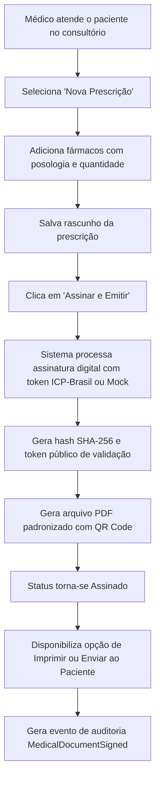

# SPEC-0011 — Prescrição Eletrônica, Atestados e Solicitações de Exames com Assinatura Digital ICP-Brasil

| Campo | Valor |
| :--- | :--- |
| **ID** | SPEC-0011 |
| **Título** | Prescrição Eletrônica, Atestados e Solicitações de Exames com Assinatura Digital ICP-Brasil |
| **Status** | Rascunho |
| **Versão** | 0.1 |
| **Data** | 2026-10-02 |
| **Autor** | Antigravity AI / Equipe CANAMED |
| **Revisores** | Responsável pelo Projeto CANAMED |
| **Módulos afetados** | backend (Domain, Application, Infrastructure, Api), frontend (workspace médico, visualizador/impressão de receitas), banco de dados (schema `medical_documents`) |
| **ADRs relacionados** | ADR-0003 (dados de saúde), ADR-0006 (.NET/React), ADR-0007 (PostgreSQL/EF Core), ADR-0008 (segurança) |

---

## 1. Objetivo

Permitir a emissão estruturada de receitas médicas (simples e de controle especial), atestados de repouso ou comparecimento e solicitações de exames complementares, com suporte à assinatura digital qualificada (padrão ICP-Brasil), geração de PDF padronizado com identidade visual CANAMED e QR Code de validação pública da integridade documental para farmácias e terceiros.

Pergunta de controle do `GEMINI.md`: **isso reduz atrito na rotina da clínica?**
Sim. Elimina a ilegibilidade das receitas manuais em papel, previne erros de dispensação em drogarias, permite ao paciente receber o documento digital por canais ágeis e garante conformidade jurídica integral com o Conselho Federal de Medicina (CFM).

---

## 2. Contexto

A emissão de receitas, pedidos de exames e atestados médicos é a entrega documental mais frequente do ato médico. Pela legislação brasileira — notadamente a **Medida Provisória nº 2.200-2/2001**, a **Lei Federal nº 14.063/2020** e as resoluções do **Conselho Federal de Medicina (CFM)** e do **Conselho Federal de Farmácia (CFF)** —, a prescrição médica digital possui plena validade jurídica e deve ser aceita em todo o território nacional desde que assinada digitalmente com certificado ICP-Brasil e contendo mecanismo de validação de autenticidade.

Além disso, o **Art. 73 do Código de Ética Médica** estabelece que a revelação do diagnóstico e do código CID-10 em atestados é vedada salvo quando houver justa causa, dever legal ou autorização expressa do próprio paciente. Esta especificação formaliza a geração desses documentos no ecossistema CANAMED.

---

## 3. Escopo

### 3.1 Dentro do escopo
- Emissão estruturada de **Prescrições Médicas** (nome do fármaco/princípio ativo, dosagem, concentração, via de administração, posologia, quantidade e tempo de uso);
- Emissão de **Atestados Médicos** (dias de afastamento/repouso, data de início e declaração de comparecimento);
- Controle ético rigoroso para inclusão do código CID-10 em atestados, condicionado ao consentimento expresso do paciente registrado no ato;
- Emissão de **Solicitações de Exames** (relação de procedimentos com justificativa clínica / suspeita diagnóstica);
- Status do documento: `rascunho`, `assinado` e `cancelado` (revogado);
- Geração de documento PDF estilizado com identidade visual oficial CANAMED, cabeçalho da clínica, dados do profissional (CRM/UF) e carimbo de assinatura;
- Geração de QR Code e código identificador único para verificação pública da autenticidade em portal sem necessidade de login;
- Mecanismo de revogação/cancelamento formal em caso de erro na emissão, alterando o status no portal público de validação;
- Adaptador simulado (`SimulatedSignatureProvider`) para ambiente de desenvolvimento local e testes automatizados.

### 3.2 Fora do escopo
- Aquisição comercial ou custódia de certificados digitais em nuvem (exige contratação externa de autoridade certificadora — BirdID, Certisign, etc.);
- Integração direta com catálogos comerciais pagos de bulários (CMED/Anvisa) nesta fase inicial (itens são digitados de forma estruturada pelo médico).

---

## 4. Atores e Permissões

| Ator | Permissões necessárias | Observações |
| :--- | :--- | :--- |
| **Médico / Profissional de Saúde** | `documents:create`, `documents:sign`, `documents:cancel`, `documents:read` | Emite, assina, cancela e visualiza os documentos emitidos sob seu CRM/UF. |
| **Recepcionista / Atendente** | `documents:print` | Pode apenas reimprimir vias de documentos já assinados a pedido do paciente presente no balcão. |
| **Paciente / Terceiro / Farmácia** | Acesso público anônimo à rota de validação | Consulta e valida a integridade do PDF via QR Code ou token alfanumérico. |

---

## 5. Regras de Negócio

| ID | Regra | Justificativa / Origem |
| :--- | :--- | :--- |
| **RN-001** | O sistema deve suportar 4 categorias de documentos médicos: (1) `receita_simples`, (2) `receita_controle_especial`, (3) `atestado_medico` e (4) `solicitacao_exames`. | Cobertura das demandas habituais de consultórios ambulatoriais. |
| **RN-002** | Todo documento emitido deve conter no cabeçalho: razão social da clínica, CNPJ, endereço completo, telefone, nome do paciente e CPF (ou documento equivalente). | Resoluções CFM e exigências de fiscalização sanitária. |
| **RN-003** | Todo documento deve identificar o médico emissor: Nome completo, CRM, Estado (UF) e Registro de Qualificação de Especialista (RQE), quando aplicável. | Código de Ética Médica e legislação profissional. |
| **RN-004** | Na emissão de atestados, o campo CID-10 é **opcional**. Sua inclusão é bloqueada pelo sistema a menos que o médico marque a opção confirmando que o paciente solicitou expressamente a inserção do diagnóstico. | Art. 73 do Código de Ética Médica (sigilo médico e consentimento do titular). |
| **RN-005** | Na prescrição de medicamentos, cada item deve conter obrigatoriamente: nome do medicamento/substância, concentração, via de administração (oral, tópica, etc.), posologia detalhada e quantidade total a ser dispensada. | Resolução CFM nº 2.299/2021 e normas da ANVISA/CFF. |
| **RN-006** | Enquanto estiver no status `rascunho`, o documento pode ser livremente editado ou descartado pelo médico. | Facilidade de edição durante o atendimento. |
| **RN-007** | A ação de **Assinar Documento** altera o status para `assinado`, calcula o hash criptográfico SHA-256 do conteúdo, aplica a assinatura digital e gera o token público único de validação. | Não repúdio, autenticidade e validade jurídica. |
| **RN-008** | Uma vez no status `assinado`, o documento é **imutável**. Não é permitido editar texto, medicamento ou dosagem de um documento já assinado. | Validade legal de documentos digitais e conformidade CFM. |
| **RN-009** | Se o médico cometer um equívoco após a assinatura, o documento deve ser **cancelado/revogado** com preenchimento obrigatório da justificativa do cancelamento. | Rastreabilidade e prevenção contra uso indevido de receita errônea. |
| **RN-010** | A página de validação pública (`/validar/{token}`) deve exibir: nome do médico emissor, CRM/UF, nome do paciente, data/hora da emissão, integridade do hash e o status atual (`Válido` ou `Cancelado pelo Emissor`). | Padrão nacional de validação de receitas do CFM e ITI. |
| **RN-011** | Em ambiente de Desenvolvimento e Testes, o sistema deve utilizar um provedor simulado de assinatura (`SimulatedSignatureProvider`), gerando certificados de teste locais com hash real sem travar a esteira por falta de token físico. | Autonomia de desenvolvimento e testes contínuos sem dependência externa. |

---

## 6. Fluxos

### 6.1 Fluxo Principal — F-001: Emissão e Assinatura de Receita Médica



1. O médico acessa a aba de documentos do paciente;
2. Seleciona "Nova Receita Médica" e insere os medicamentos de forma estruturada;
3. Clica em "Assinar Digitalmente";
4. O backend processa a assinatura através da interface `IDigitalSignatureProvider`, carimba data/hora e gera o `public_token`;
5. O PDF é compilado com o layout visual oficial CANAMED, incluindo carimbo da assinatura e QR Code;
6. O documento pode ser imediatamente impresso na clínica ou compartilhado digitalmente.

### 6.2 Fluxo Alternativo — F-002: Validação Pública por Terceiro (Farmácia)

1. O farmacêutico escaneia o QR Code presente no cabeçalho ou rodapé do PDF;
2. O navegador abre a rota pública `/validar/{public_token}`;
3. O backend consulta o documento pelo token, verifica a validade do hash e o status;
4. A tela exibe o selo verde "Documento Autêntico e Válido", confirmando o CRM do médico, a clínica e a data de emissão. Se o documento tiver sido revogado, exibe selo vermelho de alerta "Documento Cancelado pelo Emissor".

### 6.3 Fluxo de Exceção — F-003: Cancelamento de Receita Emitida com Erro

1. O médico percebe que informou dosagem incorreta em documento já assinado;
2. Clica em "Cancelar Documento";
3. O sistema solicita a justificativa obrigatória (ex.: "Ajuste na dosagem do anti-hipertensivo");
4. O status é alterado para `cancelado` e gravado na trilha de auditoria;
5. O médico procede com a emissão de uma nova receita correta.

---

## 7. Modelo de Dados

### 7.1 Entidade `MedicalDocument` (Tabela `medical_documents`)

| Campo | Tipo | Obrigatório | Classificação LGPD | Regra / Descrição |
| :--- | :--- | :--- | :--- | :--- |
| `id` | `UUID` | Sim | Anônimo | Chave primária |
| `clinic_id` | `UUID` | Sim | Comum | FK `clinics(id)` |
| `patient_id` | `UUID` | Sim | Dado pessoal | FK `patients(id)` |
| `doctor_id` | `UUID` | Sim | Comum | FK `users(id)` do médico |
| `medical_record_id`| `UUID` | Não | Operacional | FK `medical_records(id)` (prontuário correspondente) |
| `document_type` | `VARCHAR(30)` | Sim | Operacional | `receita_simples`, `receita_controle_especial`, `atestado_medico`, `solicitacao_exames` |
| `status` | `VARCHAR(20)` | Sim | Operacional | `rascunho`, `assinado`, `cancelado` (default: `rascunho`) |
| `content_payload` | `JSONB` | Sim | Sensível (Saúde) | Dados estruturados (itens da receita, dias de repouso, exames) |
| `cid10_code` | `VARCHAR(10)` | Não | Sensível (Saúde) | Código CID-10 informado (somente se consentido) |
| `patient_consented_cid` | `BOOLEAN` | Sim | Operacional | Flag de consentimento formal do paciente para exibir CID |
| `signature_hash` | `VARCHAR(128)`| Não | Operacional | Hash SHA-256 dos dados e da assinatura |
| `public_token` | `VARCHAR(64)` | Sim | Anônimo | Token alfanumérico único para URL do QR Code (índice único) |
| `cancellation_reason` | `VARCHAR(500)`| Não | Operacional | Justificativa do cancelamento (se cancelado) |
| `signed_at` | `TIMESTAMPTZ` | Não | Operacional | Data e hora exata da assinatura digital |
| `cancelled_at` | `TIMESTAMPTZ` | Não | Operacional | Data e hora do cancelamento |
| `created_at` | `TIMESTAMPTZ` | Sim | Operacional | Timestamp de criação |

### 7.2 Estrutura do `content_payload` (JSONB)
- **Para Prescrição (`receita_simples` / `receita_controle_especial`):**
  ```json
  {
    "items": [
      {
        "medication": "Amoxicilina + Clavulanato de Potássio",
        "concentration": "875mg + 125mg",
        "pharmaceuticalForm": "Comprimido revestido",
        "route": "Oral",
        "instructions": "Tomar 1 comprimido de 12 em 12 horas por 7 dias.",
        "quantity": "14 comprimidos"
      }
    ],
    "generalInstructions": "Tomar preferencialmente após as refeições. Manter hidratação abundante."
  }
  ```
- **Para Atestado (`atestado_medico`):**
  ```json
  {
    "leaveDays": 3,
    "startDate": "2026-10-02",
    "purpose": "repouso_medico",
    "justificationText": "Atesto para os devidos fins que o paciente necessita de repouso por motivo de saúde."
  }
  ```

---

## 8. Contrato de API

### 8.1 Criar Rascunho de Documento
- **Método / Rota:** `POST /api/v1/medical-documents`
- **Autorização:** `documents:create` (Perfil: `medico`)
- **Entrada:**
  ```json
  {
    "patientId": "3fa85f64-5717-4562-b3fc-2c963f66afa6",
    "medicalRecordId": "4fa85f64-5717-4562-b3fc-2c963f66afa8",
    "documentType": "receita_simples",
    "contentPayload": { ... },
    "patientConsentedCid": false
  }
  ```
- **Retorno:** `201 Created` com o ID gerado e status `rascunho`.

### 8.2 Assinar Documento Digitalmente
- **Método / Rota:** `POST /api/v1/medical-documents/{id}/sign`
- **Autorização:** `documents:sign` (Apenas o médico autor)
- **Retorno:** `200 OK` com `status: "assinado"`, `signatureHash`, `signedAt` e `validationUrl`.

### 8.3 Download do PDF Gerado
- **Método / Rota:** `GET /api/v1/medical-documents/{id}/pdf`
- **Autorização:** `documents:read` ou `documents:print`
- **Retorno:** `application/pdf` com cabeçalho `Content-Disposition: inline; filename="receita-canamed.pdf"`.

### 8.4 Cancelar Documento Assinado
- **Método / Rota:** `POST /api/v1/medical-documents/{id}/cancel`
- **Autorização:** `documents:cancel` (Apenas o médico autor)
- **Entrada:**
  ```json
  {
    "reason": "Erro no ajuste de miligramagem do antibiótico prescrito"
  }
  ```
- **Retorno:** `200 OK` com `status: "cancelado"`.

### 8.5 Validação Pública via QR Code (Rota Pública)
- **Método / Rota:** `GET /api/v1/public/validate-document/{publicToken}`
- **Autorização:** Pública (anônima, com rate limiting rígido)
- **Retorno:** `200 OK`:
  ```json
  {
    "isValid": true,
    "status": "assinado",
    "documentType": "receita_simples",
    "issuedAt": "2026-10-02T14:30:00Z",
    "doctor": {
      "name": "Dra. Maria Albuquerque",
      "crm": "12345",
      "uf": "PE"
    },
    "clinic": {
      "name": "Clínica Saúde & Vida",
      "city": "Recife"
    },
    "patientInitials": "J. S. O."
  }
  ```
  *(Nota de Privacidade: A validação pública protege o paciente exibindo apenas iniciais, em conformidade com a LGPD).*

---

## 9. Interface e Experiência

| Componente | Estado | Comportamento |
| :--- | :--- | :--- |
| **Formulário de Receita** | Edição | Campo para adicionar múltiplos medicamentos, com campos organizados em colunas (Fármaco, Dosagem, Posologia, Qtd). Botão "+ Adicionar Medicamento". |
| **Formulário de Atestado** | Edição | Seletor de dias de afastamento (1 a 30 dias), data de início e checkbox obrigatório de consentimento: *"O paciente solicitou a inclusão expressa do código CID-10 neste documento"*. |
| **Visualizador de PDF** | Leitura | Modal com renderização do PDF estilizado em formato A4/A5 oficial CANAMED, exibindo carimbo ICP-Brasil e QR Code gerado no canto superior direito. Botões "Imprimir" e "Copiar Link de Compartilhamento". |
| **Portal de Validação Pública** | Público | Página limpa e responsiva com o logo CANAMED, selo verde de autenticidade emitido com sucesso e orientações claras para o farmacêutico. |

---

## 10. Critérios de Aceitação

| ID | Critério |
| :--- | :--- |
| **CA-001** | **Dado** um médico preenchendo uma receita, **Quando** adicionar medicamentos com posologia e clicar em salvar rascunho, **Então** o documento é persistido com status `rascunho`. |
| **CA-002** | **Dado** um rascunho de receita, **Quando** o médico solicitar a assinatura digital, **Então** o sistema gera o hash SHA-256, o token de validação e altera o status para `assinado`. |
| **CA-003** | **Dado** um documento com status `assinado`, **Quando** qualquer operador tentar alterar seu conteúdo via API, **Então** a operação é rejeitada com `409 Conflict`. |
| **CA-004** | **Dado** a emissão de um atestado médico, **Quando** o médico preencher o código CID sem marcar o consentimento expresso do paciente, **Então** a API recusa a requisição com `400 Bad Request`. |
| **CA-005** | **Dado** um documento assinado, **Quando** acessada a rota pública de validação via token, **Então** a resposta confirma a veracidade, identificação do médico e omite o nome completo do paciente em respeito à LGPD. |
| **CA-006** | **Dado** um documento cancelado pelo médico com justificativa, **Quando** a rota de validação for consultada, **Então** o status retornado é `cancelado` com aviso de documento revogado. |
| **CA-007** | **Dado** um ambiente de desenvolvimento ou teste, **Quando** um documento for assinado, **Então** o provedor simulado executa com sucesso sem exigir dispositivos de hardware externos. |

---

## 11. Casos de Erro

| ID | Gatilho | Comportamento esperado | Mensagem ao usuário | Registro |
| :--- | :--- | :--- | :--- | :--- |
| **ER-001** | Tentativa de assinar receita sem nenhum medicamento cadastrado | Rejeitar com `400 Bad Request` | "A receita médica deve conter pelo menos um medicamento preenchido." | Validação de domínio |
| **ER-002** | Inserção de CID-10 em atestado sem consentimento do titular | Bloquear com `400 Bad Request` | "A inclusão de diagnóstico CID exige confirmação expressa de consentimento do paciente conforme o Código de Ética Médica." | Alerta de conformidade |
| **ER-003** | Cancelamento de documento sem justificativa textual | Rejeitar com `400 Bad Request` | "Informe a justificativa detalhada para o cancelamento do documento médico." | Validação local |
| **ER-004** | Consulta a token de validação inexistente ou adulterado | Retornar `404 Not Found` | "Documento não localizado ou inválido. Verifique o código informado." | Log de auditoria |

---

## 12. Impacto em Outras Funcionalidades

| Módulo | Tipo de Impacto | Ação Necessária |
| :--- | :--- | :--- |
| **PEP (SPEC-0010)** | Direto | Documentos emitidos durante o atendimento são automaticamente associados ao prontuário clínico da consulta. |
| **Workspace do Médico (SPEC-0012)** | Direto | Atalhos diretos para emissão de receita e atestado integrados na tela de atendimento. |
| **Visão do Paciente (SPEC-0016)** | Indireto | O paciente poderá receber o link do PDF assinado por WhatsApp ou SMS. |

---

## 13. Requisitos de Segurança

- [x] Assinatura digital assegurando integridade e não repúdio documental;
- [x] Provedor de assinatura desacoplado via interface `IDigitalSignatureProvider`;
- [x] Rota pública de validação com Rate Limiting estrito para mitigar enumeração de tokens;
- [x] Anonimização parcial do nome do paciente na validação pública (iniciais) em estrita conformidade com a LGPD;
- [x] Proibição absoluta de alteração de documentos com status `assinado` no banco de dados.

---

## 14. Requisitos Legais Aplicáveis

| Norma | Aplicável? | O que exige nesta funcionalidade |
| :--- | :--- | :--- |
| **Medida Provisória nº 2.200-2/2001 e Lei nº 14.063/2020** | **Sim** | Validade jurídica de documentos assinados digitalmente através de infraestrutura de chaves públicas. |
| **Código de Ética Médica (Art. 73)** | **Sim** | Vedação expressa de revelar diagnóstico (CID) em atestados sem consentimento do paciente. |
| **Resoluções CFM nº 2.299/2021 e CFF nº 713/2021** | **Sim** | Requisitos técnicos para prescrição eletrônica e validação por drogarias em território nacional. |
| **LGPD (Lei nº 13.709/2018)** | **Sim** | Minimização de dados sensíveis na rota pública de consulta de autenticidade. |

---

## 15. Requisitos Não Funcionais

| Categoria | Requisito |
| :--- | :--- |
| **Desempenho** | Geração e assinatura do PDF em menos de 500ms; validação pública em menos de 100ms. |
| **Compatibilidade** | PDF gerado em conformidade com leitores universais de PDF (Acrobat, navegadores modernos) e impressoras térmicas/jato de tinta. |
| **Armazenamento** | Armazenamento seguro de PDFs gerados com retenção garantida de 20 anos. |

---

## 16. Testes Previstos

| Tipo | Cobertura Mínima |
| :--- | :--- |
| **Unitário** | Validação de itens obrigatórios da receita, regra de bloqueio do CID sem consentimento e cálculo do hash de integridade. |
| **Integração** | Endpoints de criação de documento, assinatura com `SimulatedSignatureProvider`, download do PDF e cancelamento com justificativa. |
| **Comportamento** | Médico emitindo receita e atestado durante o atendimento, gerando o PDF e validando o documento através da rota pública com o token gerado. |

---

## 17. Auditoria e Observabilidade

| Evento | Recurso Afetado | Dados Registrados |
| :--- | :--- | :--- |
| `MedicalDocumentCreated` | `medical_documents` | `id`, `doctor_id`, `patient_id`, `document_type` |
| `MedicalDocumentSigned` | `medical_documents` | `id`, `doctor_id`, `signature_hash`, `public_token` |
| `MedicalDocumentCancelled`| `medical_documents` | `id`, `doctor_id`, `reason`, `cancelled_at` |
| `MedicalDocumentValidated`| `medical_documents` | `public_token`, `ip_address`, `timestamp` |

---

## 18. Pendências e Questões Abertas

| ID | Questão | Responsável | Status |
| :--- | :--- | :--- | :--- |
| **Q-001** | Na fase de produção, qual autoridade certificadora de nuvem será contratada para assinatura sem cartão físico (BirdID / Vidaas)? | Infraestrutura / Produto | Depende de contratação de provedor externo na Fase 4. |

---

## 19. Histórico de Revisões

| Versão | Data | Autor | Alteração |
| :--- | :--- | :--- | :--- |
| 0.1 | 2026-10-02 | Antigravity AI | Versão inicial da especificação de Prescrição Eletrônica e Documentos Clínicos. |

---

## 20. Aprovação

| Papel | Nome | Data | Status |
| :--- | :--- | :--- | :--- |
| **Autor** | Antigravity AI | 2026-10-02 | Elaborada |
| **Aprovador** | Responsável pelo Projeto | Pendente | Aguardando revisão |
