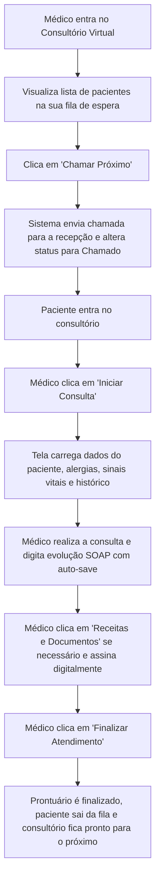

# SPEC-0012 — Consultório Virtual e Workspace Médico Integrado

| Campo | Valor |
| :--- | :--- |
| **ID** | SPEC-0012 |
| **Título** | Consultório Virtual e Workspace Médico Integrado |
| **Status** | Implementada |
| **Versão** | 1.0 |
| **Data** | 2026-10-02 |
| **Autor** | Antigravity AI / Equipe CANAMED |
| **Revisores** | Responsável pelo Projeto CANAMED |
| **Módulos afetados** | backend (Application, Api, Hubs/Endpoints), frontend (nova visão `DoctorWorkspace`, componentes clínicos), banco de dados |
| **ADRs relacionados** | ADR-0003 (dados de saúde), ADR-0006 (.NET/React), ADR-0008 (segurança) |

---

## 1. Objetivo

Criar um ambiente de trabalho unificado e centrado no profissional de saúde ("Meu Consultório"), integrando em uma única tela fluida a fila de pacientes do médico em tempo real, acionamento de chamada para o consultório, visualização instantânea dos sinais vitais da triagem, alertas persistentes de alergias e comorbidades, preenchimento do prontuário SOAP (SPEC-0010) e emissão de receitas/atestados digitais (SPEC-0011) sem troca de telas ou atrito operacional.

Pergunta de controle do `GEMINI.md`: **isso reduz atrito na rotina da clínica?**
Sim. Elimina o atrito mais crítico do médico: navegar entre múltiplas telas separadas (agenda, fila, triagem, prontuário e prescrições). Toda a jornada da consulta ocorre em um painel único, economizando minutos valiosos a cada paciente atendido.

---

## 2. Contexto

Na operação diária de uma clínica médica, o tempo do profissional de saúde deve ser dedicado à escuta e ao exame clínico. Sistemas legados e burocráticos frequentemente forçam o médico a abrir uma aba para ver a agenda, outra para ver quem chegou na fila, outra para checar a triagem, abrir um formulário isolado de prontuário e um editor externo de receitas.

O CANAMED já possui a base da fila de espera (SPEC-0005) e a triagem Manchester (SPEC-0009). Esta especificação consolida esses módulos sob a perspectiva do médico, transformando a interface em um verdadeiro "Consultório Virtual" ergonômico, moderno e aderente ao Design System oficial CANAMED (SPEC-UI-001).

---

## 3. Escopo

### 3.1 Dentro do escopo
- Painel "Meu Consultório" dedicado ao perfil `medico`;
- Fila de espera dinâmica filtrada para os pacientes aguardando especificamente pelo médico logado no dia;
- Botão "Chamar Próximo Paciente" acionando a chamada pública para o consultório e atualizando o status na fila;
- Cabeçalho do paciente em atendimento com dados demográficos, convênio e **alertas clínicos persistentes** (alergias relatadas e comorbidades);
- Widget de Sinais Vitais da Triagem com cálculo de IMC e destaque visual da cor de Manchester (SPEC-0009);
- Editor integrado de evolução médica SOAP com salvamento contínuo (SPEC-0010);
- Gaveta lateral (*drawer*) de histórico prévio de atendimentos do paciente para consulta comparativa lado a lado;
- Barra de atalhos rápidos para emissão de receitas digitais, atestados médicos e pedidos de exame (SPEC-0011);
- Encerramento atômico do atendimento clínico (finalização do prontuário, liberação da fila e desocupação da sala física).

### 3.2 Fora do escopo
- Telemedicina com videoconferência WebRTC integrada na tela (prevista para fase posterior);
- Integração com prontuários de outras clínicas externas à rede do cliente.

---

## 4. Atores e Permissões

| Ator | Permissões necessárias | Observações |
| :--- | :--- | :--- |
| **Médico / Profissional de Saúde** | `workspace:access`, `queue:call`, `queue:start`, `records:create`, `records:finalize` | Acesso pleno ao seu próprio consultório virtual, chamando e atendendo seus pacientes. |
| **Gestor da Clínica** | `workspace:audit_view` | Pode visualizar a lista de médicos em atendimento e tempo de consulta para fins de gestão operacional. |
| **Recepcionista** | *(Sem acesso ao workspace do médico)* | Opera apenas a fila da recepção geral (SPEC-0005). |

---

## 5. Regras de Negócio

| ID | Regra | Justificativa / Origem |
| :--- | :--- | :--- |
| **RN-001** | O Consultório Virtual exibe exclusivamente os pacientes que possuem agendamento ou check-in na fila direcionados para o médico autenticado na clínica ativa. | Foco de atenção do profissional e segregação de sigilo. |
| **RN-002** | O médico pode selecionar a sala física em que está atendendo no início do seu turno (ex: "Consultório 03"). Esta informação é exibida no painel da recepção e nos avisos de chamada ao paciente. | Organização espacial da clínica (SPEC-0006). |
| **RN-003** | A ação de "Chamar Paciente" comuta o status da fila para `chamado` e aciona o evento de chamada na recepção com registro do consultório de destino. | Fluxo do ciclo de atendimento (SPEC-0005). |
| **RN-004** | Alertas de **alergias conhecidas** (medicamentosas ou alimentares) coletadas na triagem ou no cadastro são exibidos em banner destacado de alto contraste visual (vermelho/amarelo) no topo do prontuário durante todo o atendimento. | Segurança do paciente e prevenção contra choque anafilático / eventos adversos graves. |
| **RN-005** | Os dados vitais da triagem (PA, pulso, saturação, temperatura, glicemia, peso, altura, IMC e cor de Manchester) são exibidos automaticamente na interface da consulta sem necessidade de redigitação. | Redução de retrabalho e agilidade operacional. |
| **RN-006** | O sistema não permite iniciar o atendimento de um novo paciente enquanto houver um paciente ativo em atendimento no mesmo consultório, a menos que o atendimento atual seja formalmente concluído ou suspenso. | Prevenção contra inconsistência de prontuários cruzados. |
| **RN-007** | O médico pode abrir a gaveta de "Histórico do Paciente" mantendo o formulário SOAP aberto na tela principal, permitindo checar condutas anteriores sem perder o que está redigindo. | Ergonomia cognitiva e fluxo contínuo de trabalho. |
| **RN-008** | A finalização do atendimento encerra o prontuário SOAP, registra o término na fila de espera, calcula o tempo total de atendimento para o dashboard gerencial e desocupa o consultório. | Fechamento integral do ciclo de atendimento (SPEC-0005 e SPEC-0007). |

---

## 6. Fluxos

### 6.1 Fluxo Principal — F-001: Atendimento no Consultório Virtual



1. O médico acessa a aba "Meu Consultório";
2. A barra lateral exibe a lista dos seus pacientes aguardando, ordenados por prioridade clínica (Manchester) e tempo de chegada;
3. O médico clica em "Chamar Próximo": o sistema atualiza o status para `chamado` e emite o aviso visual/sonoro na recepção com o número da sala;
4. Quando o paciente adentra a sala, o médico clica em "Iniciar Consulta": o cronômetro do atendimento é disparado e a tela se expande com o prontuário do paciente;
5. O médico visualiza os alertas em destaque (ex.: "ALERGIA: Penicilina"), os sinais vitais da triagem e digita a evolução clínica;
6. Se necessário, emite prescrições ou atestados através dos botões integrados;
7. Ao término, clica em "Finalizar Atendimento": o sistema conclui o ciclo, salva o prontuário imutável e retorna a lista da fila para a próxima chamada.

---

## 7. Modelo de Dados

O Workspace Médico atua como orquestrador de entidades existentes, adicionando metadados de sessão de atendimento:

### 7.1 Entidade `DoctorConsultationSession` (Tabela `doctor_consultation_sessions`)

| Campo | Tipo | Obrigatório | Classificação LGPD | Regra / Descrição |
| :--- | :--- | :--- | :--- | :--- |
| `id` | `UUID` | Sim | Anônimo | Chave primária |
| `clinic_id` | `UUID` | Sim | Comum | FK `clinics(id)` |
| `doctor_id` | `UUID` | Sim | Comum | FK `users(id)` do médico |
| `room_id` | `UUID` | Não | Operacional | FK `rooms(id)` sala física selecionada para o turno |
| `current_queue_entry_id`| `UUID` | Não | Operacional | FK `queue_entries(id)` do paciente em atendimento ativo |
| `current_patient_id` | `UUID` | Não | Dado pessoal | FK `patients(id)` |
| `started_at` | `TIMESTAMPTZ` | Não | Operacional | Início da consulta atual |
| `last_ping_at` | `TIMESTAMPTZ` | Sim | Operacional | Presença online do médico no consultório |

---

## 8. Contrato de API

### 8.1 Obter Estado do Consultório do Médico
- **Método / Rota:** `GET /api/v1/doctor-workspace/state`
- **Autorização:** `workspace:access` (Perfil: `medico`)
- **Retorno:** `200 OK`:
  ```json
  {
    "assignedRoom": { "id": "uuid", "name": "Consultório 02" },
    "activeConsultation": {
      "queueEntryId": "uuid",
      "patient": {
        "id": "uuid",
        "name": "Maria Silva",
        "birthDate": "1985-04-12",
        "allergies": ["Dipirona", "Anti-inflamatórios não esteroides"],
        "chronicConditions": ["Hipertensão Arterial"]
      },
      "triage": {
        "bloodPressure": "120/80",
        "heartRate": 74,
        "oxygenSaturation": 98,
        "temperature": 36.5,
        "bmi": 23.4,
        "riskLevel": "amarelo"
      },
      "medicalRecord": {
        "id": "uuid",
        "status": "em_andamento",
        "subjective": "...",
        "objective": "...",
        "assessment": "...",
        "plan": "..."
      },
      "consultationStartedAt": "2026-10-02T15:10:00Z"
    },
    "waitingQueue": [
      {
        "queueEntryId": "uuid",
        "patientName": "João Santos",
        "priority": "preferencial",
        "riskLevel": "verde",
        "waitingTimeMinutes": 18
      }
    ]
  }
  ```

### 8.2 Chamar Próximo Paciente
- **Método / Rota:** `POST /api/v1/doctor-workspace/call-patient`
- **Autorização:** `queue:call`
- **Entrada:** `{ "queueEntryId": "uuid" }` (ou vazio para pegar o próximo da fila por prioridade)
- **Retorno:** `200 OK` com dados do paciente chamado e evento disparado para o painel de TV da recepção.

### 8.3 Iniciar Consulta
- **Método / Rota:** `POST /api/v1/doctor-workspace/start-consultation`
- **Autorização:** `queue:start`
- **Entrada:** `{ "queueEntryId": "uuid" }`
- **Retorno:** `200 OK` inicializando o prontuário SOAP e cronômetro.

### 8.4 Finalizar Consulta
- **Método / Rota:** `POST /api/v1/doctor-workspace/finish-consultation`
- **Autorização:** `records:finalize`
- **Entrada:** `{ "medicalRecordId": "uuid" }`
- **Retorno:** `200 OK` liberando o consultório e desocupando o paciente.

---

## 9. Interface e Experiência

Layout em tela cheia otimizado para monitores de consultório médico (1920x1080 e 1366x768):

```
+-----------------------------------------------------------------------------------------------+
| CANAMED | Consultório 02 - Dr. Carlos Mendes | Paciente em Atendimento: Maria Silva (41 anos)  |
+------------------------------------+----------------------------------------------------------+
| MINHA FILA (3 aguardando)         | ALERTA: ALERGIA A DIPIRONA E AINES                      |
| [ Chamar Próximo da Fila ]         | PA: 120/80 | FC: 74 bpm | SatO2: 98% | Manchester: Amarelo     |
+------------------------------------+----------------------------------------------------------+
| 1. João Santos (Preferencial) 18m  | [SOAP: Subjetivo]                                        |
| 2. Ana Costa (Verde) 25m           | Paciente queixa-se de dor lombar com irradiação...       |
| 3. Pedro Rocha (Verde) 32m         |----------------------------------------------------------|
|                                    | [SOAP: Exame Físico / Objetivo]                          |
|                                    | Lasegue negativo bilateralmente...                       |
|                                    |----------------------------------------------------------|
|                                    | [SOAP: Avaliação e Conduta]                              |
|                                    | Lombalgia mecânica aguda. Repouso relativo.              |
+------------------------------------+----------------------------------------------------------+
| [ Gaveta: Histórico Anterior ]     | [ + Nova Receita ] [ + Atestado ] [ Finalizar Consulta ]|
+------------------------------------+----------------------------------------------------------+
```

Componentes com contraste refinado, fonte `Plus Jakarta Sans`, badges de alerta em vermelho institucional e verde petróleo CANAMED para ações principais.

---

## 10. Critérios de Aceitação

| ID | Critério |
| :--- | :--- |
| **CA-001** | **Dado** um médico autenticado, **Quando** acessar o Consultório Virtual, **Então** o sistema exibe apenas os pacientes destinados a ele na clínica selecionada. |
| **CA-002** | **Dado** pacientes na fila de espera do médico, **Quando** o médico acionar "Chamar Próximo", **Então** a chamada é propagada para o painel de atendimento e o status muda para `chamado`. |
| **CA-003** | **Dado** um paciente com alergias cadastradas na triagem, **Quando** a consulta for iniciada, **Então** os alertas de alergia são destacados no topo da tela com visual de advertência obrigatório. |
| **CA-004** | **Dado** a aferição de sinais vitais realizada na triagem (Manchester), **Quando** o médico abrir a consulta, **Então** todos os dados vitais e IMC aparecem automaticamente preenchidos. |
| **CA-005** | **Dado** uma consulta em andamento, **Quando** o médico tentar chamar outro paciente sem finalizar o atual, **Então** o sistema avisa da pendência e bloqueia a chamada sobreposta. |
| **CA-006** | **Dado** o clique em "Finalizar Consulta", **Quando** o prontuário SOAP estiver validado, **Então** a consulta é concluída, a fila atualizada e o consultório fica disponível para a próxima chamada. |

---

## 11. Casos de Erro

| ID | Gatilho | Comportamento esperado | Mensagem ao usuário | Registro |
| :--- | :--- | :--- | :--- | :--- |
| **ER-001** | Chamada de paciente quando a fila do médico está vazia | Desabilitar botão e emitir notificação toast | "Não há pacientes aguardando na sua fila no momento." | Log informativo |
| **ER-002** | Tentativa de iniciar nova consulta com outra ainda aberta | Bloquear ação | "Existe uma consulta em andamento. Conclua o atendimento atual antes de iniciar o próximo." | Validação de sessão |
| **ER-003** | Falha de conexão de rede durante a digitação do SOAP | Manter texto no estado local e exibir aviso em amarelo | "Sem conexão no momento. Suas anotações estão salvas no navegador e serão sincronizadas assim que a rede retornar." | Alerta de resiliência |

---

## 12. Impacto em Outras Funcionalidades

| Módulo | Tipo de Impacto | Ação Necessária |
| :--- | :--- | :--- |
| **PEP (SPEC-0010)** | Direto | O Workspace é a interface primária de consumo e escrita do SOAP. |
| **Prescrição (SPEC-0011)** | Direto | Modais de emissão rápida de documentos são acionados diretamente da barra de rodapé do Workspace. |
| **Fila de Espera (SPEC-0005)** | Direto | Ações de chamar, iniciar e concluir atualizam instantaneamente a fila geral da clínica. |
| **Dashboard (SPEC-0007)** | Direto | O tempo medido da consulta alimenta as métricas de tempo médio de atendimento e produtividade médica. |

---

## 13. Requisitos de Segurança

- [x] Autenticação forte com MFA obrigatório para acesso ao consultório médico;
- [x] Restrição estrita de dados clínicos por médico e por clínica;
- [x] Bloqueio automático de tela após inatividade para proteção de dados caso o médico se ausente da sala;
- [x] Trilha de auditoria completa cobrindo chamadas, início de consulta e finalização.

---

## 14. Requisitos Legais Aplicáveis

| Norma | Aplicável? | O que exige nesta funcionalidade |
| :--- | :--- | :--- |
| **Código de Ética Médica** | **Sim** | Sigilo profissional inviolável; ambiente exclusivo para a relação médico-paciente. |
| **CFM e SBIS NGS2** | **Sim** | Rastreabilidade de ações clínicas, integridade de dados e proteção da privacidade. |
| **LGPD (Lei nº 13.709/2018)** | **Sim** | Minimização de dados expostos na interface; restrição a dados estritamente necessários para o atendimento. |

---

## 15. Requisitos Não Funcionais

| Categoria | Requisito |
| :--- | :--- |
| **Ergonomia** | Layout adaptável a diferentes tamanhos de tela com atalhos de teclado ágeis (`Ctrl+Enter` para salvar, `Ctrl+P` para prescrever). |
| **Desempenho** | Transição instantânea entre pacientes (tempo de carga < 200ms). |
| **Resiliência** | Cache local de formulário via `localStorage` prevenindo perda de anotações em incidentes de navegador. |

---

## 16. Testes Previstos

| Tipo | Cobertura Mínima |
| :--- | :--- |
| **Unitário** | Orquestração de estados do workspace (vazio, chamando, em consulta, concluído). |
| **Integração** | Endpoints de consulta de estado, chamada de paciente, início e finalização com atualização de fila e prontuário. |
| **Comportamento** | Simulação ponta a ponta do fluxo médico: visualizar fila, chamar, atender com exibição de alergias e sinais vitais, e finalizar atendimento. |

---

## 17. Auditoria e Observabilidade

| Evento | Recurso Afetado | Dados Registrados |
| :--- | :--- | :--- |
| `DoctorWorkspaceOpened` | `doctor_consultation_sessions` | `doctor_id`, `clinic_id`, `room_id`, `timestamp` |
| `PatientCalledToRoom` | `queue_entries` | `queue_entry_id`, `doctor_id`, `room_id` |
| `ConsultationStarted` | `queue_entries` | `queue_entry_id`, `doctor_id`, `started_at` |
| `ConsultationFinished` | `queue_entries` | `queue_entry_id`, `doctor_id`, `duration_seconds` |

---

## 18. Pendências e Questões Abertas

| ID | Questão | Responsável | Status |
| :--- | :--- | :--- | :--- |
| **Q-001** | O médico pode atender simultaneamente em duas salas físicas diferentes? | Operação da Clínica | Não, cada médico aloca-se em uma sala ativa por turno. |

---

## 19. Histórico de Revisões

| Versão | Data | Autor | Alteração |
| :--- | :--- | :--- | :--- |
| 0.1 | 2026-10-02 | Antigravity AI | Versão inicial da especificação de Consultório Virtual e Workspace Médico Integrado. |
| 1.0 | 2026-10-03 | Antigravity AI | Implementação concluída com visão unificada 'Meu Consultório', fila lateral com triagem Manchester, chamada com um clique, alerta persistente de alergia/comorbidades, formulário estruturado SOAP com auto-rascunho e atalhos diretos para receitas e histórico. |

---

## 20. Aprovação

| Papel | Nome | Data | Status |
| :--- | :--- | :--- | :--- |
| **Autor** | Antigravity AI | 2026-10-02 | Elaborada |
| **Aprovador** | Responsável pelo Projeto | 2026-10-03 | Aprovada e Implementada |
