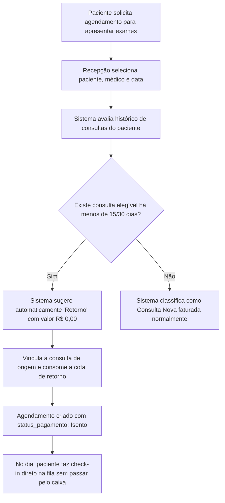

# SPEC-0013 — Gestão de Retornos e Prazos Assistenciais

| Campo | Valor |
| :--- | :--- |
| **ID** | SPEC-0013 |
| **Título** | Gestão de Retornos e Prazos Assistenciais |
| **Status** | Rascunho |
| **Versão** | 0.1 |
| **Data** | 2026-10-02 |
| **Autor** | Antigravity AI / Equipe CANAMED |
| **Revisores** | Responsável pelo Projeto CANAMED |
| **Módulos afetados** | backend (Domain, Application, Api), frontend (agenda, recepção, checkout de balcão, workspace do médico), banco de dados |
| **ADRs relacionados** | ADR-0006 (.NET/React), ADR-0007 (EF Core), ADR-0008 (segurança) |

---

## 1. Objetivo

Regulamentar, automatizar e operacionalizar a gestão de consultas de retorno médico no CANAMED em estrita conformidade com a **Resolução CFM nº 1.958/2010**, identificando automaticamente a elegibilidade de pacientes para retorno sem cobrança dentro do prazo de carência estipulado pela clínica, prevenindo cobranças indevidas no balcão e conferindo transparência à relação médico-paciente.

Pergunta de controle do `GEMINI.md`: **isso reduz atrito na rotina da clínica?**
Sim. Elimina atritos e discussões financeiras na recepção sobre cobrança de retorno, impede que o paciente seja cobrado indevidamente ao levar exames complementares e automatiza o cálculo de repasses médicos sem intervenção manual de planilhas.

---

## 2. Contexto

A definição sobre o que configura "consulta" e o que configura "retorno" é uma das fontes mais frequentes de atrito entre pacientes, secretárias e médicos em clínicas ambulatoriais.

Pela **Resolução CFM nº 1.958/2010**, a consulta médica compreende a anamnese, o exame físico, a formulação de hipóteses diagnósticas, a solicitação de exames complementares e a conduta terapêutica. Quando a avaliação clínica exigir a realização de exames complementares cujos resultados não possam ser apreciados no mesmo dia, o comparecimento do paciente para a leitura e conclusão diagnóstica daquele mesmo evento **constitui ato continuado da mesma consulta**, não cabendo a cobrança de novos honorários desde que realizado dentro do prazo estipulado pelo médico ou clínica.

Contudo, se o paciente ultrapassar o prazo de carência ou comparecer com queixa de uma nova afecção clínica, configura-se uma nova consulta. Esta especificação formaliza os parâmetros do sistema para diferenciar automaticamente essas situações.

---

## 3. Escopo

### 3.1 Dentro do escopo
- Parametrização da política de prazo de retorno por clínica e por especialidade (ex: padrão de 15 dias corridos, extensível para 21 ou 30 dias em especialidades de alta complexidade laboratorial/biópsias);
- Validação automática de elegibilidade no momento do agendamento (SPEC-0002) ou do check-in na recepção (SPEC-0005);
- Vinculação formal do retorno à consulta de origem (`originating_appointment_id`);
- Impacto financeiro no balcão (SPEC-0008): consultas classificadas como retorno dentro da carência recebem valor R$ 0,00 e status `isento`, liberando a passagem imediata para a fila de atendimento;
- Limite padrão de 1 (um) retorno gratuito por consulta faturada realizada;
- Tratamento de exceções: autorização de "Retorno Cortesia" pelo gestor ou médico mesmo se expirado o prazo, com registro da justificativa;
- Desclassificação clínica pelo médico durante a consulta se constatada nova queixa não relacionada à anterior;
- Relatórios de produtividade diferenciando consultas primárias de consultas de retorno para cálculo de repasses e indicadores.

### 3.2 Fora do escopo
- Arbitragem de glosas com operadoras de planos de saúde (faturamento TISS de convênios segue as tabelas e regras próprias das operadoras).

---

## 4. Atores e Permissões

| Ator | Permissões necessárias | Observações |
| :--- | :--- | :--- |
| **Gestor da Clínica** | `clinics:configure_returns`, `appointments:override_return` | Configura as políticas de prazo por especialidade e autoriza exceções de cortesia fora do prazo. |
| **Recepcionista** | `appointments:create`, `queue:checkin` | Visualiza o indicador de elegibilidade no agendamento/check-in. |
| **Médico / Profissional** | `appointments:override_return`, `records:create` | Pode estender o prazo de retorno do seu paciente ou desclassificar o retorno em caso de nova queixa. |

---

## 5. Regras de Negócio

| ID | Regra | Justificativa / Origem |
| :--- | :--- | :--- |
| **RN-001** | A clínica define uma política de retorno padrão em dias corridos (default: 15 dias), podendo cadastrar prazos diferenciados por especialidade médica (ex: Dermatologia/Biópsia: 30 dias). | Resolução CFM nº 1.958/2010 (Art. 2º). |
| **RN-002** | Para ser elegível a retorno gratuito, o agendamento deve preencher cumulativamente os requisitos: (1) mesmo paciente, (2) mesmo médico e mesma especialidade, (3) data da consulta dentro da janela de carência da consulta anterior faturada e (4) não ter utilizado previamente a cota de retorno daquela consulta. | Definição ética e assistencial de continuidade do ato médico. |
| **RN-003** | Ao agendar ou realizar check-in, o sistema verifica a elegibilidade e sinaliza visualmente com a tag "Retorno Elegível (Restam X dias)". | Orientação à recepção e agilidade na marcação. |
| **RN-004** | A consulta classificada como retorno isento tem seu valor fixado em R$ 0,00 e o status de pagamento marcado automaticamente como `isento`, não exigindo cobrança de caixa no balcão. | Eliminação de cobranças indevidas e atritos de balcão (SPEC-0008). |
| **RN-005** | Se o paciente comparecer após o vencimento do prazo de retorno, o sistema classifica a consulta como `consulta_regular` com valor integral, exibindo o aviso "Prazo de retorno expirado há X dias". | Previsibilidade comercial e regra contratual. |
| **RN-006** | O gestor ou o próprio médico podem autorizar excepcionalmente um "Retorno Cortesia" para consultas fora do prazo, mediante seleção expressa e preenchimento da justificativa (ex: "Atraso na entrega de resultado de ressonância pelo laboratório"). | Flexibilidade humanizada na rotina assistencial. |
| **RN-007** | Caso o paciente em retorno compareça relatando uma enfermidade completamente distinta daquela tratada na consulta inicial, o médico tem a prerrogativa de converter a consulta em nova consulta médica, gerando a respectiva cobrança. | Art. 3º da Resolução CFM nº 1.958/2010. |
| **RN-008** | Cada consulta realizada dá direito a exatamente 1 (um) retorno de acompanhamento. Consultas subsequentes exigem novo agendamento regular, salvo concessão expressa do profissional. | Sustentabilidade operacional da agenda médica. |

---

## 6. Fluxos

### 6.1 Fluxo Principal — F-001: Agendamento e Check-in de Retorno Dentro do Prazo



1. O paciente entra em contato ou comparece para marcar o retorno de exames;
2. A recepcionista busca o paciente e seleciona o médico;
3. O sistema detecta a consulta original realizada há 10 dias e informa: *"Paciente elegível a retorno até 17/10/2026"*;
4. O agendamento é registrado como tipo `Retorno`, associado ao agendamento de origem;
5. O valor é R$ 0,00 e o status financeiro é marcado como `isento`;
6. No dia do atendimento, o paciente faz check-in imediato na fila de espera, sem necessidade de pagamento no balcão.

### 6.2 Fluxo Alternativo — F-002: Retorno Fora do Prazo com Autorização de Cortesia

1. O paciente solicita agendamento 25 dias após a consulta inicial (prazo padrão: 15 dias);
2. O sistema exibe o alerta: *"Prazo de retorno expirado há 10 dias. Consulta regular com cobrança"*;
3. O paciente alega que o laboratório atrasou a liberação da biópsia;
4. O recepcionista ou médico clica em "Autorizar Retorno Cortesia" e preenche a justificativa;
5. O agendamento é registrado com a cota liberada e auditoria do autor da concessão.

---

## 7. Modelo de Dados

### 7.1 Tabela de Políticas de Retorno (`clinic_return_policies`)

| Campo | Tipo | Obrigatório | Descrição |
| :--- | :--- | :--- | :--- |
| `id` | `UUID` | Sim | Chave primária |
| `clinic_id` | `UUID` | Sim | FK `clinics(id)` |
| `specialty_id` | `UUID` | Não | FK `specialties(id)` (se nulo, aplica-se a toda a clínica) |
| `grace_period_days` | `INT` | Sim | Prazo de carência em dias corridos (default: 15) |
| `max_return_count` | `INT` | Sim | Número de retornos permitidos por consulta (default: 1) |
| `allow_override` | `BOOLEAN` | Sim | Permite cortesia mediante justificativa (default: `true`) |

### 7.2 Atualização na Entidade `Appointment` (Tabela `appointments`)

Campos complementares para rastreabilidade:
- `is_return` (`BOOLEAN`, default: `false`)
- `originating_appointment_id` (`UUID`, nulo, FK para `appointments(id)`)
- `return_override_reason` (`VARCHAR(300)`, nulo, justificativa caso concedido por cortesia)
- `return_overridden_by` (`UUID`, nulo, FK para `users(id)`)

---

## 8. Contrato de API

### 8.1 Consultar Elegibilidade de Retorno do Paciente
- **Método / Rota:** `GET /api/v1/patients/{patientId}/return-eligibility?doctorId={doctorId}&specialtyId={specialtyId}`
- **Autorização:** `appointments:create`
- **Retorno:** `200 OK`:
  ```json
  {
    "isEligible": true,
    "originatingAppointmentId": "3fa85f64-5717-4562-b3fc-2c963f66afa6",
    "originatingAppointmentDate": "2026-09-22T10:00:00Z",
    "gracePeriodDays": 15,
    "expirationDate": "2026-10-07T23:59:59Z",
    "daysRemaining": 5,
    "hasAvailableReturnSlot": true
  }
  ```

### 8.2 Configurar Política de Retornos da Clínica
- **Método / Rota:** `POST /api/v1/clinic-operations/return-policies`
- **Autorização:** `clinics:configure_returns` (Perfil: `gestor`)
- **Entrada:**
  ```json
  {
    "specialtyId": null,
    "gracePeriodDays": 21,
    "maxReturnCount": 1,
    "allowOverride": true
  }
  ```
- **Retorno:** `200 OK`.

---

## 9. Interface e Experiência

| Componente | Estado | Comportamento |
| :--- | :--- | :--- |
| **Formulário de Agendamento** | Preenchimento | Ao selecionar o paciente e o médico, badge informativo verde surge automaticamente: *"Elegível a Retorno Gratuito (expira em 5 dias)"*. Ao selecionar a opção de retorno, o campo de valor financeiro é desabilitado e marcado como R$ 0,00. |
| **Aviso de Prazo Expirado** | Alerta | Se o prazo expirou, badge em cinza/amarelo indica: *"Prazo de retorno expirou em 28/09/2026"*, acompanhado de botão sutil: *"Autorizar Cortesia"*. |
| **Card da Agenda / Fila** | Exibição | Tag visível `Retorno` em azul petróleo, distinguindo os atendimentos de retorno das consultas de primeira vez. |

---

## 10. Critérios de Aceitação

| ID | Critério |
| :--- | :--- |
| **CA-001** | **Dado** um paciente com consulta faturada realizada há 8 dias (prazo da clínica de 15 dias), **Quando** agendar nova consulta com o mesmo médico, **Então** o sistema sinaliza elegibilidade a retorno e sugere valor R$ 0,00. |
| **CA-002** | **Dado** um paciente elegível, **Quando** o agendamento for concluído como retorno, **Então** o agendamento é vinculado à consulta de origem e a cota de retorno é consumida. |
| **CA-003** | **Dado** uma consulta já associada a um retorno utilizado, **Quando** o paciente tentar marcar um segundo retorno, **Então** o sistema avisa que a cota já foi consumida e classifica como nova consulta faturada. |
| **CA-004** | **Dado** um paciente cuja consulta ocorreu há 20 dias (expirado o prazo de 15 dias), **Quando** a recepção selecionar o agendamento, **Então** o sistema calcula como consulta regular com valor integral. |
| **CA-005** | **Dado** uma consulta fora do prazo, **Quando** o gestor ou médico acionar "Autorizar Cortesia" informando o motivo, **Então** o agendamento é gravado como retorno isento com justificativa registrada em auditoria. |
| **CA-006** | **Dado** um agendamento de retorno, **Quando** o paciente fizer check-in no balcão, **Então** o status do pagamento é `isento` e ele entra na fila de espera sem solicitação de cobrança. |

---

## 11. Casos de Erro

| ID | Gatilho | Comportamento esperado | Mensagem ao usuário | Registro |
| :--- | :--- | :--- | :--- | :--- |
| **ER-001** | Tentativa de autorizar cortesia sem fornecer justificativa textual | Bloquear operação com `400 Bad Request` | "A justificativa é obrigatória para a concessão de retorno fora do prazo legal." | Validação local |
| **ER-002** | Configuração de prazo de carência negativo ou superior a 90 dias | Rejeitar com `400 Bad Request` | "O prazo de retorno deve ser um número positivo entre 1 e 90 dias." | Validação de domínio |

---

## 12. Impacto em Outras Funcionalidades

| Módulo | Tipo de Impacto | Ação Necessária |
| :--- | :--- | :--- |
| **Agenda (SPEC-0002)** | Direto | Exibição de badge de elegibilidade e cálculo de dias restantes na tela de marcação. |
| **Pagamentos (SPEC-0008)** | Direto | Isenção automática de cobrança no balcão para atendimentos com tag de retorno. |
| **Workspace do Médico (SPEC-0012)** | Direto | Identificação da consulta como retorno de exames na visualização do consultório. |
| **Dashboards (SPEC-0007)** | Direto | Métricas de produção segregam consultas iniciais de retornos para cálculo de faturamento real. |

---

## 13. Requisitos de Segurança e Legais

- [x] Respeito estrito à **Resolução CFM nº 1.958/2010** quanto à continuidade do ato médico;
- [x] Trilha de auditoria indelével registrando quem concedeu autorizações de cortesia fora do prazo;
- [x] Proteção contra fraudes na utilização duplicada da cota de retorno;
- [x] Conformidade com o Código de Defesa do Consumidor na transparência de prazos informados ao paciente.

---

## 14. Requisitos Não Funcionais

| Categoria | Requisito |
| :--- | :--- |
| **Desempenho** | Verificação de elegibilidade de retorno em menos de 100ms via consulta indexada em `appointments(patient_id, doctor_id, start_at)`. |
| **Clareza de Interface** | Mensagens e badges autoexplicativos sem ambiguidades conceituais. |

---

## 15. Testes Previstos

| Tipo | Cobertura Mínima |
| :--- | :--- |
| **Unitário** | Cálculo de dias de carência, expiração de prazos e validação de parâmetros de política. |
| **Integração** | Endpoint de verificação de elegibilidade, criação de agendamento de retorno vinculado e validação de isenção no balcão. |
| **Comportamento** | Ciclo completo: agendamento inicial pago -> passagem de dias -> verificação de elegibilidade de retorno -> agendamento de retorno isento. |

---

## 16. Auditoria e Observabilidade

| Evento | Recurso Afetado | Dados Registrados |
| :--- | :--- | :--- |
| `ReturnPolicyUpdated` | `clinic_return_policies` | `clinic_id`, `specialty_id`, `grace_period_days`, `user_id` |
| `ReturnAppointmentCreated` | `appointments` | `appointment_id`, `originating_appointment_id`, `patient_id`, `doctor_id` |
| `ReturnOverrideGranted` | `appointments` | `appointment_id`, `granted_by`, `reason`, `timestamp` |

---

## 17. Pendências e Questões Abertas

| ID | Questão | Responsável | Status |
| :--- | :--- | :--- | :--- |
| **Q-001** | Em caso de cancelamento e remarcação do retorno pelo próprio paciente, a data de carência original permanece ou é congelada? | Jurídico / Produto | Permanece a data limite contada da consulta original, salvo cortesia autorizada. |

---

## 18. Histórico de Revisões

| Versão | Data | Autor | Alteração |
| :--- | :--- | :--- | :--- |
| 0.1 | 2026-10-02 | Antigravity AI | Versão inicial completa da especificação de Gestão de Retornos e Prazos Assistenciais. |

---

## 19. Aprovação

| Papel | Nome | Data | Status |
| :--- | :--- | :--- | :--- |
| **Autor** | Antigravity AI | 2026-10-02 | Elaborada |
| **Aprovador** | Responsável pelo Projeto | Pendente | Aguardando revisão |
