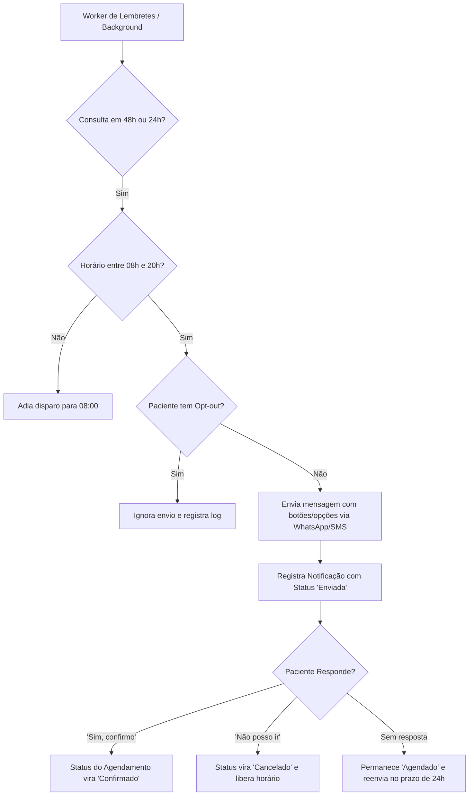

# SPEC-0014 — Notificações e Lembretes Ativos (WhatsApp / SMS)

| Campo | Valor |
| :--- | :--- |
| **ID** | SPEC-0014 |
| **Título** | Notificações e Lembretes Ativos de Consulta com Confirmação e Cancelamento via WhatsApp e SMS |
| **Status** | Implementada |
| **Versão** | 1.0 |
| **Data** | 2026-10-03 |
| **Autor** | Antigravity AI / Equipe CANAMED |
| **Revisores** | Responsável pelo Projeto CANAMED |
| **Módulos afetados** | backend (Domain, Application, Infrastructure, Api, Background Services), frontend (configuração de templates na gestão, histórico de mensagens na agenda e recepção), banco de dados (schema `notifications`) |
| **ADRs relacionados** | ADR-0003 (dados pessoais e de saúde), ADR-0006 (.NET/React), ADR-0007 (EF Core/PostgreSQL), ADR-0008 (segurança e auditoria) |

---

## 1. Objetivo

Automatizar o envio de lembretes ativos pré-consulta e comunicados operacionais via WhatsApp e SMS, permitindo que o paciente confirme ou cancele sua presença com um clique ou resposta simplificada, atualizando instantaneamente a grade da agenda médica ([SPEC-0002](0002-spec-agenda-de-consultas.md)), reduzindo drasticamente o índice de faltas (*no-show*) e otimizando a taxa de ocupação dos consultórios.

Pergunta de controle do `GEMINI.md`: **isso reduz atrito na rotina da clínica?**
Sim. Elimina a necessidade de recepcionistas gastarem horas diárias ligando manualmente para cada paciente para confirmar horários, previne ociosidade médica por esquecimento do paciente e libera horários cancelados com antecedência para reencaixe.

---

## 2. Contexto

O absenteísmo não informado em consultas ambulatoriais (*no-show*) varia entre 20% e 35% no cenário brasileiro. Esse comportamento gera prejuízo financeiro para a clínica, tempo ocioso para os profissionais de saúde e impede que outros pacientes que aguardam na fila ou em lista de espera consigam atendimento oportuno.

Atualmente, o CANAMED possui controle de agendamento (SPEC-0002), mas a confirmação depende de ação manual dos operadores da recepção. A implementação de uma mensageria ativa e bidirecional conecta o paciente ao sistema da clínica de forma ágil, respeitando os preceitos da LGPD (Art. 7º e 11) com gestão transparente de consentimento e opção de *opt-out*.

---

## 3. Escopo

### 3.1 Dentro do escopo
- Disparo automatizado de lembretes de consulta com janelas programáveis (padrão: 48h e 24h antes da consulta);
- Processamento de respostas do paciente (Confirmação, Cancelamento e Pedido de Reagendamento);
- Atualização em tempo real do status do agendamento na agenda ([SPEC-0002](0002-spec-agenda-de-consultas.md)) e recepção ([SPEC-0005](0005-spec-fila-de-espera-e-ciclo-de-atendimento.md));
- Interface de simulação de envio para ambiente de desenvolvimento e testes locais sem custos de API externa;
- Adaptador com suporte a provedores de WhatsApp Business API e SMS transacional;
- Mecanismo rigoroso de *opt-out* (descadastramento a pedido do paciente conforme LGPD);
- Histórico auditável de mensagens disparadas e respostas recebidas vinculado ao agendamento.

### 3.2 Fora do escopo
- Chatbot complexo com inteligência artificial generativa de triagem clínica diagnóstica (para evitar enquadramento como dispositivo médico ANVISA RDC nº 657/2022);
- Disparo em massa de campanhas publicitárias ou promocionais de marketing não assistencial;
- Negociação financeira de descontos ou cobranças via chat.

---

## 4. Atores e Permissões

| Ator | Permissão necessária | Observações |
| :--- | :--- | :--- |
| **Paciente** | Acesso público tokenizado / Webhook | Interage respondendo mensagem via WhatsApp/SMS ou link seguro com token temporário |
| **Recepcionista** | `agenda:write` ou `notifications:read` | Visualiza status da confirmação do paciente e histórico de envios |
| **Gestor da Clínica**| `notifications:manage` | Configura janelas de envio, horários de disparo e templates institucionais |
| **Sistema (Cron/Worker)** | Execução em background | Varre agendamentos pendentes de lembrete e executa disparos em lote |

---

## 5. Regras de Negócio

| ID | Regra | Justificativa / Origem |
| :--- | :--- | :--- |
| **RN-001** | **Janelas de Disparo Pré-Consulta:** Os lembretes devem ser agendados para 48h e 24h antes do horário da consulta. Se o agendamento for criado com menos de 24h de antecedência, um único lembrete imediato deve ser disparado após 15 minutos da criação. | Boas práticas de engajamento e redução de absenteísmo. |
| **RN-002** | **Janela de Horário Ético:** Mensagens só podem ser enviadas entre 08h00 e 20h00 (horário local da clínica). Disparos previstos para o período noturno devem ser enfileirados e postergados para as 08h00 do dia seguinte. | Respeito ao descanso do paciente e compliance com normas de proteção ao consumidor. |
| **RN-003** | **Confirmação Ativa:** Quando o paciente responder confirmando (ex: digitando "1" ou clicando em "Sim, confirmo"), o agendamento muda seu status para `Confirmado`. | Automatização de processos operacionais de recepção. |
| **RN-004** | **Cancelamento com Desocupação Imediata:** Quando o paciente responder cancelando (ex: "2" ou "Não poderei ir"), o agendamento é marcado como `CanceladoPeloPaciente` com motivo registrado, liberando imediatamente o horário na grade médica. | Otimização da ocupação e liberação de vagas para encaixe. |
| **RN-005** | **Direito de Opt-Out (LGPD):** Toda mensagem deve conter orientação de cancelamento de recebimento (ex: "Responda SAIR para não receber mais lembretes"). Caso solicitado, o número de telefone é marcado como `OptedOut`, bloqueando envios subsequentes automáticos. | Art. 8º e 18 da LGPD (revogação de consentimento). |
| **RN-006** | **Privacidade e Sigilo Médico:** O texto do lembrete deve conter data, horário, nome do profissional e endereço da clínica, mas **nunca** deve citar suspeitas diagnósticas, CID-10, ou termos clínicos estigmatizantes no corpo da mensagem. | Sigilo médico e Código de Ética Médica (CFM). |
| **RN-007** | **Tolerância a Falhas e Idempotência:** Cada tentativa de envio deve possuir chave de idempotência (`appointment_id + trigger_type`), impedindo disparos duplicados para o mesmo paciente no mesmo ciclo. | Integridade de sistema e experiência do usuário. |

---

## 6. Fluxos

### 6.1 Fluxo Principal: Disparo e Confirmação de Consulta (F-001)

### 6.2 Fluxos Alternativos e Exceções

- **F-002 — Falha na Entrega (Número Inválido / Sem WhatsApp):** O sistema detecta a falha, registra no histórico do agendamento e gera alerta visual para a recepção ("Telefone com falha de entrega — contatar manualmente").
- **F-003 — Pedido de Reagendamento:** Se o paciente responder solicitando reagendamento, o agendamento recebe a tag `ReagendamentoSolicitado`, notificando a recepção com atalho direto para a grade do profissional.

---

## 7. Modelo de Dados

### Tabela: `appointment_notifications` (schema `notifications`)

| Campo | Tipo | Obrigatório | Regra / Índice | Classificação LGPD |
| :--- | :--- | :--- | :--- | :--- |
| `id` | `UUID` | Sim | Chave primária | Anônimo |
| `clinic_id` | `UUID` | Sim | FK `clinics.id`, Index | Anônimo |
| `appointment_id` | `UUID` | Sim | FK `appointments.id`, Index | Anônimo |
| `patient_id` | `UUID` | Sim | FK `patients.id`, Index | Anônimo |
| `channel` | `VARCHAR(20)` | Sim | `whatsapp`, `sms` | Anônimo |
| `recipient_phone` | `VARCHAR(20)` | Sim | Formato E.164 | Pessoal comum |
| `trigger_type` | `VARCHAR(30)` | Sim | `reminder_48h`, `reminder_24h`, `instant_confirmation` | Anônimo |
| `status` | `VARCHAR(20)` | Sim | `pending`, `sent`, `delivered`, `failed`, `replied` | Anônimo |
| `message_body` | `TEXT` | Sim | Texto sanitizado sem dado clínico sensível | Pessoal comum |
| `response_payload`| `TEXT` | Não | Texto ou botão recebido do paciente | Pessoal comum |
| `idempotency_key` | `VARCHAR(100)`| Sim | Unique (`appointment_id`, `trigger_type`) | Anônimo |
| `sent_at` | `TIMESTAMPTZ`| Não | Data/hora do envio | Anônimo |
| `replied_at` | `TIMESTAMPTZ`| Não | Data/hora da resposta | Anônimo |
| `created_at` | `TIMESTAMPTZ`| Sim | Default `NOW()` | Anônimo |

### Tabela: `patient_communication_preferences` (schema `notifications`)

| Campo | Tipo | Obrigatório | Regra / Índice | Classificação LGPD |
| :--- | :--- | :--- | :--- | :--- |
| `id` | `UUID` | Sim | Chave primária | Anônimo |
| `patient_id` | `UUID` | Sim | Unique, FK `patients.id` | Anônimo |
| `whatsapp_enabled`| `BOOLEAN` | Sim | Default `true` | Anônimo |
| `sms_enabled` | `BOOLEAN` | Sim | Default `true` | Anônimo |
| `opted_out_at` | `TIMESTAMPTZ`| Não | Data do opt-out | Anônimo |
| `opt_out_reason` | `VARCHAR(150)`| Não | Motivo declarado | Pessoal comum |

---

## 8. Contrato de API

| Método | Rota | Autorização | Descrição |
| :--- | :--- | :--- | :--- |
| `POST` | `/api/notifications/reminders/process` | Background / `agenda:write` | Dispara processamento em lote da fila de lembretes pendentes |
| `POST` | `/api/notifications/webhook/incoming` | Chave de Webhook / Pública | Recebe callback de resposta do WhatsApp/SMS e processa confirmação |
| `GET` | `/api/notifications/appointments/{appointmentId}/history` | `agenda:read` | Retorna histórico de mensagens e respostas de um agendamento |
| `POST` | `/api/notifications/opt-out` | Pública tokenizada ou `agenda:write` | Registra revogação de consentimento de mensageria para o paciente |
| `POST` | `/api/notifications/test-send` | `notifications:manage` | Envio de teste para validação de número e template em ambiente DEV |

---

## 9. Interface e Experiência

- **Na Agenda e Recepção:** Ícones visuais de status da mensagem:
  - 🟡 *Aguardando envio* (relógio)
  - 🔵 *Enviado / Não respondido* (um check)
  - 🟢 *Confirmado pelo paciente via WhatsApp* (balão verde com check duplo)
  - 🔴 *Cancelado pelo paciente* (ícone de recusa com liberação do horário em destaque)
- **Simulador de Mensagens (DEV):** Painel acessível para testar respostas de simulação ("Sim", "Não", "Sair") sem consumir APIs externas pagas.

---

## 10. Critérios de Aceitação

| ID | Critério |
| :--- | :--- |
| **CA-001** | **Dado** uma consulta agendada para daqui a 48h, **Quando** o processador de lembretes rodar às 09h00, **Então** deve criar o registro de notificação, enviar a mensagem e marcar o agendamento com lembrete enviado. |
| **CA-002** | **Dado** que o paciente recebe o lembrete e responde "1" (Confirmo), **Quando** o webhook processar a resposta, **Então** o status do agendamento deve ser atualizado para `Confirmado` e o evento auditado. |
| **CA-003** | **Dado** que o paciente responde "2" (Não posso ir), **Quando** o webhook processar o cancelamento, **Então** o agendamento é cancelado, o horário é liberado na grade e a recepção é alertada. |
| **CA-004** | **Dado** que um paciente possui preferência `whatsapp_enabled = false` ou `opted_out_at` preenchido, **Quando** o disparador for executado, **Então** nenhuma mensagem deve ser enviada para seu número. |

---

## 11. Casos de Erro

| ID | Gatilho | Comportamento Esperado | Mensagem ao Usuário | Registro |
| :--- | :--- | :--- | :--- | :--- |
| **ER-001** | Telefone em formato inválido ou ausente | Não enfileira mensagem; marca status como `failed` | "Telefone do paciente não possui formato válido para envio." | Log com ID do agendamento |
| **ER-002** | Webhook recebe resposta para agendamento inexistente ou já finalizado | Rejeita atualização e responde com HTTP 200/400 seguro sem expor dados internos | Mensagem genérica de recepção | Auditoria de webhook |
| **ER-003** | Provedor externo fora do ar | Aplica retry com backoff exponencial; se persistir, alerta recepção | "Serviço de mensageria temporariamente indisponível." | Log de erro estruturado |

---

## 12. Impacto em Outras Funcionalidades

- **SPEC-0002 (Agenda):** Ganha visualização em tempo real do status de confirmação do paciente.
- **SPEC-0005 (Fila de Espera):** Pacientes confirmados via WhatsApp têm triagem e check-in agilizados.
- **SPEC-0017 (Check-in Autônomo):** Utiliza o status de confirmação prévia para liberar check-in express no totem.

---

## 13. Requisitos de Segurança

- [x] Chave de webhook e assinatura de cabeçalho (`X-Hub-Signature`) validadas no backend.
- [x] Proteção contra spoofing de respostas em canais abertos.
- [x] Nenhum dado de saúde (diagnóstico, queixa, sintomas) transmitido em notificações push ou WhatsApp sem autenticação.
- [x] Rate limiting aplicado no endpoint receptor de webhooks.

---

## 14. Requisitos Legais Aplicáveis

| Norma | Aplicável? | O que exige nesta funcionalidade |
| :--- | :--- | :--- |
| **LGPD (Lei nº 13.709/2018)** | Sim | Base legal de execução de contrato / legítimo interesse com direito a *opt-out* simples e revogação imediata (Art. 8º e 18). |
| **Código de Ética Médica (CFM)** | Sim | Sigilo da relação médico-paciente. Não divulgar especialidades ou tratamentos que possam gerar constrangimento em canais compartilhados. |
| **Marco Civil da Internet** | Sim | Guarda de logs de conexão e envio de mensagens para fins de rastreabilidade. |

---

## 15. Requisitos Não Funcionais

- **Desempenho:** Processamento de respostas e atualização do status da agenda em menos de 1,5 segundos.
- **Idempotência:** Garantia de que múltiplos cliques do paciente não disparem transações concorrentes na agenda.
- **Simulação Local:** Provedor em memória totalmente funcional para desenvolvimento e testes automatizados.

---

## 16. Testes Previstos

- **Testes Unitários:** Validação de regras de janela de horário ético (08h-20h), geração de texto sem dados sensíveis e lógica de opt-out.
- **Testes de Integração:** Simulação de webhook de confirmação e cancelamento com verificação de efeito colateral na tabela `appointments`.

---

## 17. Auditoria e Observabilidade

| Evento | Recurso Afetado | Dados Registrados |
| :--- | :--- | :--- |
| `NotificationEnqueued` | `appointment_notifications` | `appointment_id`, `patient_id`, `channel`, `trigger_type` |
| `NotificationSent` | `appointment_notifications` | `notification_id`, `recipient_phone`, `sent_at` |
| `AppointmentConfirmedByPatient` | `appointments` | `appointment_id`, `channel`, `timestamp` |
| `AppointmentCancelledByPatient` | `appointments` | `appointment_id`, `channel`, `reason`, `timestamp` |
| `PatientCommunicationOptOut` | `patient_communication_preferences` | `patient_id`, `timestamp`, `channel` |

---

## 18. Pendências e Questões Abertas

| ID | Questão | Responsável | Status |
| :--- | :--- | :--- | :--- |
| **Q-001** | Em produção, qual provedor de WhatsApp oficial (Meta Cloud API direta, Z-API ou Twilio) será configurado? | Infra / Gestão | O sistema utilizará arquitetura desacoplada via adapter (`ISmsWhatsAppProvider`), permitindo plugar qualquer gateway. |

---

## 19. Histórico de Revisões

| Versão | Data | Autor | Alteração |
| :--- | :--- | :--- | :--- |
| 0.1 | 2026-10-03 | Antigravity AI | Versão inicial da especificação de Lembretes Ativos e Confirmação via WhatsApp/SMS. |

---

## 20. Aprovação

| Papel | Nome | Data | Status |
| :--- | :--- | :--- | :--- |
| **Autor** | Antigravity AI | 2026-10-03 | Elaborada |
| **Aprovador** | Responsável pelo Projeto | Pendente | Aguardando revisão |
