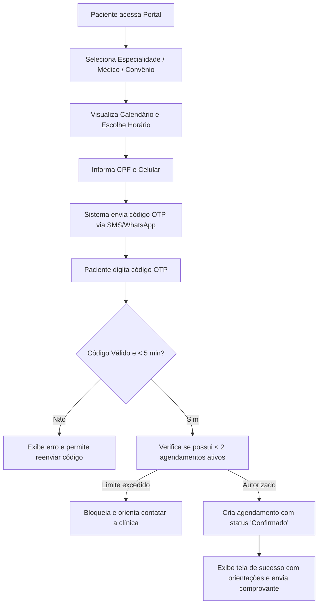

# SPEC-0015 — Agendamento Online e Portal do Paciente

| Campo | Valor |
| :--- | :--- |
| **ID** | SPEC-0015 |
| **Título** | Agendamento Online Público e Portal do Paciente com Autenticação Passwordless (OTP) |
| **Status** | Implementada |
| **Versão** | 1.0 |
| **Data** | 2026-10-03 |
| **Autor** | Antigravity AI / Equipe CANAMED |
| **Revisores** | Responsável pelo Projeto CANAMED |
| **Módulos afetados** | backend (Domain, Application, Infrastructure, Api), frontend (portal público web e responsivo mobile do paciente), banco de dados (schema `portal`) |
| **ADRs relacionados** | ADR-0003 (dados pessoais e de saúde), ADR-0006 (.NET/React), ADR-0007 (EF Core/PostgreSQL), ADR-0008 (segurança e rate-limiting) |

---

## 1. Objetivo

Disponibilizar uma interface web pública, rápida e intuitiva para que pacientes possam consultar a grade de horários disponíveis dos profissionais de saúde por especialidade, selecionar convênios aceitos ou modalidade particular, e realizar o autoagendamento da sua consulta com confirmação de identidade por senha descartável (OTP via SMS/WhatsApp), sem necessidade de instalação de aplicativos pesados ou cadastro de senhas complexas.

Pergunta de controle do `GEMINI.md`: **isso reduz atrito na rotina da clínica?**
Sim. Desafoga a central telefônica e o WhatsApp da recepção, permite que o paciente marque consultas 24 horas por dia, 7 dias por semana (inclusive fora do horário comercial), e preenche os dados cadastrais diretamente na base, diminuindo erros de digitação.

---

## 2. Contexto

A maior parte dos contatos de primeiro nível em clínicas médicas consiste em solicitações de "Quais horários têm disponíveis para o médico X?". Esse processo consome grande parte do tempo da equipe de recepção, gerando filas de espera no atendimento presencial e insatisfação no paciente que precisa ligar várias vezes.

O CANAMED já conta com infraestrutura de agenda (SPEC-0002), catálogo assistencial (SPEC-0004) e gestão de salas/horários de funcionamento (SPEC-0006). A SPEC-0015 expõe essas regras de forma segura para o público externo através de uma camada orientada a autosserviço (portal do paciente).

---

## 3. Escopo

### 3.1 Dentro do escopo
- Catálogo público de especialidades, profissionais e convênios aceitos por clínica;
- Busca dinâmica de horários livres em tempo real com prevenção de conflitos e overbooking;
- Fluxo de autenticação *passwordless* via código OTP (6 dígitos) enviado ao celular do paciente;
- Conclusão do agendamento com escolha de forma de pagamento (no balcão na chegada ou pré-pago via PIX);
- Portal simplificado ("Minhas Consultas") onde o paciente visualiza seus agendamentos futuros e passados;
- Cancelamento e reagendamento autônomo com respeito às políticas de prazo da clínica;
- Proteção contra bots e reservas em massa (Rate Limiting e CAPTCHA simplificado quando necessário).

### 3.2 Fora do escopo
- Criação de prontuário ou preenchimento de anamnese profunda pelo paciente (deve ocorrer na triagem e atendimento médico);
- Telemedicina com videoconferência integrada (planejada para fase futura);
- Gestão de prontuários de terceiros sem representação legal comprovada.

---

## 4. Atores e Permissões

| Ator | Permissão necessária | Observações |
| :--- | :--- | :--- |
| **Paciente Não Autenticado** | Acesso público | Consulta especialidades, profissionais credenciados e horários vagos |
| **Paciente Autenticado (OTP)**| Token de Sessão de Paciente | Reserva consultas em seu CPF, visualiza seus agendamentos e cancela |
| **Recepcionista / Gestor** | `agenda:read` / `agenda:write` | Visualiza agendamentos marcados como origem "Online" na agenda interna |

---

## 5. Regras de Negócio

| ID | Regra | Justificativa / Origem |
| :--- | :--- | :--- |
| **RN-001** | **Disponibilidade em Tempo Real:** Apenas horários sem agendamentos ativos, que estejam dentro do horário de atendimento da clínica ([SPEC-0006](0006-spec-gestao-operacional-da-clinica.md)) e que não possuam bloqueio médico ([SPEC-0002](0002-spec-agenda-de-consultas.md)) podem ser ofertados. | Integridade absoluta da grade clínica. |
| **RN-002** | **Identificação Sem Senha (OTP):** A identificação do paciente é realizada via número de celular + CPF. Um código numérico aleatório de 6 dígitos é gerado, com validade de 5 minutos e limite de 3 tentativas de validação. | Princípio de simplicidade e segurança sem fricção de senhas esquecidas. |
| **RN-003** | **Limite de Agendamentos Concorrentes:** Um paciente só pode manter no máximo **2 consultas futuras ativas simultâneas** agendadas via portal online. Novas marcações exigem a realização da consulta anterior ou cancelamento. | Prevenção contra abusos, reservas abusivas e no-show malicioso. |
| **RN-004** | **Trava de Antecedência Mínima e Máxima:** O agendamento online só é permitido para horários entre **2 horas no futuro** (tempo hábil de deslocamento) e **45 dias à frente** (evita grades congeladas). | Eficiência de gestão de agenda ambulatorial. |
| **RN-005** | **Cancelamento Autônomo:** O paciente pode cancelar seu agendamento pelo portal com até **2 horas de antecedência**. Cancelamentos com menos de 2 horas exigem contato telefônico com a recepção. | Política de ocupação e possibilidade de remanejamento de vagas. |
| **RN-006** | **Origem Rastreada:** Todo agendamento criado via portal é registrado com o metadado `Origin = Online` e vinculado ao IP e canal de confirmação. | Rastreabilidade e análise de canais no dashboard gerencial. |
| **RN-007** | **Tratamento de Dados Mínimos (LGPD):** São exigidos estritamente: Nome Completo, CPF, Celular e Data de Nascimento. O cadastro de endereço completo e foto é opcional no portal e pode ser completado na recepção. | Princípio da necessidade e minimização de dados (LGPD Art. 6º, III). |

---

## 6. Fluxos

### 6.1 Fluxo de Autoagendamento Online (F-001)

### 6.2 Fluxo de Consulta de "Meus Agendamentos" e Cancelamento (F-002)

1. Paciente acessa "Minhas Consultas" digitando celular e validando OTP;
2. Visualiza listagem de consultas futuras (data, hora, médico, clínica e endereço);
3. Pode clicar em "Cancelar Consulta", confirmar o motivo e liberar a grade imediatamente.

---

## 7. Modelo de Dados

### Tabela: `patient_otp_codes` (schema `portal`)

| Campo | Tipo | Obrigatório | Regra / Índice | Classificação LGPD |
| :--- | :--- | :--- | :--- | :--- |
| `id` | `UUID` | Sim | PK | Anônimo |
| `phone` | `VARCHAR(20)` | Sim | Index | Pessoal comum |
| `cpf` | `VARCHAR(14)` | Sim | Formato 000.000.000-00 | Pessoal comum |
| `code_hash` | `VARCHAR(128)`| Sim | Hash seguro SHA-256 do código | Anônimo |
| `expires_at` | `TIMESTAMPTZ`| Sim | Validade de 5 minutos | Anônimo |
| `attempts_count` | `INTEGER` | Sim | Default 0, Max 3 | Anônimo |
| `verified_at` | `TIMESTAMPTZ`| Não | Data de validação | Anônimo |
| `created_at` | `TIMESTAMPTZ`| Sim | Default `NOW()` | Anônimo |

### Tabela: `patient_portal_sessions` (schema `portal`)

| Campo | Tipo | Obrigatório | Regra / Índice | Classificação LGPD |
| :--- | :--- | :--- | :--- | :--- |
| `id` | `UUID` | Sim | PK | Anônimo |
| `patient_id` | `UUID` | Sim | FK `patients.id`, Index | Anônimo |
| `session_token`| `VARCHAR(64)` | Sim | Unique, Token seguro criptográfico | Anônimo |
| `expires_at` | `TIMESTAMPTZ`| Sim | Validade de 24 horas | Anônimo |
| `ip_address` | `VARCHAR(45)` | Não | Endereço IP do solicitante | Pessoal comum |
| `user_agent` | `TEXT` | Não | Navegador utilizado | Anônimo |

---

## 8. Contrato de API

| Método | Rota | Autorização | Descrição |
| :--- | :--- | :--- | :--- |
| `GET` | `/api/public/booking/clinics/{clinicId}/specialties` | Pública | Lista especialidades disponíveis na clínica |
| `GET` | `/api/public/booking/clinics/{clinicId}/slots` | Pública | Retorna slots livres por especialidade, profissional e data |
| `POST` | `/api/public/booking/auth/request-otp` | Pública (Rate-limited) | Gera e envia código OTP para o celular |
| `POST` | `/api/public/booking/auth/verify-otp` | Pública (Rate-limited) | Valida OTP e retorna `session_token` do paciente |
| `POST` | `/api/public/booking/appointments` | Token Paciente | Efetiva a reserva de consulta online |
| `GET` | `/api/public/booking/patient/appointments` | Token Paciente | Lista agendamentos do paciente autenticado |
| `POST` | `/api/public/booking/patient/appointments/{id}/cancel` | Token Paciente | Cancela agendamento com antecedência mínima |

---

## 9. Interface e Experiência

- **Design Responsivo Mobile-First:** Interface limpa, com tipografia legível, botões de toque generosos e etapas numeradas (*stepper* visual):
  1. *Especialidade e Médico*
  2. *Data e Horário*
  3. *Identificação do Paciente*
  4. *Confirmação Final*
- **Acessibilidade:** Compatível com navegação por teclado e leitores de tela (WCAG AA).
- **Sem Telas Poluídas:** Nada de propagandas ou excesso de formulários antes da escolha do horário.

---

## 10. Critérios de Aceitação

| ID | Critério |
| :--- | :--- |
| **CA-001** | **Dado** um paciente acessando a página pública, **Quando** selecionar a especialidade e data, **Então** o sistema deve listar apenas horários vagos e não conflitantes. |
| **CA-002** | **Dado** que o paciente informou CPF e celular válidos, **Quando** clicar em "Continuar", **Então** um código OTP de 6 dígitos deve ser gerado e enviado por mensagem. |
| **CA-003** | **Dado** que o paciente digita o código correto dentro de 5 minutos, **Quando** confirmar a reserva, **Então** o agendamento é salvo na agenda com status `Confirmado` e metadado `Origem: Online`. |
| **CA-004** | **Dado** um paciente que já possui 2 agendamentos futuros não realizados, **Quando** tentar reservar um terceiro, **Então** o sistema bloqueia e orienta a concluir ou cancelar os existentes. |

---

## 11. Casos de Erro

| ID | Gatilho | Comportamento Esperado | Mensagem ao Usuário | Registro |
| :--- | :--- | :--- | :--- | :--- |
| **ER-001** | Concorrência de slot: dois pacientes tentam o mesmo horário simultaneamente | O primeiro a confirmar ganha o slot; o segundo é alertado com atualização imediata da grade | "Este horário acabou de ser preenchido por outro paciente. Por favor, selecione outro horário." | Log de conflito otimista |
| **ER-002** | Código OTP digitado incorretamente 3 vezes | Invalida o código e exige nova solicitação | "Número de tentativas excedido. Solicite um novo código." | Auditoria de segurança |
| **ER-003** | Tentativa de cancelamento com menos de 2 horas da consulta | Bloqueia operação no portal | "Cancelamentos com menos de 2 horas de antecedência devem ser solicitados diretamente à recepção da clínica." | Registro no agendamento |

---

## 12. Impacto em Outras Funcionalidades

- **SPEC-0002 (Agenda):** Agendamentos online entram com identificador visual específico (`Online`) para a recepção saber a origem.
- **SPEC-0014 (Lembretes WhatsApp):** Agendamentos online já ingressam na esteira automática de confirmação de 48h/24h.
- **SPEC-0017 (Totem Check-in):** Permite reconhecimento instantâneo do agendamento feito pela internet.

---

## 13. Requisitos de Segurança

- [x] Proteção anti-brute force no envio de OTP (máximo de 3 solicitações por IP/celular a cada 10 minutos).
- [x] Código OTP armazenado apenas na forma de hash criptográfico (nunca em texto claro).
- [x] Validação de CPF com algoritmo de dígitos verificadores oficial.
- [x] Isolamento de dados: paciente só acessa agendamentos vinculados ao seu próprio CPF validado.

---

## 14. Requisitos Legais Aplicáveis

| Norma | Aplicável? | O que exige nesta funcionalidade |
| :--- | :--- | :--- |
| **LGPD (Lei nº 13.709/2018)** | Sim | Base legal de tutela da saúde / execução de procedimentos preliminares a pedido do titular (Art. 7º, V e Art. 11, II, f). |
| **Código de Defesa do Consumidor** | Sim | Informação clara e prévia de preços de consultas particulares e regras de cancelamento. |

---

## 15. Requisitos Não Funcionais

- **Tempo de Resposta:** Listagem de slots livres em menos de 800ms.
- **Disponibilidade:** Alta disponibilidade (99,8%), suportando acessos noturnos e de fins de semana.

---

## 16. Testes Previstos

- **Testes Unitários:** Geração e expiração de OTP, trava de máximo de 2 agendamentos concorrentes, bloqueio de horários passados.
- **Testes de Integração:** Fluxo ponta a ponta desde solicitação de OTP, reserva do slot e reflexo na tabela `appointments`.

---

## 17. Auditoria e Observabilidade

| Evento | Recurso Afetado | Dados Registrados |
| :--- | :--- | :--- |
| `OtpRequested` | `patient_otp_codes` | `phone`, `ip_address`, `timestamp` |
| `OtpVerified` | `patient_portal_sessions` | `patient_id`, `phone`, `timestamp` |
| `OnlineAppointmentBooked` | `appointments` | `appointment_id`, `patient_id`, `clinic_id`, `slot_time`, `origin` |
| `OnlineAppointmentCancelled` | `appointments` | `appointment_id`, `patient_id`, `reason`, `timestamp` |

---

## 18. Pendências e Questões Abertas

| ID | Questão | Responsável | Status |
| :--- | :--- | :--- | :--- |
| **Q-001** | Devemos exigir pagamento antecipado obrigatório via PIX para consultas particulares online? | Gestão da Clínica | O sistema tornará isso configurável por clínica (pagamento no local ou online prévio). |

---

## 19. Histórico de Revisões

| Versão | Data | Autor | Alteração |
| :--- | :--- | :--- | :--- |
| 0.1 | 2026-10-03 | Antigravity AI | Versão inicial da especificação de Agendamento Online e Portal do Paciente. |

---

## 20. Aprovação

| Papel | Nome | Data | Status |
| :--- | :--- | :--- | :--- |
| **Autor** | Antigravity AI | 2026-10-03 | Elaborada |
| **Aprovador** | Responsável pelo Projeto | Pendente | Aguardando revisão |
