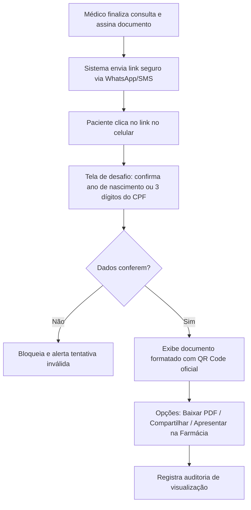

# SPEC-0016 — Carteira Digital e Acesso a Documentos Clínicos

| Campo | Valor |
| :--- | :--- |
| **ID** | SPEC-0016 |
| **Título** | Carteira Digital e Acesso Seguro a Receitas, Atestados e Exames Assinados Digitalmente |
| **Status** | Rascunho |
| **Versão** | 0.1 |
| **Data** | 2026-10-03 |
| **Autor** | Antigravity AI / Equipe CANAMED |
| **Revisores** | Responsável pelo Projeto CANAMED |
| **Módulos afetados** | backend (Application, Infrastructure, Api), frontend (visualizador público de documentos, carteira do paciente no portal), banco de dados |
| **ADRs relacionados** | ADR-0003 (dados de saúde), ADR-0006 (.NET/React), ADR-0007 (EF Core), ADR-0008 (segurança) |

---

## 1. Objetivo

Fornecer ao paciente uma experiência digital segura e sem atrito para acessar, visualizar, baixar em PDF e compartilhar suas receitas médicas, atestados de saúde e pedidos de exames laboratoriais/imagem emitidos pelo médico ([SPEC-0011](0011-spec-prescricao-eletronica-atestados-e-documentos-clinicos.md)), garantindo a validade jurídica nacional (ICP-Brasil), permitindo a dispensação direta em farmácias e eliminando o extravio de papéis.

Pergunta de controle do `GEMINI.md`: **isso reduz atrito na rotina da clínica?**
Sim. Elimina a necessidade de o paciente retornar fisicamente à clínica para solicitar 2ª via de receita perdida ou atestado rasgado, e reduz o tempo de atendimento da recepção com reimpressões de balcão.

---

## 2. Contexto

A emissão de receitas e documentos clínicos eletrônicos com assinatura digital no padrão ICP-Brasil foi implementada na SPEC-0011. Contudo, para que o ecossistema assistencial se complete, o paciente necessita de um canal direto e intuitivo para acessar esses documentos sem depender de e-mails que caem no spam ou de anexos pesados.

Além disso, drogarias e farmácias de manipulação precisam conferir a integridade da receita no ato da dispensação, conforme as exigências da Anvisa (RDC nº 44/2009 e Portaria nº 344/1998) e do Conselho Federal de Farmácia (CFF).

---

## 3. Escopo

### 3.1 Dentro do escopo
- Página de visualização web pública e responsiva para o documento clínico, acessível através de link curto seguro ou leitura do QR Code impresso;
- Proteção por segundo fator simplificado (confirmação dos 3 primeiros dígitos do CPF ou data de nascimento) para visualização completa;
- Download em PDF com certificação digital visual e hash SHA-256 de integridade;
- Carteira Digital integrada ao Portal do Paciente ([SPEC-0015](0015-spec-agendamento-online-e-portal-do-paciente.md)), listando o histórico de todos os documentos emitidos;
- Interface para conferência e validação pública de autenticidade por farmácias e órgãos periciais;
- Compartilhamento facilitado via botão WhatsApp / e-mail diretamente do smartphone do paciente.

### 3.2 Fora do escopo
- Sistema de compra ou e-commerce de medicamentos integrado (fora do propósito assistencial);
- Alteração ou edição do conteúdo do documento (o documento é rigorosamente imutável).

---

## 4. Atores e Permissões

| Ator | Permissão necessária | Observações |
| :--- | :--- | :--- |
| **Paciente** | Link seguro tokenizado ou Sessão OTP | Acessa e baixa seus próprios documentos clínicos |
| **Farmacêutico / Terceiro** | Validação pública por token / QR Code | Valida integridade e confere registro profissional (CRM) |
| **Recepcionista** | `documents:print` | Reemprime vias no balcão a pedido do paciente |
| **Médico Emissor** | `documents:prescribe` | Consulta documentos emitidos e cancela em caso de erro |

---

## 5. Regras de Negócio

| ID | Regra | Justificativa / Origem |
| :--- | :--- | :--- |
| **RN-001** | **Validade Jurídica e Integridade:** O documento renderizado ou baixado em PDF deve corresponder byte a byte ao conteúdo assinado pelo médico na SPEC-0011, exibindo o hash criptográfico SHA-256 e o carimbo do tempo. | MP 2.200-2/2001 e Lei nº 14.063/2020. |
| **RN-002** | **Proteção contra Acesso Indevido (LGPD):** Ao clicar no link público recebido por SMS/WhatsApp, o paciente deve confirmar os 3 primeiros dígitos do seu CPF ou o ano de nascimento antes que o conteúdo sensível de medicamentos/diagnósticos seja exibido em tela. | Prevenção de vazamento acidental em caso de número compartilhado. |
| **RN-003** | **Sigilo de Diagnóstico em Atestados:** Em atestados médicos, a CID-10 só deve constar no documento visualizado se o paciente houver manifestado autorização expressa documentada na consulta ([SPEC-0011](0011-spec-prescricao-eletronica-atestados-e-documentos-clinicos.md)). | Art. 73 do Código de Ética Médica (CFM). |
| **RN-004** | **Controle de Dispensação Farmacêutica:** O validador público deve permitir que farmacêuticos registrem a dispensação (parcial ou total) de receitas de controle especial, prevenindo o reuso indevido da mesma receita em múltiplas drogarias. | Portaria SVS/MS nº 344/1998 e RDC ANVISA nº 44/2009. |
| **RN-005** | **Identificação Clara do Profissional:** Todo documento deve exibir de forma destacada o nome completo do médico, número de inscrição no CRM, estado (UF) e especialidade/RQE quando aplicável. | Resoluções CFM nº 1.821/2007 e 2.217/2018. |
| **RN-006** | **Rastreabilidade de Downloads:** Todo download ou visualização de documento clínico deve gerar registro de auditoria com IP, data, hora e identificação do canal. | Trilha de auditoria e segurança da informação. |

---

## 6. Fluxos

### 6.1 Fluxo de Acesso do Paciente ao Documento (F-001)

### 6.2 Fluxo de Conferência Farmacêutica (F-002)

1. Farmacêutico escaneia o QR Code do documento com o leitor da drogaria ou acessa a URL de validação;
2. O sistema exibe o status oficial: `Válido e Assinado`, nome do médico, CRM/UF e medicamentos prescritos;
3. O farmacêutico visualiza a via oficial original, atestando a ausência de adulteração física ou digital.

---

## 7. Modelo de Dados

A SPEC-0016 consome a estrutura de persistência criada na [SPEC-0011](0011-spec-prescricao-eletronica-atestados-e-documentos-clinicos.md) (`medical_documents`), adicionando o rastreamento de acessos externos:

### Tabela: `medical_document_access_logs` (schema `medical_documents`)

| Campo | Tipo | Obrigatório | Regra / Índice | Classificação LGPD |
| :--- | :--- | :--- | :--- | :--- |
| `id` | `UUID` | Sim | PK | Anônimo |
| `medical_document_id` | `UUID` | Sim | FK `medical_documents.id`, Index | Anônimo |
| `access_type` | `VARCHAR(30)` | Sim | `patient_view`, `patient_download`, `pharmacy_verification` | Anônimo |
| `ip_address` | `VARCHAR(45)` | Não | Endereço IP do dispositivo | Pessoal comum |
| `user_agent` | `TEXT` | Não | Dispositivo/Navegador | Anônimo |
| `accessed_at` | `TIMESTAMPTZ`| Sim | Default `NOW()` | Anônimo |

---

## 8. Contrato de API

| Método | Rota | Autorização | Descrição |
| :--- | :--- | :--- | :--- |
| `GET` | `/api/public/documents/{token}` | Pública (Tokenizada) | Retorna metadados e conteúdo sanitizado para exibição |
| `POST` | `/api/public/documents/{token}/unlock` | Pública (Tokenizada) | Desbloqueia visualização completa mediante confirmação cadastral |
| `GET` | `/api/public/documents/{token}/pdf` | Pública (Tokenizada) | Gera e retorna o stream do PDF assinado para download |
| `GET` | `/api/public/patients/documents` | Token Paciente (OTP) | Lista todos os documentos emitidos para o paciente logado |
| `POST` | `/api/public/documents/{token}/dispense` | Pública (Farmácia) | Registra dispensação farmacêutica no documento |

---

## 9. Interface e Experiência

- **Visualizador Web Otimizado para Mobile:**
  - Layout limpo, com cabeçalho institucional CANAMED em padrão oficial;
  - Botão flutuante destacado: `📥 Baixar PDF` e `📲 Compartilhar via WhatsApp`;
  - Selo visual de autenticidade verde com cadeado: *"Documento Assinado Digitalmente — ICP-Brasil"*;
  - Abas claras para Posologia, Orientações de Uso e Duração do Tratamento.

---

## 10. Critérios de Aceitação

| ID | Critério |
| :--- | :--- |
| **CA-001** | **Dado** um token válido de receita médica, **Quando** o paciente acessar o link e confirmar seus dados cadastrais, **Então** o sistema exibe os itens da prescrição com dados do médico e QR Code de validação. |
| **CA-002** | **Dado** que o paciente clica em "Baixar PDF", **Quando** a requisição for processada, **Então** o PDF gerado deve conter o timbre oficial CANAMED, informações completas e certificado ICP-Brasil legível. |
| **CA-003** | **Dado** um atestado médico emitido sem consentimento para CID-10, **Quando** for visualizado ou baixado, **Então** o campo CID-10 deve constar expressamente omitido por sigilo ético médico. |
| **CA-004** | **Dado** uma tentativa de acesso a um documento inexistente ou com token revogado, **Quando** a página for carregada, **Então** deve exibir mensagem clara de erro sem expor informações de banco de dados. |

---

## 11. Casos de Erro

| ID | Gatilho | Comportamento Esperado | Mensagem ao Usuário | Registro |
| :--- | :--- | :--- | :--- | :--- |
| **ER-001** | Token inválido ou expirado | Retorna HTTP 404 e tela orientando contatar a clínica | "Documento clínico não localizado ou link expirado." | Log de tentativa inválida |
| **ER-002** | Erro na confirmação de segurança (ano/CPF não confere) | Bloqueia exibição e permite nova tentativa | "Dados de confirmação não conferem com o titular da receita." | Auditoria de segurança |
| **ER-003** | Documento cancelado pelo médico assistente | Exibe tarja vermelha com motivo do cancelamento e data | "Este documento foi cancelado pelo profissional responsável." | Log de verificação |

---

## 12. Impacto em Outras Funcionalidades

- **SPEC-0011 (Prescrição e Documentos):** Conecta a emissão feita pelo médico no consultório à experiência final do paciente.
- **SPEC-0014 (Lembretes e Mensageria):** Utiliza o link público da carteira digital para envio automatizado de receitas por WhatsApp.
- **SPEC-0015 (Portal do Paciente):** Adiciona a aba "Minhas Receitas e Atestados" na área autenticada do paciente.

---

## 13. Requisitos de Segurança

- [x] Tokens públicos gerados com alta entropia criptográfica (mínimo 256 bits).
- [x] Proteção anti-scraping com limitação de requisições por IP no endpoint de validação pública.
- [x] Não indexação por mecanismos de busca (cabeçalho `X-Robots-Tag: noindex, nofollow`).

---

## 14. Requisitos Legais Aplicáveis

| Norma | Aplicável? | O que exige nesta funcionalidade |
| :--- | :--- | :--- |
| **Lei nº 14.063/2020** | Sim | Regula o uso de assinaturas eletrônicas em documentos de saúde e receituários. |
| **Portaria SVS/MS nº 344/1998** | Sim | Critérios para prescrição e controle de substâncias sob controle especial. |
| **Código de Ética Médica (Art. 73)** | Sim | Proibição de revelação de diagnóstico e CID sem consentimento expresso do paciente. |

---

## 15. Requisitos Não Funcionais

- **Geração de PDF:** Renderização e download do arquivo PDF em menos de 1,2 segundos.
- **Compatibilidade:** Visualização perfeita em navegadores móveis (Chrome, Safari, Firefox no iOS e Android).

---

## 16. Testes Previstos

- **Testes Unitários:** Validação de desafio de confirmação cadastral, formatação de posologia e omissão de CID sem consentimento.
- **Testes de Integração:** Endpoint de download de PDF, verificação de hash SHA-256 e registro de log de acesso.

---

## 17. Auditoria e Observabilidade

| Evento | Recurso Afetado | Dados Registrados |
| :--- | :--- | :--- |
| `DocumentViewedByPatient` | `medical_documents` | `document_id`, `ip_address`, `timestamp` |
| `DocumentPdfDownloaded` | `medical_documents` | `document_id`, `ip_address`, `timestamp` |
| `DocumentVerifiedByThirdParty` | `medical_documents` | `document_id`, `verifier_type`, `timestamp` |

---

## 18. Pendências e Questões Abertas

| ID | Questão | Responsável | Status |
| :--- | :--- | :--- | :--- |
| **Q-001** | Devemos integrar com o Validador Nacional do ITI/CFM diretamente na tela? | Produto / Jurídico | O documento já traz link direto e QR Code para o validador oficial do ITI. |

---

## 19. Histórico de Revisões

| Versão | Data | Autor | Alteração |
| :--- | :--- | :--- | :--- |
| 0.1 | 2026-10-03 | Antigravity AI | Versão inicial da especificação de Carteira Digital e Acesso a Documentos Clínicos. |

---

## 20. Aprovação

| Papel | Nome | Data | Status |
| :--- | :--- | :--- | :--- |
| **Autor** | Antigravity AI | 2026-10-03 | Elaborada |
| **Aprovador** | Responsável pelo Projeto | Pendente | Aguardando revisão |
