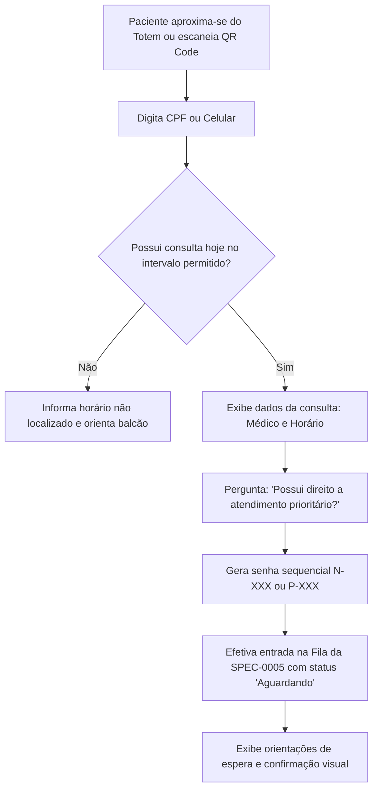

# SPEC-0017 — Check-in Autônomo na Recepção (Totem / QR Code)

| Campo | Valor |
| :--- | :--- |
| **ID** | SPEC-0017 |
| **Título** | Check-in Autônomo na Recepção via Totem de Autoatendimento e QR Code Mobile |
| **Status** | Rascunho |
| **Versão** | 0.1 |
| **Data** | 2026-10-03 |
| **Autor** | Antigravity AI / Equipe CANAMED |
| **Revisores** | Responsável pelo Projeto CANAMED |
| **Módulos afetados** | backend (Application, Infrastructure, Api), frontend (modo quiosque em tela cheia / interface web móvel de check-in), banco de dados |
| **ADRs relacionados** | ADR-0006 (.NET/React), ADR-0007 (EF Core/PostgreSQL), ADR-0008 (segurança) |

---

## 1. Objetivo

Permitir que pacientes que já possuam consulta agendada realizem a confirmação de sua chegada à clínica de forma 100% autônoma através de um terminal físico (totem) ou lendo um QR Code com seu próprio celular na entrada da unidade, retirando sua senha de atendimento e ingressando imediatamente na fila de espera da recepção e triagem ([SPEC-0005](0005-spec-fila-de-espera-e-ciclo-de-atendimento.md)), eliminando aglomerações e filas no balcão.

Pergunta de controle do `GEMINI.md`: **isso reduz atrito na rotina da clínica?**
Sim. Elimina a fila de pacientes em pé no balcão da recepção apenas para avisar "cheguei para a minha consulta", liberando os recepcionistas para atendimentos mais complexos, autorização de convênios e cadastro de novos pacientes.

---

## 2. Contexto

Nos horários de pico (início da manhã e início da tarde), a recepção de clínicas médicas sofre com picos de congestionamento. Pacientes que chegam no horário pontual para suas consultas frequentemente ficam esperando na fila física atrás de pessoas que estão negociando orçamentos ou autorizando guias demoradas.

A SPEC-0017 conecta a agenda existente (SPEC-0002) diretamente ao fluxo da fila de espera (SPEC-0005), permitindo que o paciente pontual anuncie sua presença em menos de 10 segundos, receba sua senha (física ou digital) e aguarde confortavelmente sentado a chamada para a triagem (SPEC-0009) ou consultório (SPEC-0012).

---

## 3. Escopo

### 3.1 Dentro do escopo
- Interface em modo Totem/Quiosque (touchscreen em tela cheia) com botões grandes e acessíveis;
- Modo QR Code de entrada ("Totem Mobile"): paciente aponta a câmera do celular para o QR Code no balcão e faz o check-in em seu próprio dispositivo;
- Busca do agendamento do dia por CPF ou número de celular;
- Seleção de prioridade legal de atendimento conforme as Leis nº 10.048/2000 e 10.741/2003 (idosos, gestantes, PCDs);
- Entrada em tempo real na fila do dia da clínica com status `Aguardando`;
- Exibição de senha alfanumérica e acompanhamento da posição na fila pelo celular;
- Notificação instantânea no painel da recepção de que o paciente realizou auto-check-in.

### 3.2 Fora do escopo
- Reconhecimento facial biométrico por inteligência artificial (desnecessário nesta fase inicial e com alto risco regulatório de privacidade);
- Pagamento em dinheiro físico em cédulas no totem (pagamentos particulares continuam no balcão ou via PIX no celular).

---

## 4. Atores e Permissões

| Ator | Permissão necessária | Observações |
| :--- | :--- | :--- |
| **Paciente no Totem / Mobile**| Acesso público / Totem Mode | Confirma presença no agendamento do dia e emite senha |
| **Recepcionista** | `agenda:write` | Visualiza check-ins autônomos no painel da fila em tempo real |
| **Gestor da Clínica**| `clinic:manage` | Configura modo totem e imprime QR Code de recepção |

---

## 5. Regras de Negócio

| ID | Regra | Justificativa / Origem |
| :--- | :--- | :--- |
| **RN-001** | **Janela de Tolerância de Chegada:** O auto-check-in só é permitido para consultas marcadas para o dia atual, no intervalo entre **60 minutos antes** e **15 minutos após** o horário agendado. | Prevenção de fila prematura ou check-in de pacientes com atraso grave. |
| **RN-002** | **Tratamento de Atraso (> 15 minutos):** Se o paciente tentar check-in autônomo com mais de 15 minutos de atraso, o totem exibe mensagem amigável instruindo-o a comparecer ao balcão para verificar possibilidade de encaixe com o médico assistente. | Gestão operacional de pontualidade da clínica. |
| **RN-003** | **Prioridades Legais Obrigatórias:** A interface deve questionar com destaque se o paciente se enquadra em atendimento prioritário legal (Idosos 60+, Idosos 80+ superprioridade, Gestantes, Lactantes, Pessoas com Deficiência e Autistas — Lei nº 10.048/2000). | Cumprimento legal inegociável de atendimento prioritário no Brasil. |
| **RN-004** | **Numeração de Senhas Sequenciais:** A senha gerada segue o padrão `N-XXX` (Normal) ou `P-XXX` (Preferencial), reiniciando a contagem diariamente por clínica. | Organização clara do fluxo e painéis de TV. |
| **RN-005** | **Check-in Único por Consulta:** Um agendamento não pode receber mais de um check-in no mesmo dia. Tentativas repetidas apenas reexibem a senha já emitida. | Idempotência e integridade da fila de espera. |
| **RN-006** | **Acompanhamento no Smartphone:** No modo QR Code mobile, o paciente mantém a página aberta no navegador do celular e acompanha em tempo real quantas pessoas estão na sua frente na fila. | Conforto do paciente e redução da ansiedade na sala de espera. |

---

## 6. Fluxos

### 6.1 Fluxo de Auto-check-in no Totem / QR Code (F-001)

### 6.2 Fluxo Alternativo: Consulta Particular Pendente de Pagamento (F-002)

Se a consulta for particular e a clínica exigir pagamento prévio que ainda não tenha sido liquidado online, o totem emite a senha e orienta: *"Senha emitida com sucesso! Por favor, passe no balcão de atendimento para validar seu pagamento antes da triagem."*

---

## 7. Modelo de Dados

Consome a tabela `queue_entries` da [SPEC-0005](0005-spec-fila-de-espera-e-ciclo-de-atendimento.md), enriquecendo o registro com a origem do check-in:

### Campos Adicionados em `queue_entries`:
- `check_in_origin`: `VARCHAR(20)` (`desk`, `kiosk`, `mobile_qrcode`);
- `ticket_code`: `VARCHAR(10)` (ex: `N-001`, `P-002`);
- `kiosk_session_id`: `UUID` (para rastreabilidade do terminal).

---

## 8. Contrato de API

| Método | Rota | Autorização | Descrição |
| :--- | :--- | :--- | :--- |
| `POST` | `/api/kiosk/check-in/search` | Pública / Kiosk | Localiza agendamentos do dia por CPF ou celular na clínica |
| `POST` | `/api/kiosk/check-in/confirm` | Pública / Kiosk | Efetiva o check-in na fila e retorna a senha emitida |
| `GET` | `/api/kiosk/tickets/{ticketCode}/status` | Pública / Kiosk | Consulta posição atual e tempo estimado de espera na fila |

---

## 9. Interface e Experiência

- **Modo Totem Físico:**
  - Tema escuro/alto contraste com tipografia ampliada para facilitar a leitura por idosos;
  - Teclado virtual numérico grande e responsivo na tela;
  - Botão de saída rápida / início limpo a cada 30 segundos de inatividade para proteção de dados do paciente anterior.
- **Modo QR Code Mobile:**
  - Tela leve, carregamento ultrarrápido em redes 4G/5G móveis;
  - Exibição de cartão da senha com animação sutil quando o paciente é chamado.

---

## 10. Critérios de Aceitação

| ID | Critério |
| :--- | :--- |
| **CA-001** | **Dado** um paciente com consulta agendada para as 10h00, **Quando** realizar o check-in às 09h30 digitando seu CPF no totem, **Então** o sistema localiza a consulta, gera a senha e insere a entrada na fila de espera. |
| **CA-002** | **Dado** que o paciente selecionou "Atendimento Prioritário (Idoso / PCD)", **Quando** confirmar o check-in, **Então** a senha deve receber o prefixo `P-` e prioridade `Preferencial` na fila. |
| **CA-003** | **Dado** um paciente chegando com 30 minutos de atraso, **Quando** tentar o check-in, **Então** o totem orienta o paciente a procurar a recepção humana. |
| **CA-004** | **Dado** que o check-in foi concluído, **Quando** o painel da recepção for consultado, **Então** o paciente já deve constar na lista da fila com a tag `Totem`. |

---

## 11. Casos de Erro

| ID | Gatilho | Comportamento Esperado | Mensagem ao Usuário | Registro |
| :--- | :--- | :--- | :--- | :--- |
| **ER-001** | CPF não encontrado nos agendamentos do dia | Não gera senha; orienta a recepção | "Nenhum agendamento localizado para hoje com este CPF. Por favor, dirija-se à nossa recepção." | Log de busca |
| **ER-002** | Tentativa de check-in para consulta de outro dia | Alerta data correta do agendamento | "Sua consulta está marcada para outro dia. Por favor, consulte nossa equipe." | Log de validação |

---

## 12. Impacto em Outras Funcionalidades

- **SPEC-0005 (Fila de Espera):** Recebe entradas de pacientes de forma autônoma sem passar pelo operador.
- **SPEC-0009 (Triagem):** A enfermagem visualiza a ordem de chegada imediatamente e pode chamar os prioritários.

---

## 13. Requisitos de Segurança

- [x] Limpeza automática da tela e encerramento de sessão do totem após 30 segundos de inatividade (evita que o próximo usuário veja o CPF ou nome do paciente anterior).
- [x] Ocultação parcial de dados na confirmação (exibição de nome como `Maria F. da S.` e CPF mascarado `***.***.123-**`).

---

## 14. Requisitos Legais Aplicáveis

| Norma | Aplicável? | O que exige nesta funcionalidade |
| :--- | :--- | :--- |
| **Lei nº 10.048/2000** | Sim | Obrigatoriedade de atendimento prioritário a idosos, gestantes, lactantes e PCDs. |
| **Lei nº 10.741/2003 (Estatuto do Idoso)** | Sim | Prioridade especial a maiores de 80 anos sobre os demais idosos. |
| **LGPD (Lei nº 13.709/2018)** | Sim | Não expor dados pessoais completos na tela pública do totem. |

---

## 15. Requisitos Não Funcionais

- **Velocidade do Check-in:** Conclusão completa em menos de 15 segundos por paciente.
- **Resiliência:** Operação contínua mesmo se a internet oscilar momentaneamente na unidade.

---

## 16. Testes Previstos

- **Testes Unitários:** Validação das regras de tolerância de horário e categorização de prioridade.
- **Testes de Integração:** Criação de entrada na fila a partir do endpoint do totem e validação de concorrência de senhas.

---

## 17. Auditoria e Observabilidade

| Evento | Recurso Afetado | Dados Registrados |
| :--- | :--- | :--- |
| `KioskCheckInCompleted` | `queue_entries` | `queue_entry_id`, `ticket_code`, `priority`, `clinic_id`, `timestamp` |
| `KioskSearchFailed` | `audit_logs` | `search_term_hash`, `clinic_id`, `timestamp` |

---

## 18. Pendências e Questões Abertas

| ID | Questão | Responsável | Status |
| :--- | :--- | :--- | :--- |
| **Q-001** | Devemos acoplar impressora térmica física USB/Rede para tickets de papel? | Infra / Operação | O sistema suportará impressão via driver ESC/POS e o modo mobile sem papel (eco-friendly). |

---

## 19. Histórico de Revisões

| Versão | Data | Autor | Alteração |
| :--- | :--- | :--- | :--- |
| 0.1 | 2026-10-03 | Antigravity AI | Versão inicial da especificação de Check-in Autônomo na Recepção. |

---

## 20. Aprovação

| Papel | Nome | Data | Status |
| :--- | :--- | :--- | :--- |
| **Autor** | Antigravity AI | 2026-10-03 | Elaborada |
| **Aprovador** | Responsável pelo Projeto | Pendente | Aguardando revisão |
