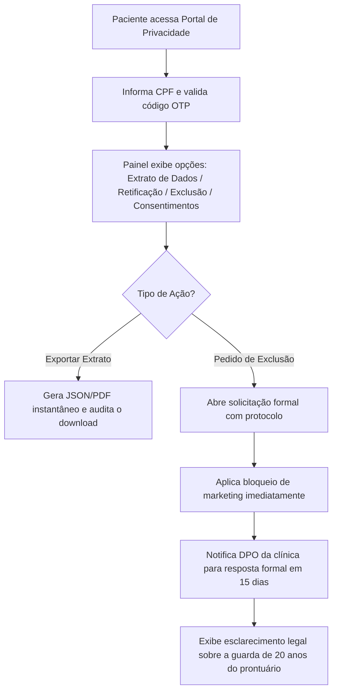

# SPEC-0018 — Portal de Autonomia e Direitos do Titular (LGPD)

| Campo | Valor |
| :--- | :--- |
| **ID** | SPEC-0018 |
| **Título** | Portal de Autonomia e Exercício dos Direitos do Titular de Dados (Art. 18 da LGPD) |
| **Status** | Rascunho |
| **Versão** | 0.1 |
| **Data** | 2026-10-03 |
| **Autor** | Antigravity AI / Equipe CANAMED |
| **Revisores** | Responsável pelo Projeto CANAMED |
| **Módulos afetados** | backend (Domain, Application, Infrastructure, Api), frontend (portal de privacidade do paciente, painel interno de gestão de requisições LGPD do DPO), banco de dados (schema `privacy`) |
| **ADRs relacionados** | ADR-0003 (dados pessoais e de saúde), ADR-0006 (.NET/React), ADR-0007 (PostgreSQL), ADR-0008 (segurança e auditoria) |

---

## 1. Objetivo

Disponibilizar aos pacientes um canal centralizado, transparente e auditável para o exercício dos seus direitos de titular de dados pessoais previstos no **Artigo 18 da Lei Geral de Proteção de Dados (Lei nº 13.709/2018 — LGPD)**, incluindo confirmação da existência de tratamento, acesso aos dados, correção de cadastros incompletos, exportação estruturada em formato aberto (portabilidade) e revogação de consentimentos, estabelecendo a conciliação técnica entre a privacidade e o dever legal de guarda médica de prontuários por no mínimo 20 anos (**Lei Federal nº 13.787/2018**).

Pergunta de controle do `GEMINI.md`: **isso reduz atrito na rotina da clínica?**
Sim. Organiza as obrigações regulatórias da clínica em um fluxo padronizado, prevenindo multas e sanções administrativas da ANPD, automatiza a emissão de relatórios de dados sem sobrecarregar a equipe jurídica e confere confiança e transparência na relação com o paciente.

---

## 2. Contexto

O CANAMED lida diretamente com dados pessoais comuns (nome, CPF, telefone) e **dados pessoais sensíveis de saúde** (consultas, prontuários SOAP, diagnósticos, medicações prescritas e triagem de risco). O Artigo 18 da LGPD assegura a todo titular o direito de obter do controlador informações claras sobre o tratamento de seus dados a qualquer momento.

Contudo, na área médica, o direito de eliminação não é absoluto: a guarda dos prontuários e registros assistenciais é uma obrigação legal impositiva de 20 anos estabelecida pela Lei Federal nº 13.787/2018 e pelo Conselho Federal de Medicina (CFM). A SPEC-0018 implementa a governança exata para atender aos direitos do titular sem violar a legislação médica e sanitária vigente.

---

## 3. Escopo

### 3.1 Dentro do escopo
- Painel público e autenticado via OTP para que o paciente consulte os dados pessoais e categorias de dados tratados pela clínica;
- Emissão de Relatório de Transparência do Titular (dados cadastrais, agendamentos realizados e profissionais assistentes);
- Exportação dos dados cadastrais em formato interoperável aberto (JSON e PDF seguro);
- Formulário formal para solicitação de retificação cadastral, eliminação e revogação de consentimentos de comunicação;
- Geração de número de protocolo único para acompanhamento do pedido com prazo legal de resposta (até 15 dias);
- Painel administrativo para o Encarregado pelo Tratamento de Dados Pessoais (DPO) da clínica gerenciar e responder às solicitações dos titulares.

### 3.2 Fora do escopo
- Exclusão ou anonimização prematura de prontuários eletrônicos protegidos pelo prazo legal de 20 anos da Lei nº 13.787/2018;
- Gestão de dados de colaboradores internos e médicos (foco estrito no paciente como titular assistencial).

---

## 4. Atores e Permissões

| Ator | Permissão necessária | Observações |
| :--- | :--- | :--- |
| **Paciente Titular** | Autenticação OTP por CPF | Exerce seus direitos de titular e consulta protocolos |
| **Encarregado de Dados (DPO)**| `privacy:manage` | Analisa solicitações de titulares, despacha laudos e gera pareceres |
| **Gestor da Clínica**| `clinic:manage` | Acompanha prazos de SLA das solicitações abertas |

---

## 5. Regras de Negócio

| ID | Regra | Justificativa / Origem |
| :--- | :--- | :--- |
| **RN-001** | **Autenticação Forte e Prevenção de Fraude:** Antes de exibir qualquer dado pessoal ou relatório de saúde, a identidade do titular deve ser rigorosamente confirmada através de código descartável (OTP via SMS/WhatsApp) enviado para o número validado previamente em seu cadastro. | Prevenção contra engenharia social e vazamento de dados de saúde. |
| **RN-002** | **Relatório Claro e Acessível (Art. 18, II):** O relatório deve informar a finalidade do tratamento, a base legal aplicada (tutela da saúde / cumprimento de obrigação legal), as categorias de dados armazenadas e o tempo previsto de retenção. | Transparência ativa mandatória da LGPD. |
| **RN-003** | **Portabilidade em Formato Aberto (Art. 18, V):** Os dados cadastrais e o histórico de atendimentos devem poder ser exportados pelo próprio paciente em arquivos padronizados (`.json` e `.pdf`), sem travas proprietárias. | Livre acesso e portabilidade da LGPD. |
| **RN-004** | **Prevalência da Guarda Legal de Prontuários:** Solicitações de "exclusão total de dados" devem aplicar exclusão sobre dados de marketing e comunicação, mas **manter os registros assistenciais e prontuários médicos pelo prazo legal de 20 anos**, informando o paciente fundamentadamente com base no Artigo 16, I da LGPD e Lei nº 13.787/2018. | Harmonização entre LGPD e legislação médico-sanitária. |
| **RN-005** | **Protocolo e Prazos Legais (Art. 19):** Toda requisição formal do titular gera protocolo único de 10 dígitos (ex: `LGPD-2026-00123`), com prazo máximo de resposta conclusiva estipulado em **15 dias corridos**. | Cumprimento dos prazos estabelecidos pela ANPD. |
| **RN-006** | **Trilha de Consentimento Documentada:** Aceites aos Termos de Uso e à Política de Privacidade são versionados, registrando data, hora, IP, hash da política e identificador do usuário. | Princípio da responsabilização e prestação de contas (Art. 6º, X). |

---

## 6. Fluxos

### 6.1 Fluxo de Solicitação pelo Titular (F-001)

---

## 7. Modelo de Dados

### Tabela: `privacy_requests` (schema `privacy`)

| Campo | Tipo | Obrigatório | Regra / Índice | Classificação LGPD |
| :--- | :--- | :--- | :--- | :--- |
| `id` | `UUID` | Sim | PK | Anônimo |
| `protocol` | `VARCHAR(30)` | Sim | Unique, ex: `LGPD-2026-0001` | Anônimo |
| `clinic_id` | `UUID` | Sim | FK `clinics.id`, Index | Anônimo |
| `patient_id` | `UUID` | Sim | FK `patients.id`, Index | Anônimo |
| `request_type`| `VARCHAR(30)` | Sim | `data_access`, `rectification`, `deletion`, `consent_revocation` | Anônimo |
| `details` | `TEXT` | Não | Texto descritivo da solicitação | Pessoal comum |
| `status` | `VARCHAR(20)` | Sim | `pending`, `under_review`, `completed`, `rejected` | Anônimo |
| `response_notes`| `TEXT` | Não | Resposta do DPO ao titular | Pessoal comum |
| `due_date` | `TIMESTAMPTZ`| Sim | Data limite (15 dias) | Anônimo |
| `completed_at`| `TIMESTAMPTZ`| Não | Data de conclusão | Anônimo |
| `created_at` | `TIMESTAMPTZ`| Sim | Default `NOW()` | Anônimo |

### Tabela: `privacy_consents` (schema `privacy`)

| Campo | Tipo | Obrigatório | Regra / Índice | Classificação LGPD |
| :--- | :--- | :--- | :--- | :--- |
| `id` | `UUID` | Sim | PK | Anônimo |
| `patient_id` | `UUID` | Sim | FK `patients.id`, Index | Anônimo |
| `consent_type`| `VARCHAR(50)` | Sim | `terms_of_service`, `privacy_policy`, `whatsapp_messaging` | Anônimo |
| `policy_version`| `VARCHAR(20)` | Sim | Versão da política (ex: `v1.2`) | Anônimo |
| `is_granted` | `BOOLEAN` | Sim | `true` ou `false` | Anônimo |
| `ip_address` | `VARCHAR(45)` | Não | Endereço IP do consentimento | Pessoal comum |
| `granted_at` | `TIMESTAMPTZ`| Sim | Data e hora do registro | Anônimo |

---

## 8. Contrato de API

| Método | Rota | Autorização | Descrição |
| :--- | :--- | :--- | :--- |
| `POST` | `/api/privacy/requests` | Token Paciente (OTP) | Cria protocolo de exercício de direito do titular |
| `GET` | `/api/privacy/requests/{protocol}` | Pública ou Token Paciente | Consulta andamento do protocolo por número |
| `GET` | `/api/privacy/export-data` | Token Paciente (OTP) | Exporta dados cadastrais e histórico do titular em JSON |
| `GET` | `/api/privacy/consents` | Token Paciente (OTP) | Lista consentimentos ativos e histórico de versões |
| `POST` | `/api/privacy/consents/update` | Token Paciente (OTP) | Atualiza opções de consentimento (ex: revoga WhatsApp) |
| `GET` | `/api/privacy/admin/requests` | `privacy:manage` | Painel de controle do DPO para responder chamados |
| `POST` | `/api/privacy/admin/requests/{id}/respond` | `privacy:manage` | Conclui ou rejeita solicitação com parecer fundamentado |

---

## 9. Interface e Experiência

- **Portal de Privacidade do Paciente:**
  - Aba "Meus Direitos & Privacidade" no portal do paciente;
  - Botões simples e diretos: `📥 Baixar Meus Dados (JSON/PDF)`, `✏️ Solicitar Correção Cadastral`, `🛡️ Gerenciar Comunicações`;
  - Quadro explicativo em linguagem acessível (sem "juridiquês") sobre por que o histórico médico e receitas são preservados por 20 anos;
  - Lista de protocolos em aberto com indicador visual de status.

---

## 10. Critérios de Aceitação

| ID | Critério |
| :--- | :--- |
| **CA-001** | **Dado** um paciente autenticado por OTP, **Quando** solicitar a exportação de seus dados, **Então** o sistema gera um arquivo estruturado com seus dados cadastrais e datas de atendimentos, sem expor anotações sigilosas de terceiros. |
| **CA-002** | **Dado** que o paciente abre uma solicitação de exclusão de dados, **Quando** o pedido for registrado, **Então** um protocolo com prazo de 15 dias é gerado, as mensagens de comunicação são desativadas e o DPO é notificado. |
| **CA-003** | **Dado** que o paciente consulta o status de um protocolo pelo número, **Quando** a busca for realizada, **Então** o sistema exibe o status atual e a resposta oficial cadastrada pelo DPO. |
| **CA-004** | **Dado** uma revogação de consentimento de mensageria, **Quando** confirmada pelo paciente, **Então** a tabela `patient_communication_preferences` é atualizada e a auditoria é registrada. |

---

## 11. Casos de Erro

| ID | Gatilho | Comportamento Esperado | Mensagem ao Usuário | Registro |
| :--- | :--- | :--- | :--- | :--- |
| **ER-001** | Protocolo não localizado | Retorna 404 seguro | "Protocolo de solicitação não localizado. Verifique os dígitos informados." | Log de consulta |
| **ER-002** | Tentativa de exportar dados sem validação prévia de identidade | Bloqueia requisição e redireciona para desafio OTP | "Para sua segurança, valide sua identidade para acessar seus dados." | Auditoria de segurança |

---

## 12. Impacto em Outras Funcionalidades

- **SPEC-0003 (Autenticação e Auditoria):** Registra eventos de solicitação e exportação de dados na trilha central.
- **SPEC-0010 (Prontuário):** Protegido pelo mecanismo de salvaguarda legal contra exclusões prematuras.
- **SPEC-0014 (Lembretes):** Sincroniza revogações de consentimento para parar disparos automaticamente.

---

## 13. Requisitos de Segurança

- [x] Prevenção absoluta de acesso a dados de um paciente por outro (isolamento por CPF/sessão).
- [x] Exportação de dados com hash de integridade e marca d'água digital de emissão.
- [x] Trilha de auditoria append-only para todas as solicitações LGPD criadas e despachadas.

---

## 14. Requisitos Legais Aplicáveis

| Norma | Aplicável? | O que exige nesta funcionalidade |
| :--- | :--- | :--- |
| **LGPD (Lei nº 13.709/2018)** | Sim | Atendimento integral aos direitos dos titulares estabelecidos nos Artigos 18 e 19. |
| **Lei nº 13.787/2018 (Guarda de Prontuários)** | Sim | Exceção legal imperativa de custódia médica por 20 anos (Art. 16, I da LGPD). |
| **Resolução CFM nº 1.821/2007** | Sim | Sigilo e integridade documental de saúde. |

---

## 15. Requisitos Não Funcionais

- **Exportação:** Geração de arquivo JSON/PDF em menos de 2 segundos.
- **Rastreabilidade:** Registro perpétuo dos protocolos para comprovação fiscalizatória junto à ANPD.

---

## 16. Testes Previstos

- **Testes Unitários:** Geração de protocolo com SLA de 15 dias, validação de impedimento de exclusão de prontuário, exportação de payload sanitizado.
- **Testes de Integração:** Fluxo de abertura de requisição LGPD, despacho do DPO e consulta de status.

---

## 17. Auditoria e Observabilidade

| Evento | Recurso Afetado | Dados Registrados |
| :--- | :--- | :--- |
| `PrivacyRequestCreated` | `privacy_requests` | `protocol`, `patient_id`, `request_type`, `timestamp` |
| `PrivacyDataExported` | `patients` | `patient_id`, `format`, `ip_address`, `timestamp` |
| `PrivacyRequestAnswered` | `privacy_requests` | `protocol`, `dpo_user_id`, `status`, `timestamp` |
| `PrivacyConsentRevoked` | `privacy_consents` | `patient_id`, `consent_type`, `timestamp` |

---

## 18. Pendências e Questões Abertas

| ID | Questão | Responsável | Status |
| :--- | :--- | :--- | :--- |
| **Q-001** | Quem será o Encarregado de Dados (DPO) nomeado pela clínica nos termos do Art. 41 da LGPD? | Governança / Jurídico | O sistema permite configurar o e-mail e nome do DPO nas configurações da clínica. |

---

## 19. Histórico de Revisões

| Versão | Data | Autor | Alteração |
| :--- | :--- | :--- | :--- |
| 0.1 | 2026-10-03 | Antigravity AI | Versão inicial da especificação de Portal de Autonomia e Direitos do Titular (LGPD). |

---

## 20. Aprovação

| Papel | Nome | Data | Status |
| :--- | :--- | :--- | :--- |
| **Autor** | Antigravity AI | 2026-10-03 | Elaborada |
| **Aprovador** | Responsável pelo Projeto | Pendente | Aguardando revisão |
