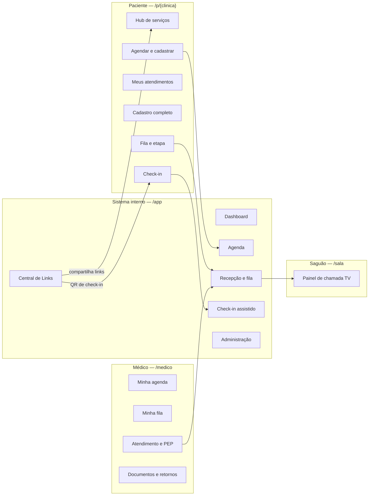
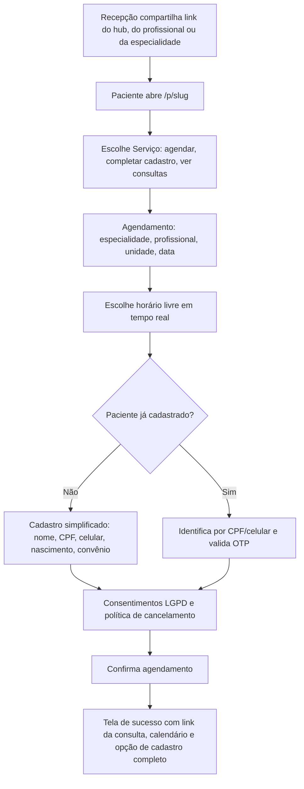
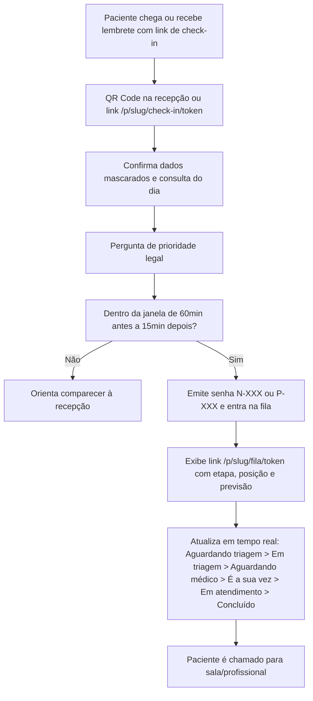
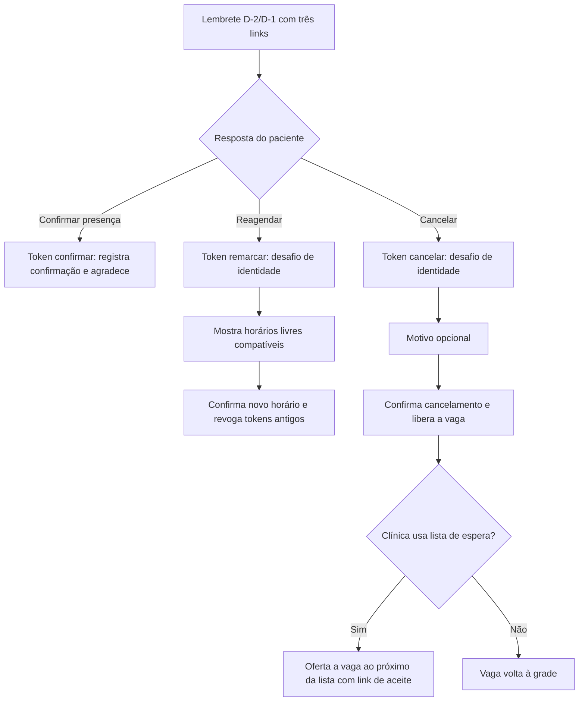
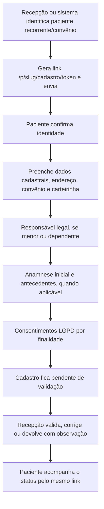
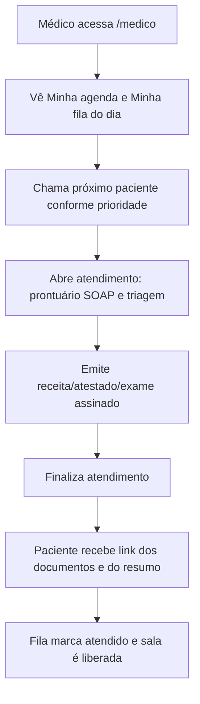

# SPEC-0026 — Jornada Digital do Paciente, Superfícies Dedicadas e Links Compartilháveis

| Campo | Valor |
| :--- | :--- |
| **ID** | SPEC-0026 |
| **Título** | Jornada Digital do Paciente, Superfícies Dedicadas e Links Compartilháveis |
| **Status** | Aprovada |
| **Versão** | 1.0 |
| **Data** | 2026-10-03 |
| **Autor** | Equipe CANAMED |
| **Revisores** | Responsável pelo Projeto CANAMED |
| **Módulos afetados** | frontend (roteamento, layouts por superfície, features `patient` e `medical`), backend (Application, Api, Infrastructure), banco de dados, mensageria (SPEC-0014) |
| **ADRs relacionados** | [ADR-0006](../adr/0006-stack-de-aplicacao.md), [ADR-0007](../adr/0007-banco-de-dados-e-persistencia.md), [ADR-0008](../adr/0008-autenticacao-autorizacao-e-auditoria.md), [ADR-0010](../adr/0010-sessao-de-usuario-e-substituicao-da-identidade-de-desenvolvimento.md), [ADR-0011](../adr/0011-roteamento-por-url-e-superficies-dedicadas.md) |
| **Amenda** | [SPEC-0015](0015-spec-agendamento-online-e-portal-do-paciente.md) (descoberta, acesso e links), [SPEC-0016](0016-spec-carteira-digital-e-acesso-a-documentos-clinicos.md) (endereço próprio do documento e da validação), [SPEC-0017](0017-spec-checkin-autonomo-totem-e-qrcode.md) (substituição do totem físico), [SPEC-0018](0018-spec-portal-de-autonomia-e-direitos-do-titular-lgpd.md) (endereço público próprio) |

---

## 1. Objetivo

Reorganizar toda a experiência do paciente e do médico em **superfícies separadas e endereçáveis por
URL**, de modo que cada funcionalidade relevante tenha um **link próprio, curto e compartilhável**, e que
o paciente acesse o que precisa — agendar, acompanhar a fila, cancelar, remarcar, completar cadastro e
ver documentos — sem nunca entrar no sistema interno da clínica.

Ao mesmo tempo, esta SPEC **aposenta o totem físico de autoatendimento** como produto: o check-in passa a
ser feito no celular do paciente por QR Code/link e, excepcionalmente, no balcão pela recepção. As
regras de tolerância de horário, prioridade legal e emissão de senha da [SPEC-0017](0017-spec-checkin-autonomo-totem-e-qrcode.md)
são preservadas e reaproveitadas.

Pergunta de controle do `GEMINI.md`: **isso reduz atrito na rotina da clínica?**
Sim, em três frentes: (1) o paciente resolve sozinho o que hoje viraria ligação para a recepção;
(2) a recepção deixa de operar um totem e passa a usar um único sistema com check-in assistido;
(3) cada link enviado por WhatsApp/SMS leva direto à ação, reduzindo faltas, cancelamentos tardios e
tempo de espera percebido.

---

## 2. Contexto

O CANAMED já implementou o portal do paciente (SPEC-0015), o check-in autônomo (SPEC-0017), a carteira
digital (SPEC-0016), a privacidade LGPD (SPEC-0018), o workspace médico (SPEC-0012) e a fila de espera
(SPEC-0005). Entretanto, no estado atual:

- o frontend não possui roteador: a navegação é feita por estado (`AppView`) dentro de um único *shell*
  administrativo, então **nenhuma tela tem endereço próprio**;
- o Portal do Paciente e o Totem estão dentro do menu lateral do sistema interno, visíveis a operadores
  e inalcançáveis por link direto;
- o paciente, ao acessar o portal, vê a moldura do sistema da clínica (sidebar, topbar, seletor de
  clínica, botão "Sair" do operador), o que não corresponde à sua jornada;
- o totem exige um terminal físico e uma sessão de operador para ser aberto;
- o médico convive com o menu administrativo inteiro, embora seu trabalho tenha um recorte próprio;
- o reagendamento autônomo não existe (só cancelar e agendar de novo);
- não há um modelo de link tokenizado por ação; os endpoints públicos usam cabeçalho
  `X-Patient-Token` de sessão inteira, inadequado para um link de mensagem.

O [ADR-0011](../adr/0011-roteamento-por-url-e-superficies-dedicadas.md) propõe a correção estrutural:
roteamento por URL e três superfícies (`/app`, `/p`, `/medico`). Esta SPEC detalha o produto sobre essa
decisão.

---

## 3. Escopo

### 3.1 Dentro do escopo

- Roteamento por URL com *deep links* e *layouts* por superfície (Sistema, Paciente, Médico, Saguão);
- Catálogo formal de links compartilháveis por funcionalidade (Tabela 9.1) e **Central de Links** no
  sistema interno para copiar/compartilhar esses endereços;
- Link geral e links por profissional/especialidade para agendamento e cadastro;
- Check-in digital do paciente por QR Code/link, substituindo o totem físico;
- Página de acompanhamento de fila com **etapa do atendimento**, posição, sala e previsão;
- Confirmação de presença em um clique;
- Cancelamento e **reagendamento** autônomos por link, com as políticas da clínica;
- Cadastro simplificado (para agendar) e **cadastro completo** (paciente recorrente, convênio,
  responsável legal, anamnese e consentimentos);
- Central do paciente ("Meus atendimentos") com documentos, histórico e autocuidado;
- Superfície do médico separada (`/medico`);
- Página pública de validação de documento clínico por QR Code (farmácia/terceiros);
- Modelo de **token de capacidade** por link, com escopo, validade, revogação e auditoria;
- Estados vazios, erro, carregamento, acessibilidade e linguagem para o público idoso;
- Fila de espera/reposição de vagas disparada por cancelamento (funcionalidade nova, ligada ao link de
  cancelamento).

### 3.2 Fora do escopo

- Loja de aplicativos aplicativo nativo (o produto permanece web/PWA responsivo);
- Telemedicina por vídeo (permanece fora, conforme SPEC-0015);
- Pagamento online com gateway real (permanece simulado; apenas o **link de pagamento** entra no mapa);
- Balcão de impressão de senha em papel (o check-in gera senha digital; impressão fica opcional e
  condicionada à SPEC-0017 Q-001);
- Reconhecimento facial ou biometria.

---

## 4. Atores e Permissões

| Ator | Superfície | Autenticação | Observações |
| :--- | :--- | :--- | :--- |
| **Visitante (futuro paciente)** | `/p/...` | Nenhuma para ver horários | Só enxerga grade pública, preços quando configurados e especialidades |
| **Paciente identificado por link** | `/p/...` | Token de capacidade | Acessa apenas o escopo do token; ações sensíveis exigem desafio |
| **Paciente autenticado** | `/p/...` | OTP (SPEC-0015) | Acessa "Meus atendimentos", documentos e histórico |
| **Farmacêutico / terceiro** | `/p/{clínica}/validar/{token}` | Público | Valida autenticidade do documento (SPEC-0016) |
| **Recepção** | `/app/recepcao` | Sessão + `agenda:write` | Opera fila, check-in assistido, encaixes e Central de Links |
| **Gestor** | `/app/...` | Sessão + permissões de gestão | Configura links, políticas e slug da clínica |
| **Médico / profissional** | `/medico/...` | Sessão + `workspace:access` | Vê apenas a própria agenda/fila e pacientes em atendimento |
| **Enfermagem / triagem** | `/app/recepcao` | Sessão + permissões de triagem | Registra triagem (SPEC-0009); a etapa reflete no link do paciente |
| **Saguão (TV)** | `/sala/tv` | Público (somente leitura) | Painel de chamada (SPEC-0020) |

---

## 5. Regras de Negócio

| ID | Regra | Justificativa / Origem |
| :--- | :--- | :--- |
| **RN-001** | **Superfícies segregadas:** o paciente nunca acessa `/app`; o operador não vê telas do paciente no menu; o médico acessa `/medico`, não o menu administrativo. | ADR-0011, princípio de menor privilégio e de clareza de papel. |
| **RN-002** | **Toda funcionalidade tem URL própria e estável**, compartilhável e restaurável por *refresh*/*Back*. Nenhuma ação depende de navegação por estado interno. | Requisito central do produto. |
| **RN-003** | **Slug de clínica:** links públicos usam `clinics.slug` único e estável (ex.: `/p/cana-med/agendar`). O slug nunca é derivado de dado sensível e pode ser trocado pelo gestor com preservação de redirecionamento do antigo. | Multi-clínica (SPEC-0024) e previsibilidade de link. |
| **RN-004** | **Token de capacidade:** links de ação usam token opaco aleatório (≥ 256 bits), armazenado apenas como hash, com escopo (`confirmar`, `cancelar`, `remarcar`, `check_in`, `fila`, `cadastro`, `documento`), validade e estado (`ativo`, `usado`, `revogado`, `expirado`). | Segurança de links compartilháveis. |
| **RN-005** | **Identificação progressiva:** o sistema pede o mínimo de informação na etapa atual. Ver horários e confirmar presença não exigem login; ações sensíveis (cancelar, remarcar, ver documento) exigem **desafio de identidade** (3 primeiros dígitos do CPF, ano de nascimento ou OTP), conforme SPEC-0016. | Reduzir atrito sem expor dados. |
| **RN-006** | **Nenhum dado sensível na URL:** CPF, nome, telefone, diagnóstico, medicamento ou classificação de risco não aparecem em *path*, *query string* ou *fragment*. | LGPD e prevenção de vazamento por histórico/compartilhamento. |
| **RN-007** | **Token de uso único para ação que muda estado:** `confirmar`, `cancelar`, `remarcar` e `check_in` consomem/rotacionam o token ao concluir; repetir a ação é idempotente e não duplica o efeito. | Integridade e idempotência. |
| **RN-008** | **Revogação:** cancelar ou remarcar invalida os tokens antigos daquele agendamento e emite novos apenas para o estado vigente. | Evita link "zumbi" levando a ação inválida. |
| **RN-009** | **Check-in digital substitui o totem:** o paciente faz check-in por QR Code/link em `/p/{slug}/check-in/{token}`. Permanecem as regras da SPEC-0017: janela de **60 min antes a 15 min depois** do horário; atraso acima de 15 min orienta procurar a recepção; um único check-in por consulta. | Reaproveitamento da regra aprovada sem o hardware de totem. |
| **RN-010** | **Prioridade legal obrigatória:** o fluxo pergunta, com destaque, se o paciente se enquadra em atendimento prioritário (idoso 60+, idoso 80+, gestante, lactante, PCD, autista). A resposta define o prefixo `P-`/`N-` e a ordem na fila. | Leis nº 10.048/2000 e nº 10.741/2003. |
| **RN-011** | **Acompanhamento por etapa:** após o check-in, o link da fila mostra a **etapa do atendimento** (Seção 9.3), a posição, o profissional e a sala quando chamado. A classificação de risco clínico (Manchester) **não** é exibida ao paciente. | Conforto e não exposição de dado clínico. |
| **RN-012** | **Confirmação em um clique:** o lembrete (SPEC-0014) oferece "Confirmar presença", "Reagendar" e "Cancelar" em links distintos. Confirmar não exige login, apenas token válido. | Redução de no-show. |
| **RN-013** | **Cancelamento autônomo:** permitido com antecedência mínima definida na política da clínica (padrão 2 horas, SPEC-0025). Abaixo do prazo, o link orienta contato com a recepção. | SPEC-0015 RN-005, agora parametrizável. |
| **RN-014** | **Reagendamento autônomo:** permitido dentro do prazo da política e limitado a **1 remarcação por agendamento** (configurável). O novo horário respeita disponibilidade, antecedência mínima e duração do tipo de consulta. | Nova funcionalidade, alto valor de autocuidado. |
| **RN-015** | **Cadastro simplificado x completo:** para agendar, exige-se o mínimo (nome, CPF, celular, nascimento). O **cadastro completo** (endereço, convênio/carteirinha, responsável legal, anamnese e consentimentos) é solicitado para convênio, retorno recorrente ou por decisão da recepção, via link próprio. | Minimização de dados (LGPD) e qualidade cadastral. |
| **RN-016** | **Validação do cadastro completo:** o cadastro completo entra como `pendente de validação`; a recepção aprova, corrige ou devolve. O paciente é avisado do status pelo próprio link. | Evita dado incorreto entrando na operação. |
| **RN-017** | **Limite de agendamentos online** preservado da SPEC-0015 (máximo 2 futuros ativos), configurável por clínica. Encaixes e retornos seguem a SPEC-0025. | Antiabuso. |
| **RN-018** | **Central de Links** é exclusiva de perfis com `agenda:write`/`clinic:manage` e permite copiar links com rótulo, destino e QR Code. | Operacionaliza o pedido "cada funcionalidade com link próprio". |
| **RN-019** | **Reposição de vaga:** ao cancelar, o sistema pode oferecer a vaga a pacientes em lista de espera da mesma especialidade/profissional, com link de aceite de validade curta. A oferta só existe se a clínica habilitar. | Transforma cancelamento em oportunidade de ocupação. |
| **RN-020** | **Sessões isoladas:** a sessão do operador (cookie `httpOnly`) e a do paciente (token de portal) não compartilham armazenamento. Um não autentica o outro. | Segurança e evita contaminação de contexto. |
| **RN-021** | **Acessibilidade e linguagem:** rotas públicas são mobile-first, com alvos ≥ 48 px, contraste AA, foco visível, leitura em voz e textos em linguagem simples. Nenhuma etapa depende exclusivamente de cor. | Público idoso e WCAG. |
| **RN-022** | **Fallback humano:** toda tela pública exibe "Precisa de ajuda? Ligue para a recepção" com o telefone da clínica; nenhuma jornada obriga o uso de smartphone. | Inclusão digital. |
| **RN-023** | **Mensagens sem dado clínico:** WhatsApp/SMS usam apenas nome, data/hora, profissional e links; nunca diagnóstico, medicamento, classificação de risco ou valor. | CFM Art. 73 e LGPD. |
| **RN-024** | **Contexto de clínica no link:** o paciente vê dados da clínica do link, mesmo que tenha histórico em outra unidade do grupo; troca de contexto exige identificação. | Multi-clínica (SPEC-0024). |
| **RN-025** | **Auditoria de link:** criação, abertura, uso, expiração e revogação de token geram evento auditável com clínica, escopo, agendamento e IP, sem registrar o token em claro. | Trilha de auditoria e resposta a incidentes. |

---

## 6. Fluxos

### 6.1 Mapa geral das superfícies



### 6.2 Jornada de descoberta, cadastro e agendamento (F-001)



### 6.3 Jornada de check-in e acompanhamento da fila (F-002)



### 6.4 Jornada de confirmação, reagendamento e cancelamento (F-003)



### 6.5 Jornada de cadastro completo (F-004)



### 6.6 Jornada do médico (F-005)



---

## 7. Modelo de Dados

### 7.1 `clinics` — campos novos

| Campo | Tipo | Obrigatório | Regra / Índice |
| :--- | :--- | :--- | :--- |
| `slug` | `VARCHAR(60)` | Sim | Unique global, minúsculo, `[a-z0-9-]`; usado nos links públicos |
| `public_name` | `VARCHAR(120)` | Não | Nome exibido na superfície do paciente; usa o nome da clínica quando vazio |
| `allow_waitlist` | `BOOLEAN` | Sim | Default `false`; habilita reposição de vaga (RN-019) |
| `allow_self_reschedule` | `BOOLEAN` | Sim | Default `true`; habilita `/remarcar` |
| `max_online_appointments` | `INTEGER` | Sim | Default `2`; preserva a SPEC-0015 RN-003 |

### 7.2 `patient_capability_tokens` (novo — schema `portal`)

| Campo | Tipo | Obrigatório | Regra / Índice | Classificação LGPD |
| :--- | :--- | :--- | :--- | :--- |
| `id` | `UUID` | Sim | PK | Anônimo |
| `clinic_id` | `UUID` | Sim | FK `clinics.id`, Index | Anônimo |
| `patient_id` | `UUID` | Não | FK `patients.id`, Index | Anônimo |
| `appointment_id` | `UUID` | Não | FK `appointments.id`, Index | Anônimo |
| `queue_entry_id` | `UUID` | Não | FK `queue_entries.id`, Index | Anônimo |
| `medical_document_id` | `UUID` | Não | FK `medical_documents.id`, Index | Anônimo |
| `scope` | `VARCHAR(30)` | Sim | `confirm`, `cancel`, `reschedule`, `check_in`, `queue`, `registration`, `document`, `waitlist_offer` | Anônimo |
| `token_hash` | `VARCHAR(128)` | Sim | Unique, hash SHA-256 do token | Anônimo |
| `status` | `VARCHAR(20)` | Sim | `active`, `used`, `revoked`, `expired` | Anônimo |
| `expires_at` | `TIMESTAMPTZ` | Sim | Definido por escopo | Anônimo |
| `used_at` | `TIMESTAMPTZ` | Não | Consumo do token | Anônimo |
| `created_at` | `TIMESTAMPTZ` | Sim | Default `NOW()` | Anônimo |
| `created_by` | `VARCHAR(80)` | Sim | `system`, `reception`, `doctor` | Anônimo |

### 7.3 `patient_registration_drafts` (novo — cadastro completo)

| Campo | Tipo | Obrigatório | Regra |
| :--- | :--- | :--- | :--- |
| `id` | `UUID` | Sim | PK |
| `patient_id` | `UUID` | Sim | FK `patients.id` |
| `clinic_id` | `UUID` | Sim | FK `clinics.id` |
| `payload_json` | `JSONB` | Sim | Dados cadastrais/convênio/anamnese em rascunho |
| `status` | `VARCHAR(20)` | Sim | `draft`, `pending_review`, `approved`, `returned` |
| `review_note` | `TEXT` | Não | Observação da recepção quando devolve |
| `submitted_at` | `TIMESTAMPTZ` | Não | Envio para validação |
| `reviewed_at` | `TIMESTAMPTZ` | Não | Validação |
| `reviewed_by` | `UUID` | Não | FK `users.id` |

> O cadastro completo **não** altera diretamente `patients` enquanto `pending_review`; a aprovação
> aplica os campos validados e registra auditoria.

### 7.4 `waitlist_entries` (novo — reposição de vaga)

| Campo | Tipo | Obrigatório | Regra |
| :--- | :--- | :--- | :--- |
| `id` | `UUID` | Sim | PK |
| `clinic_id` | `UUID` | Sim | FK `clinics.id` |
| `patient_id` | `UUID` | Sim | FK `patients.id` |
| `specialty_id` | `UUID` | Sim | FK `specialties.id` |
| `professional_id` | `UUID` | Não | Preferência por profissional |
| `desired_from` / `desired_to` | `DATE` | Sim | Janela desejada |
| `status` | `VARCHAR(20)` | Sim | `waiting`, `offered`, `accepted`, `expired`, `cancelled` |
| `offer_token_id` | `UUID` | Não | Token de aceite (escopo `waitlist_offer`) |
| `position` | `INTEGER` | Sim | Ordem na lista |

---

## 8. Contrato de API e Rotas

### 8.1 Rotas da superfície do paciente (`/p`)

| Rota | Finalidade | Autenticação | Observações |
| :--- | :--- | :--- | :--- |
| `/p/{slug}` | Hub de serviços do paciente | Pública | Vitrine com ações (agendar, atendimentos, cadastro, ajuda) |
| `/p/{slug}/agendar` | Agendamento online | Pública → OTP | Wizard: serviço → profissional → horário → identificação |
| `/p/{slug}/agendar/profissional/{profSlug}` | Link de agendamento por profissional | Pública | Para cartões, convênios e redes sociais |
| `/p/{slug}/agendar/especialidade/{specSlug}` | Link de agendamento por especialidade | Pública | Para campanhas de captação |
| `/p/{slug}/cadastro` | Cadastro simplificado | Pública → OTP | Normalmente embutido no agendamento |
| `/p/{slug}/cadastro/{token}` | Cadastro completo | Token `registration` | Enviado pela recepção; status ao final |
| `/p/{slug}/consultas` | Meus atendimentos | OTP | Lista futuros, passados e pendências |
| `/p/{slug}/c/{token}` | Detalhe da consulta | Token de escopo da consulta | Sem dado clínico |
| `/p/{slug}/c/{token}/confirmar` | Confirmação em um clique | Token `confirm` | Idempotente |
| `/p/{slug}/c/{token}/remarcar` | Mudança de horário | Token `reschedule` + desafio | Respeita RN-014 |
| `/p/{slug}/c/{token}/cancelar` | Cancelamento | Token `cancel` + desafio | Respeita RN-013 e dispara lista de espera |
| `/p/{slug}/check-in/{token}` | Check-in digital | Token `check_in` | Substitui o totem (RN-009) |
| `/p/{slug}/fila/{token}` | Posição e etapa do atendimento | Token `queue` | Atualização em tempo real |
| `/p/{slug}/documentos` | Carteira digital | OTP | SPEC-0016 |
| `/p/{slug}/documentos/{token}` | Documento específico | Token `document` + desafio | Hash, PDF e compartilhar |
| `/p/{slug}/validar/{token}` | Validação pública do documento | Pública | Farmácias e terceiros |
| `/p/{slug}/privacidade` | Direitos do titular | OTP | SPEC-0018 |
| `/p/{slug}/privacidade/{protocol}` | Acompanhamento de solicitação | Pública (protocolo) | Sem dado clínico |

### 8.2 Rotas da superfície do sistema (`/app`)

| Rota | Tela |
| :--- | :--- |
| `/app/dashboard` | Painel operacional |
| `/app/agenda` | Agenda de consultas |
| `/app/recepcao` | Fila e ciclo de atendimento |
| `/app/recepcao/check-in` | Check-in assistido, busca por CPF/telefone, QR Code e senha |
| `/app/recepcao/lista-espera` | Lista de espera e reposição de vagas |
| `/app/operacao` | Salas, convênios, horários e feriados |
| `/app/catalogo` | Catálogo assistencial |
| `/app/usuarios` | Usuários e permissões |
| `/app/caixa` | Frente de caixa |
| `/app/financeiro` | Financeiro e repasses |
| `/app/estoque` | Insumos e estoque |
| `/app/dpo` | Governança LGPD |
| `/app/politicas` | Políticas de encaixe e cancelamento |
| `/app/links` | **Central de Links** (novo) |

### 8.3 Rotas da superfície do médico (`/medico`)

| Rota | Tela |
| :--- | :--- |
| `/medico` | Hoje: agenda + fila do profissional |
| `/medico/agenda` | Minha agenda (dia/semana) |
| `/medico/fila` | Minha fila com prioridade e risco (dado clínico interno) |
| `/medico/atendimento/{queueEntryId}` | PEP SOAP, triagem, documentos e finalização |
| `/medico/paciente/{patientId}` | Histórico e documentos do paciente |
| `/medico/documentos` | Documentos emitidos/recebidos |
| `/medico/retornos` | Retornos e prazos (SPEC-0013) |

### 8.4 Rotas de exibição

| Rota | Tela |
| :--- | :--- |
| `/sala/tv` | Painel de chamada para a TV (SPEC-0020) |

### 8.5 Endpoints de API (novos/ajustados)

| Método | Rota | Autorização | Descrição |
| :--- | :--- | :--- | :--- |
| `GET` | `/api/v1/public/clinics/{slug}/meta` | Pública | Metadados públicos por slug (SPEC-0026/RN-003) |
| `POST` | `/api/v1/public/links/{scope}` | Sessão (`agenda:write`) | Gera link/token para enviar ao paciente |
| `GET` | `/api/v1/public/capabilities/{token}` | Pública | Resolve escopo, retorna o mínimo necessário |
| `POST` | `/api/v1/public/capabilities/{token}/confirm` | Pública | Confirma presença |
| `POST` | `/api/v1/public/capabilities/{token}/cancel` | Pública + desafio | Cancela e dispara lista de espera |
| `POST` | `/api/v1/public/capabilities/{token}/reschedule` | Pública + desafio | Reagenda |
| `GET` | `/api/v1/public/capabilities/{token}/queue` | Pública | Status/etapa da fila (SSE opcional em `/stream`) |
| `POST` | `/api/v1/public/check-in/{token}` | Pública | Check-in digital (reusa `KioskCheckInService`) |
| `GET` | `/api/v1/public/registration/{token}` | Pública | Carrega rascunho de cadastro |
| `PUT` | `/api/v1/public/registration/{token}` | Pública | Salva rascunho |
| `POST` | `/api/v1/public/registration/{token}/submit` | Pública | Envia para validação |
| `GET` | `/api/v1/reception/registration-reviews` | Sessão (`agenda:write`) | Fila de cadastros pendentes |
| `POST` | `/api/v1/reception/registration-reviews/{id}` | Sessão (`agenda:write`) | Aprova, corrige ou devolve |
| `GET` | `/api/v1/reception/links` | Sessão (`agenda:write`) | Catálogo de links (Central de Links) |
| `GET` | `/api/v1/reception/waitlist` | Sessão (`agenda:write`) | Lista de espera |
| `POST` | `/api/v1/public/capabilities/{token}/waitlist-accept` | Pública | Aceita vaga ofertada |
| `GET` | `/api/v1/doctor/workspace/today` | Sessão (`workspace:access`) | Estado do médico (reuso da SPEC-0012) |

---

## 9. Interface e Experiência

### 9.1 Catálogo de links compartilháveis

| # | Link | Exemplo de rota | Quem gera | Para que serve |
| :--- | :--- | :--- | :--- | :--- |
| L-01 | Hub do paciente | `/p/cana-med` | Central de Links | Link genérico de bio/Instagram/site |
| L-02 | Agendamento geral | `/p/cana-med/agendar` | Central de Links | Marcar consulta |
| L-03 | Agendamento por profissional | `/p/cana-med/agendar/profissional/dr-joao` | Central de Links | Cartão do médico, convênio, indicação |
| L-04 | Agendamento por especialidade | `/p/cana-med/agendar/especialidade/cardiologia` | Central de Links | Campanhas e captação |
| L-05 | Cadastro completo | `/p/cana-med/cadastro/{token}` | Recepção/sistema | Paciente recorrente, convênio, anamnese |
| L-06 | Meus atendimentos | `/p/cana-med/consultas` | Central de Links | Autocuidado geral |
| L-07 | Detalhe da consulta | `/p/cana-med/c/{token}` | Sistema (mensagem) | Ver/confirmar/remarcar/cancelar |
| L-08 | Confirmação | `/p/cana-med/c/{token}/confirmar` | Sistema (mensagem) | Confirmar presença em 1 clique |
| L-09 | Reagendamento | `/p/cana-med/c/{token}/remarcar` | Sistema (mensagem) | Mudar horário |
| L-10 | Cancelamento | `/p/cana-med/c/{token}/cancelar` | Sistema (mensagem) | Cancelar com política |
| L-11 | Check-in | `/p/cana-med/check-in/{token}` | QR Code / mensagem | Confirmar chegada |
| L-12 | Fila e etapa | `/p/cana-med/fila/{token}` | Sistema após check-in | Acompanhar atendimento |
| L-13 | Documentos | `/p/cana-med/documentos/{token}` | Sistema após consulta | Receita/atestado/exame |
| L-14 | Validação pública | `/p/cana-med/validar/{token}` | Documento impresso/QR | Farmácia e terceiros |
| L-15 | Privacidade/LGPD | `/p/cana-med/privacidade` | Central de Links | Direitos do titular |
| L-16 | Aceite de vaga | `/p/cana-med/fila-espera/{token}` | Reposição de vaga | Aceitar horário liberado |

### 9.2 Layout da superfície do paciente

```text
┌──────────────────────────────────────────┐
│  [logo]  Clínica Cana Med     Precisa de  │  ← cabeçalho enxuto, sem sidebar
│          Profissional / unidade  ajuda?   │
├──────────────────────────────────────────┤
│  Onde estou: Agendar > Horário > Dados    │  ← breadcrumb/stepper simples
│                                           │
│        Título da única ação da tela       │
│        Explicação curta em 1–2 linhas     │
│                                           │
│        [ conteúdo principal ]             │
│                                           │
├──────────────────────────────────────────┤
│  [ Voltar ]            [ Ação principal ] │  ← barra fixa inferior no mobile
└──────────────────────────────────────────┘
```

Regras visuais obrigatórias:

- **Nenhum elemento do sistema interno** (sidebar, topbar, seletor de clínica, menus administrativos);
- uma ação principal por tela e um caminho de volta sempre visível;
- tipografia ampliada, alvos ≥ 48 px e confirmações com linguagem simples;
- logo oficial e paleta da identidade visual existente (SPEC-UI-001, seção 2);
- "Precisa de ajuda?" persistente com telefone/WhatsApp da clínica em todas as telas públicas.

### 9.3 Etapa do atendimento exibida ao paciente

| Etapa exibida | Origem técnica | Mensagem ao paciente |
| :--- | :--- | :--- |
| **Chegada confirmada** | `queue_entries.status = aguardando` | "Recebemos sua chegada. Sua senha é N-012." |
| **Aguardando triagem** | `aguardando` sem triagem registrada | "Você é o 3º da fila de triagem. Previsão ~25 min." |
| **Em triagem** | triagem em andamento (SPEC-0009) | "Você está em triagem. Em seguida aguardará o(a) profissional." |
| **Aguardando o(a) profissional** | `aguardando`/`chamado` pós-triagem | "Seu atendimento será com Dr(a). X. Você é o 2º." |
| **É a sua vez** | `chamado` | "É a sua vez! Dirija-se à sala 3." |
| **Em atendimento** | `em_atendimento` | "Você está em atendimento com Dr(a). X." |
| **Atendimento concluído** | `atendido` | "Atendimento concluído. Consulte seus documentos." |
| **Consulta não realizada** | `desistiu`/`cancelado` | "Este atendimento não foi realizado. Fale com a recepção." |

Atualização: *polling* curto (10–15 s) na primeira versão e SSE (`/queue/stream`) como evolução. A
classificação de Manchester nunca é exibida aqui (RN-011).

### 9.4 Shell do médico

- Cabeçalho reduzido: logo, nome do profissional, clínica e status do dia;
- Navegação de 5 itens: **Hoje, Agenda, Minha fila, Documentos, Retornos**;
- A tela `/medico/atendimento/{id}` concentra o PEP, triagem, alertas de alergia e emissão de documentos
  (reuso da SPEC-0012), sem menus administrativos;
- O médico continua podendo acessar `/app` **somente** se tiver permissão administrativa explícita.

### 9.5 Central de Links (`/app/links`)

- Lista os links L-01 a L-16 com nome, destino, validade e um botão **Copiar**;
- Filtros por profissional, especialidade e tipo;
- Gera e imprime o **QR Code de check-in** da recepção (cartaz A4/A5);
- Mostra o status do link (ativo/revogado) e a data de criação;
- Explica em uma linha "quando usar cada link" para a recepção não errar.

---

## 10. Critérios de Aceitação

| ID | Critério |
| :--- | :--- |
| **CA-001** | **Dado** que a recepção copia o link de agendamento na Central de Links, **Quando** o paciente o abre no celular, **Então** vê a superfície do paciente (sem sidebar/topbar do sistema) e consegue agendar. |
| **CA-002** | **Dado** um link de agendamento por profissional, **Quando** o paciente o abre, **Então** o profissional já vem selecionado. |
| **CA-003** | **Dado** um paciente com consulta futura, **Quando** recebe o lembrete, **Então** os links de confirmar, reagendar e cancelar são distintos, com escopo e validade próprios. |
| **CA-004** | **Dado** que o paciente confirma presença por link, **Quando** a ação conclui, **Então** a consulta é marcada como confirmada e o link consumido não repete a ação. |
| **CA-005** | **Dado** que o paciente cancela por link dentro do prazo, **Quando** confirma, **Então** a vaga é liberada e, se houver lista de espera habilitada, a oferta é disparada. |
| **CA-006** | **Dado** que o paciente reagenda por link, **Quando** escolhe um novo horário livre, **Então** o agendamento é atualizado, os tokens antigos são revogados e o limite de remarcações é respeitado. |
| **CA-007** | **Dado** um paciente no dia da consulta dentro da janela permitida, **Quando** abre o QR Code de check-in, **Então** informa prioridade legal, recebe senha `N-`/`P-` e entra na fila. |
| **CA-008** | **Dado** check-in concluído, **Quando** o paciente abre o link da fila, **Então** vê a etapa correta do atendimento, a posição e o profissional, sem classificação de risco clínico. |
| **CA-009** | **Dado** que o paciente é chamado, **Quando** o status muda para `chamado`, **Então** o link da fila reflete "É a sua vez" e a sala em até 15 segundos. |
| **CA-010** | **Dado** um paciente recorrente com convênio, **Quando** a recepção envia o link de cadastro completo, **Então** ele preenche, envia e acompanha o status até a validação. |
| **CA-011** | **Dado** um médico autenticado, **Quando** acessa `/medico`, **Então** vê apenas as telas do seu recorte e não o menu administrativo. |
| **CA-012** | **Dado** um token expirado, revogado ou de outra clínica, **Quando** aberto, **Então** exibe mensagem clara sem dado sensível e registra a tentativa em auditoria. |
| **CA-013** | **Dado** um link público, **Quando** inspecionado, **Então** não contém CPF, nome, diagnóstico ou qualquer dado de saúde na URL e responde com `X-Robots-Tag: noindex`. |
| **CA-014** | **Dado** o paciente que não usa smartphone, **Quando** não consegue concluir uma etapa, **Então** encontra telefone de ajuda e a recepção consegue fazer o mesmo pelo sistema interno. |

---

## 11. Casos de Erro

| ID | Gatilho | Comportamento Esperado | Mensagem ao Usuário | Registro |
| :--- | :--- | :--- | :--- | :--- |
| **ER-001** | Token inexistente, expirado, usado ou revogado | Página neutra, sem revelar se existe agendamento | "Este link não está mais disponível. Fale com a recepção ou abra Meus atendimentos." | `CapabilityTokenRejected` |
| **ER-002** | Token de outra clínica ou de outro paciente | Bloqueia; nenhuma informação é exibida | Mesma mensagem neutra do ER-001 | `CapabilityTokenScopeDenied` |
| **ER-003** | Desafio de identidade incorreto 3 vezes | Bloqueia o link por 15 min e exige novo envio/OTP | "Não conseguimos confirmar seus dados. Tente novamente mais tarde ou fale com a recepção." | `PatientIdentityChallengeFailed` |
| **ER-004** | Reagendamento sem vaga compatível | Não altera o agendamento; oferece lista de espera | "Não há horários livres no momento. Quer entrar na lista de espera?" | `RescheduleNoSlot` |
| **ER-005** | Reagendamento bloqueado pela política | Mantém o agendamento e orienta a recepção | "Esta consulta não pode ser remarcada por aqui. Fale com a recepção." | `ReschedulePolicyBlocked` |
| **ER-006** | Cancelamento fora do prazo | Não cancela; orienta contato humano | "Cancelamentos com menos de X horas devem ser feitos pela recepção." | `CancelWindowClosed` |
| **ER-007** | Check-in fora da janela de tolerância | Não entra na fila; orienta balcão | "Você chegou fora da janela de check-in. Procure a recepção." | `CheckInWindowClosed` |
| **ER-008** | Check-in duplicado | Reexibe a senha existente, sem duplicar | "Seu check-in já foi feito. Sua senha é N-012." | `CheckInIdempotentReplay` |
| **ER-009** | Slug de clínica inexistente/inativo | 404 institucional sem dados internos | "Clínica não encontrada. Verifique o link recebido." | `PublicSlugNotFound` |
| **ER-010** | Documento cancelado pelo médico | Tarja vermelha com motivo e data (SPEC-0016) | "Este documento foi cancelado pelo profissional responsável." | `DocumentCancelledView` |

---

## 12. Impacto em Outras Funcionalidades

- **SPEC-0002 (Agenda):** origem dos agendamentos passa a incluir `online`, `link` e `waitlist`; o
  remarcar online reusa as regras de conflito.
- **SPEC-0005 (Fila):** o item "Totem" da fila passa a exibir origem `QR Code`/`Link`; a projeção de
  etapa alimenta o link do paciente.
- **SPEC-0009 (Triagem):** a triagem atualiza a etapa exibida ao paciente sem expor risco clínico.
- **SPEC-0012 (Workspace Médico):** migra para `/medico`, mantendo PEP, triagem e documentos.
- **SPEC-0014 (Notificações):** os templates passam a usar os links L-07 a L-12 e a registrar o canal
  de origem; confirmação 1-clique fecha o ciclo de no-show.
- **SPEC-0015 (Portal):** reorganizada em superfície própria; cadastro simplificado permanece; o portal
  deixa de ser item de menu do sistema.
- **SPEC-0016 (Documentos):** ganha página pública própria e link por documento.
- **SPEC-0017 (Totem):** o totem físico é removido; regras de tolerância, prioridade e senha são
  reaproveitadas no check-in por link e no check-in assistido. Recomenda-se marcar a SPEC-0017 como
  **Substituída parcialmente por SPEC-0026** após aprovação.
- **SPEC-0018 (LGPD):** ganha superfície pública própria e acompanhamento por protocolo.
- **SPEC-0020 (TV):** passa a viver em `/sala/tv`, sem login.
- **SPEC-0024 (Multi-clínica):** o slug segmenta o contexto público; o seletor de clínica permanece
  apenas no sistema interno.
- **SPEC-0025 (Políticas):** os prazos de cancelamento, remarcação e lista de espera passam a ser lidos
  pelo link.

---

## 13. Requisitos de Segurança

- [x] Token de capacidade com ≥ 256 bits de entropia, armazenado somente como hash (RN-004).
- [x] Escopo, validade e revogação por token; tokens antigos revogados ao mudar o estado do agendamento.
- [x] Nenhum dado sensível em URL, log ou mensagem (RN-006, RN-023).
- [x] Desafio de identidade para cancelamento, remarcação e documento (RN-005).
- [x] Rate limiting por IP e por token nas rotas públicas (`/p` e `/api/v1/public`).
- [x] `Referrer-Policy: no-referrer`, `X-Robots-Tag: noindex, nofollow` e `Cache-Control: no-store` nas
  páginas com dado pessoal.
- [x] Isolamento de sessão entre operador e paciente (RN-020).
- [x] Autorização por recurso no backend em toda ação; a UI nunca é a única barreira.
- [x] Auditoria de criação, abertura, uso, expiração e revogação de token (RN-025).
- [x] Confirmação de que o token de fila só expõe dados mínimos e mascarados.

---

## 14. Requisitos Legais Aplicáveis

| Norma | Aplicável? | O que exige nesta funcionalidade |
| :--- | :--- | :--- |
| **LGPD (Lei nº 13.709/2018)** | Sim | Minimização de dados nos links, finalidade por consentimento, segurança e direitos do titular; token opaco e auditoria. |
| **Lei nº 10.048/2000 e nº 10.741/2003** | Sim | Pergunta obrigatória de prioridade legal no check-in e reflexo na fila. |
| **Código de Ética Médica (Art. 73)** | Sim | Nenhum dado clínico em mensagens/links; CID apenas com consentimento (SPEC-0016). |
| **Lei nº 13.787/2018** | Sim | Documentos e prontuário permanecem íntegros e imutáveis; o link apenas os apresenta. |
| **CDC (Lei nº 8.078/1990)** | Sim | Informação clara de política de cancelamento, remarcação e preços quando particulares. |
| **Lei nº 14.063/2020 / ICP-Brasil** | Sim | Assinatura do documento validável pela página pública (SPEC-0016). |
| **WCAG 2.1 AA (referência)** | Sim | Acessibilidade das superfícies públicas, com atenção ao público idoso. |

---

## 15. Requisitos Não Funcionais

- **Abertura de link público:** primeira renderização útil em menos de 1,5 s em 4G.
- **Atualização da fila:** etapa refletida em até 15 s (polling inicial) e em até 3 s com SSE.
- **Disponibilidade:** superfície do paciente independente do sistema interno (o paciente não fica sem
  acesso se o backoffice oscilar).
- **Mobile-first:** usável em telas de 360 px, sem zoom horizontal.
- **Observabilidade:** métricas por link (aberto, confirmado, cancelado, remarcado, check-in, no-show).

---

## 16. Testes Previstos

- **Unitários:** geração/hash/expiração/revogação de token; projeção de etapa da fila; regras de
  reagendamento e limite de remarcações.
- **Integração:** fluxo ponta a ponta de agendamento por link, check-in, fila, cancelamento, reposição de
  vaga e cadastro completo; rejeição de token de outra clínica/paciente.
- **Frontend:** rotas por superfície, ausência de sidebar no `/p`, deep link direto, `Back/Forward`,
  acessibilidade e estados de erro.
- **E2E (Playwright):** jornadas F-001 a F-005 em viewport mobile.

---

## 17. Auditoria e Observabilidade

| Evento | Recurso Afetado | Dados Registrados |
| :--- | :--- | :--- |
| `CapabilityTokenCreated` | `patient_capability_tokens` | `id`, `scope`, `clinic_id`, `appointment_id`, `created_by`, `expires_at` |
| `CapabilityLinkOpened` | `patient_capability_tokens` | `id`, `scope`, `ip`, `user_agent`, `timestamp` |
| `CapabilityTokenUsed` | `patient_capability_tokens` | `id`, `scope`, `timestamp`, `result` |
| `CapabilityTokenRejected` | `patient_capability_tokens` | `hash_prefix`, `scope`, `reason`, `ip`, `timestamp` |
| `AppointmentConfirmedByLink` | `appointments` | `appointment_id`, `channel`, `timestamp` |
| `AppointmentRescheduledByLink` | `appointments` | `appointment_id`, `old_slot`, `new_slot`, `timestamp` |
| `WaitlistOfferCreated` | `waitlist_entries` | `entry_id`, `appointment_id`, `expires_at` |
| `PublicDocumentValidatedByThirdParty` | `medical_documents` | `document_id`, `verifier_type`, `timestamp` |

---

## 18. Pendências e Questões Abertas

| ID | Questão | Responsável | Status |
| :--- | :--- | :--- | :--- |
| **Q-001** | Portal do paciente em *path* (`/p`) ou subdomínio por clínica (`cana-med.canamed.app`)? | Produto / Infra | **Resolvida:** primeira entrega em *path* (`/p/{slug}`); o subdomínio é evolução via resolvedor de clínica por slug, sem reescrever as telas. |
| **Q-002** | Qual o prazo padrão de cancelamento e limite de remarcações por clínica? | Gestão da Clínica | Hoje 2 h (SPEC-0015); passa a ser configurável na SPEC-0025. |
| **Q-003** | Cadastro completo é obrigatório para convênio ou apenas recomendado? | Produto / Recepção | Recomendação inicial: obrigatório para convênio e retorno recorrente. |
| **Q-004** | Lista de espera entra na primeira entrega ou em fase seguinte? | Produto | Recomendada como fase 2, após os links base. |
| **Q-005** | O produto precisa de PWA instalável com notificações? | Produto | Não para o MVP; notificação atual é WhatsApp/SMS (SPEC-0014). |
| **Q-006** | Confirmar presença deve exigir desafio? | Segurança / Produto | Não; o token de escopo `confirm` é suficiente por não expor dado clínico. |

---

## 19. Histórico de Revisões

| Versão | Data | Autor | Alteração |
| :--- | :--- | :--- | :--- |
| 0.1 | 2026-10-03 | Equipe CANAMED | Versão inicial: superfícies dedicadas, catálogo de links, check-in digital, cadastro completo, reagendamento, lista de espera e shell do médico. |
| 1.0 | 2026-10-03 | Equipe CANAMED | Aprovação: Q-001 resolvida (path primeiro) e início da implementação conforme o ADR-0011. |

---

## 20. Aprovação

| Papel | Nome | Data | Status |
| :--- | :--- | :--- | :--- |
| **Autor** | Equipe CANAMED | 2026-10-03 | Elaborada |
| **Aprovador** | Responsável pelo Projeto | 2026-10-03 | Aprovada |

---

## Anexo A — Situação atual x proposta

| Tema | Hoje | Proposta |
| :--- | :--- | :--- |
| Navegação | Estado interno (`AppView`), sem URL | Roteamento por URL com deep links |
| Superfície do paciente | Dentro do shell administrativo | `/p/{slug}` mobile-first, sem sidebar |
| Superfície do médico | Item "Consultório" no menu administrativo | `/medico` com shell próprio |
| Totem | Tela dentro do sistema, depende de operador | Check-in por QR Code/link + check-in assistido |
| Compartilhamento | Impossível (sem URL) | Central de Links + tokens por ação |
| Cancelamento | Sim, por token de sessão inteira | Link específico com desafio e política |
| Reagendamento | Não existe | Link específico com disponibilidade em tempo real |
| Cadastro completo | Parcial no cadastro simplificado | Fluxo próprio com validação da recepção |
| Fila | Posição por senha digitada manualmente | Link com etapa, posição, sala e previsão |
| Documentos | Lista no portal; link cai na API | Página pública própria e validação por QR |
| Lista de espera | Não existe | Reposição automática da vaga cancelada |

---

## Anexo B — Padrões observados em serviços de clínica existentes

Levantamento de referência (sem copiar identidade visual ou código) usado para validar as escolhas de UX
desta SPEC:

| Referência de mercado | Padrão relevante | Decisão no CANAMED |
| :--- | :--- | :--- |
| Doctoralia / iClinic | Página pública de agendamento por profissional, com URL compartilhável e confirmação por mensagem | Links L-02 a L-04 (agendamento geral, por profissional e por especialidade) |
| Feegow e Ninsaúde Apolo | Portal do paciente com autocuidado: ver consultas, confirmar presença e cancelar sem ligar | Links L-06 a L-10 e a Central de Links |
| Amplimed e Clinicorp | Área do paciente leve, mobile-first, com acesso por link/token em vez de senha | Identificação progressiva (RN-005) e token de capacidade (RN-004) |
| Sistemas hospitalares de grande porte (Tasy, MV, Shosp) | Totem/auto-atendimento costuma fazer sentido em alto volume e recepção física estruturada | Confirma a tese de que o totem não se justifica nas clínicas de pequeno e médio porte; o check-in vira QR Code no celular e ação assistida no balcão |
| Ferramentas de agendamento estilo calendário | Link por profissional e por serviço como canal de captação | L-03 e L-04, com QR Code e botão de compartilhamento |
| Acompanhamento de fila de bancos, laboratórios e aeroportos | "Sua posição", "previsão" e "é a sua vez" reduzem ansiedade e idas ao balcão | Seção 9.3 (etapa do atendimento) e link L-12 |
| Confirmação de consulta por WhatsApp (padrão brasileiro) | Três botões: confirmar, reagendar e cancelar | F-003 e links L-08 a L-10 |
| Portais com carteira de documentos | Receita/atestado com validade e QR de verificação para farmácia | Anexo da SPEC-0016 e link L-14 |

Conclusão do benchmark: o mercado resolve a jornada do paciente com **links curtos e ações isoladas**,
não com um sistema completo exposto ao paciente. O CANAMED passa a seguir esse padrão, mantendo o
diferencial de integrar o link diretamente à agenda, à fila e ao prontuário.

---

## Anexo C — Lacunas e dívidas identificadas na implementação atual

Itens encontrados na auditoria e que precisam ser tratados junto desta SPEC (não são novas
funcionalidades, são correções para o fluxo proposto funcionar):

| # | Lacuna | Evidência | Ação sugerida |
| :--- | :--- | :--- | :--- |
| D-01 | O frontend não envia `appointmentTypeId` no agendamento online, embora o contrato exija | `frontend/src/features/patient/patientApi.ts` envia `clinicId`, `professionalId`, `specialtyId`, `startsAt`; `BookOnlineAppointmentRequest` espera `AppointmentTypeId` | Enviar o tipo de consulta escolhido e validar no backend |
| D-02 | Paciente criado na verificação de OTP com `clinicId = Guid.Empty` | `OnlineBookingService.VerifyOtpAsync` | Definir identidade de paciente por CPF e vincular à clínica no agendamento, sem clínica vazia |
| D-03 | Lista de consultas do paciente ignora a especialidade e mostra "Consulta Médica" fixo | `OnlineBookingService.GetMyAppointmentsAsync` | Carregar a especialidade real do agendamento |
| D-04 | Endpoints públicos do portal estão `AllowAnonymous` sem o rate limiting prometido na SPEC-0015 | `PortalEndpoints` e `Program.cs` | Aplicar políticas de rate limit por IP/token nas rotas públicas |
| D-05 | Sessão do paciente fica em `localStorage` na mesma origem da sessão do operador | `PatientPortal.tsx` | Isolar armazenamento por superfície (RN-020) e reavaliar cookies `httpOnly` para o paciente |
| D-06 | O link de documento aponta para a API (`/api/...`) em vez de uma página pública | `PatientPortal.tsx` (botão de download) | Criar a página `/p/{slug}/documentos/{token}` (L-13) |
| D-07 | O totem só é alcançável dentro do sistema autenticado | `App.tsx` + `Sidebar.tsx` | Remover o item de menu e entregar o check-in por QR Code/link |
| D-08 | Não há testes E2E das jornadas do paciente (agendar, confirmar, cancelar, fila) | `frontend/e2e/` cobre login, fila e agenda interna | Incluir os cenários da Seção 16 |

> As correções D-01 a D-04 são pré-requisito para a primeira entrega da SPEC-0026; D-05 a D-08 entram
> conforme a separação das superfícies for implementada.
